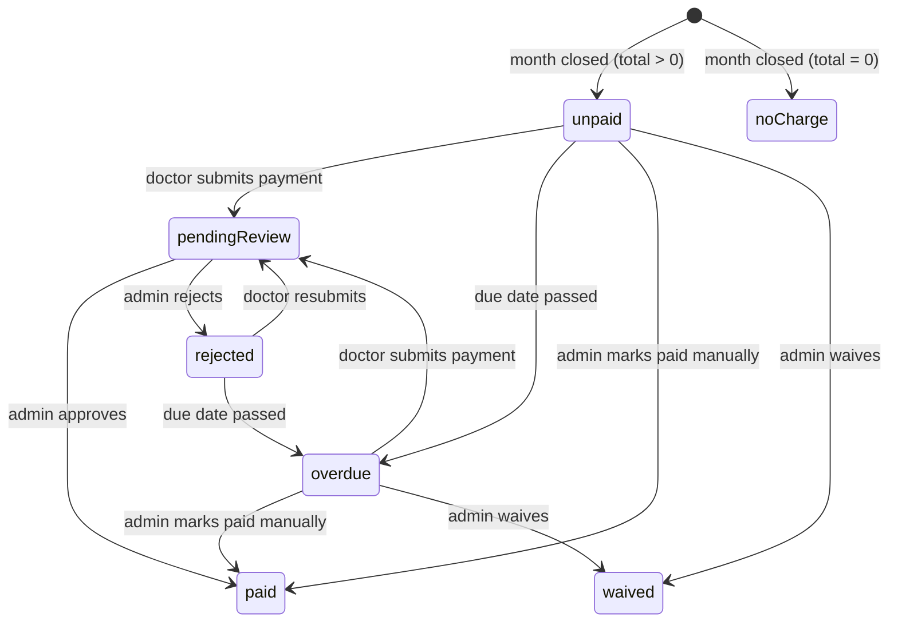
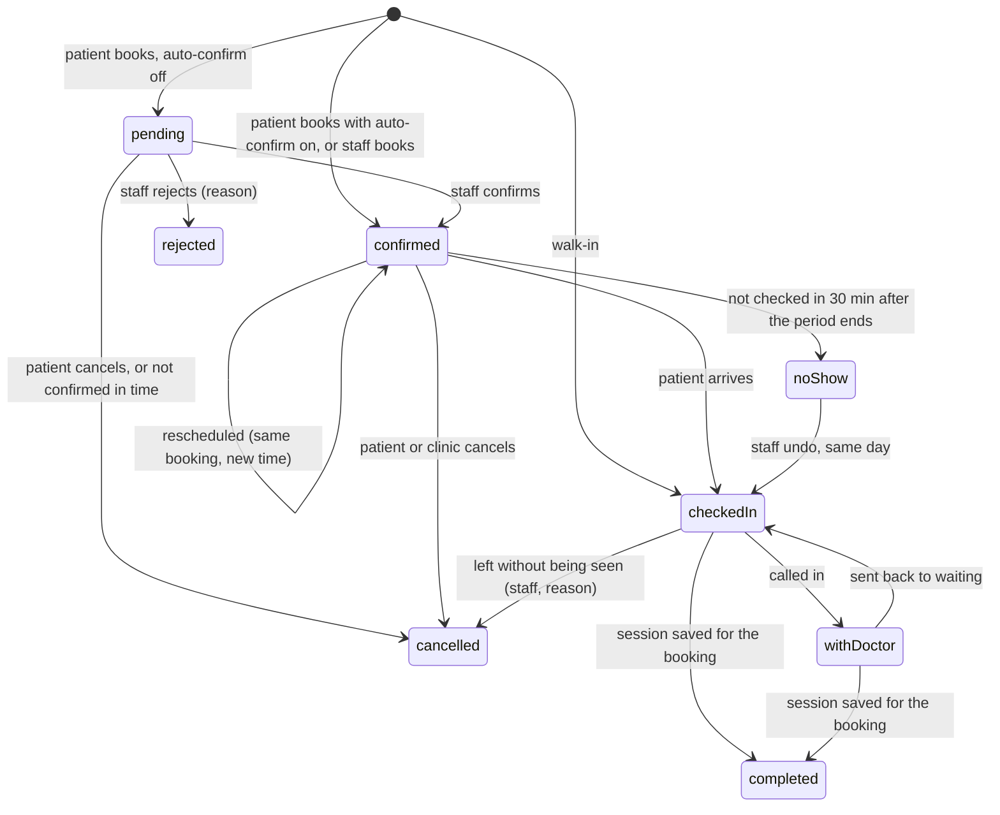

# el3yada (العيادة): Product & Technical Specification

| | |
|---|---|
| **Version** | 0.1 (draft for review) |
| **Date** | 2026-11-15 |
| **Platforms** | Flutter: Android, iOS, Windows (macOS optional). No web, no Linux. |
| **Backend** | ASP.NET Core Web API (JWT auth, SQL Server, file storage, Hangfire jobs, SignalR, FCM for mobile push), plus Cloud Firestore as a real-time mirror for the live board |
| **Languages** | Arabic (right-to-left, default) and English (left-to-right), switchable at any time |
| **Appearance** | Light and Dark themes, following the device setting by default |

---

## Table of contents

1. [Overview](#1-overview)
2. [Key decisions and assumptions](#2-key-decisions-and-assumptions)
3. [Glossary](#3-glossary)
4. [Platforms and who uses what](#4-platforms-and-who-uses-what)
5. [Roles and permissions](#5-roles-and-permissions)
6. [Business rules](#6-business-rules)
7. [Screens](#7-screens)
8. [Data model (SQL Server)](#8-data-model-sql-server)
9. [Backend: ASP.NET Core Web API, jobs, authorization](#9-backend-aspnet-core-web-api-jobs-authorization)
10. [Notifications](#10-notifications)
11. [Field validation rules](#11-field-validation-rules)
12. [Non-functional requirements](#12-non-functional-requirements)
13. [Tech stack](#13-tech-stack)
14. [Acceptance criteria](#14-acceptance-criteria)
15. [Delivery phases](#15-delivery-phases)
16. [Out of scope for v1](#16-out-of-scope-for-v1)
17. [Open questions](#17-open-questions)
18. [Appendix A: Catalog data guide (for developers)](#appendix-a-catalog-data-guide-for-developers)

Priority labels used below: **[M]** Must have for v1, **[S]** Should have, **[C]** Could have if time allows.

---

## 1. Overview

el3yada (العيادة) is a clinic app for doctors and their patients.

- **Doctors** create patient accounts, record each visit as an *examination* or a *consultation*, scan or upload medical documents, write medication prescriptions and lab/radiology requests, and chat with patients.
- **Assistants (مساعد الطبيب)** are clinic staff accounts that a doctor creates. A doctor can have several, each with its own permissions: for example registering patients and visits at reception, scanning papers, chatting with patients, or paying the monthly invoice. Medical decisions always stay with the doctor.
- **Branches and appointments:** a doctor can work from several branches, each with its own address, phones, working hours and booking rules. Patients book appointments from the app (queue number or exact time), and clinic staff book for patients, manage the day's queue, and search every booking.
- **Patients** open the app to see their full medical file: visits, diagnoses, notes, prescriptions, uploaded documents. They can chat with their doctor.
- **The platform (admin)** charges the doctor a fixed fee per session: **30 EGP per examination** and **15 EGP per consultation** (both editable by the admin). The app totals what the doctor owes each day and each month. At month end the doctor transfers the total via **InstaPay** and uploads a screenshot. The admin approves the payment. If a month stays unpaid after a **7-day grace period** (editable by the admin), the doctor's service is suspended until payment is approved.

---

## 2. Key decisions and assumptions

These defaults were chosen where the brief was silent. Each one links to an open question in [section 17](#17-open-questions) so it can be confirmed or changed before development starts.

| # | Decision | Why |
|---|---|---|
| D1 | The backend is **ASP.NET Core Web API**. Flutter talks to it over HTTPS (JSON). Auth is JWT (access + refresh). Data lives in SQL Server. Files live on disk or object storage behind the API. Background jobs use Hangfire. Real-time updates (chat, Windows toasts) use SignalR. The live board uses a read-only Cloud Firestore mirror written by the API (section 9.6). Mobile push still uses FCM, sent from the API. (Q1) |
| D2 | After an examination, a patient can have **up to 2 consultations in a row** with the same doctor (admin setting `maxConsecutiveConsultations`). After that, an examination is required. An examination is always allowed, including right after another examination. The first session must be an examination. | Matches "no more than 2 consultations in a row". Blocking exam-after-exam would force doctors to record cheaper sessions, which works against the platform. (Q2, Q3) |
| D3 | Session type and date cannot be changed after saving. A session can be deleted only if it is the patient's latest session and it was created the same day. Deletions are soft and visible to the admin. | Protects billing and keeps the exam/consultation chain valid. (Q14) |
| D4 | Every prescription or lab/radiology request must belong to a session. | Stops prescriptions being issued without a billable session. (Q13) |
| D5 | Doctors sign up themselves and wait for admin approval. Admins can also create doctors directly. | Lets the admin verify the medical license before a doctor can use the app. (Q4) |
| D6 | One patient account (phone number) can be linked to several doctors. Each doctor sees only the records they created. The patient sees everything, grouped by doctor. | Patients often see more than one doctor. Avoids duplicate accounts. (Q5) |
| D7 | A suspended doctor can still log in, see the dashboard, view records read-only and pay. They cannot add patients, sessions, files or prescriptions, or send chat messages. Their patients keep read access. | Unpaid fees should not cut a patient off from their own medical history. (Q6) |
| D8 | A doctor with a payment waiting for admin review is not suspended when the grace period ends. | The doctor has done their part. (Q7) |
| D9 | The admin cannot read medical content (diagnoses, files, prescriptions, chats) or the doctor's own clinic revenue. The admin sees billing data only, with patient names masked. | Health data is sensitive under Egypt's Personal Data Protection Law (Law 151 of 2020). (Q15) |
| D10 | Patients log in with their mobile number and a password. The doctor gives them a temporary password, which must be changed at first login. Patients who forget their password ask their doctor to reset it (no SMS OTP in v1). | SMS OTP costs money per message. (Q10) |
| D11 | Money is stored as integer piasters (1 EGP = 100 piasters). Days and months are calculated in the `Africa/Cairo` time zone. | Avoids rounding errors and day-boundary bugs. |
| D12 | A doctor can add several assistants (up to 5 by default, an admin setting). Each assistant works for **one** doctor and has the permissions that doctor picks. Assistants never write diagnoses, never send prescriptions and never see private notes. Sessions they record are billed to the doctor at the normal fees. Assistants are free (no extra fee). | Egyptian clinics usually have a secretary at reception who registers patients and the visit type. Medical decisions stay with the doctor. (Q22, Q23) |
| D13 | A doctor has one or more branches (up to 5 by default). Patients belong to the doctor, and each session belongs to a branch. One monthly invoice covers all branches. | Patients often move between a doctor's branches, and one medical file per doctor avoids duplicates. (Q26) |
| D14 | Appointments are free and work in one of two modes per branch: **queue numbers per period** (the default) or **timed slots**. Patients book only with doctors they are linked to. Staff book new people as guests. Bookings never add platform fees; only recorded sessions do. | Most Egyptian clinics run on queue numbers. Linking booking to existing doctor–patient links fits the model where doctors create patient accounts. (Q24, Q25, Q27) |

---

## 3. Glossary

| English (code) | Arabic (UI) | Meaning |
|---|---|---|
| Examination (`examination`) | كشف | Full visit. Fee 30 EGP by default. |
| Consultation (`consultation`) | استشارة | Follow-up visit. Fee 15 EGP by default. Allowed after an examination, up to 2 in a row (admin setting). |
| Session | جلسة / زيارة | One recorded visit, either an examination or a consultation. |
| Medication prescription (`medication`) | روشتة علاج | Medicines written by the doctor inside the app. |
| Investigations request (`investigations`) | روشتة تحاليل وأشعة | Lab tests and radiology scans requested by the doctor. |
| Medical record / file | ملف طبي | A scanned or uploaded document with one or more attachments. |
| Radiology | أشعة | File category. |
| Lab tests | تحاليل | File category. |
| Prescriptions | روشتات | File category for scanned or uploaded paper prescriptions. |
| Other | أخرى | File category for any other document: medical reports, referrals, sick leave, ECG, consent forms, and so on. |
| Monthly invoice | فاتورة شهرية | What the doctor owes for one month. In the Arabic UI, use **فاتورة**, not **كشف حساب**, because **كشف** already means examination. |
| Grace period | فترة السماح | Days after month end before an unpaid invoice suspends the doctor. Default 7. |
| Suspension | إيقاف الخدمة | The doctor and their assistants are limited to read-only and payment screens. |
| Assistant (`assistant`) | مساعد الطبيب / سكرتير | A clinic staff account created by a doctor, with permissions that doctor chooses. |
| Branch | فرع | One clinic location of a doctor, with its own address, phones, hours and booking settings. |
| Appointment / booking | حجز / ميعاد | A reserved place with a doctor at a branch: a timed slot, or a queue number in a period. |
| Queue booking | الحجز بالدور | Booking a place in a period (for example Saturday evening) and getting a queue number. |
| Walk-in | حضور بدون حجز | A patient who arrives without booking and is added to today's queue. |
| Check-in | تسجيل الحضور | Staff marking that a booked patient has arrived. |
| No-show | عدم الحضور | A confirmed booking where the patient never arrived. |
| Live board | اللوحة المباشرة | The real-time home screen for the doctor and assistants, showing today's patients by stage. |
| Amount charged | المبلغ المحصّل | What the patient paid the clinic for a session. This is the doctor's income, not the platform fee. |
| Clinic revenue | إيرادات العيادة | The total of the amounts charged over a period. |
| Guest booking | حجز لزائر | A booking made by staff with only a name and phone, for someone who doesn't have an account yet. |
| Link (doctor–patient) | — | The relationship between one doctor and one patient. Holds that doctor's view of the patient. |

---

## 4. Platforms and who uses what

| Platform | Doctor | Assistant | Patient | Admin |
|---|---|---|---|---|
| Android | Yes | Yes | Yes (main) | Yes |
| iOS | Yes | Yes | Yes (main) | Yes |
| Windows 10/11 (64-bit) | Yes (main, in the clinic) | Yes (main, at reception) | **No:** patients use the mobile app (A14) | Yes (main) |
| macOS | Optional (Q12) | Optional | **No** (A14) | Optional |

- **Mobile app** (Android, iOS): admin, doctor, assistant and patient.
- **Desktop app** (Windows, macOS): admin, doctor and assistant only. A patient who signs in on desktop is refused with A14, and a saved patient session found on desktop is discarded.

- One Flutter codebase and one app. After login, the app routes to the doctor, assistant, patient or admin area based on the user's role.
- Responsive layouts:
  - **Phone** (width < 600): bottom navigation bar, one screen at a time.
  - **Tablet** (600–1024): navigation rail.
  - **Desktop** (> 1024): side menu and master-detail layouts. For example, the patient list on the left and the patient profile on the right.
- **Scanning** with the camera is mobile only. On desktop, doctors use the file picker or drag and drop. A file scanned on the phone appears on the desktop straight away because it is stored in the cloud.

---

## 5. Roles and permissions

| Capability | Admin | Doctor | Assistant | Patient |
|---|---|---|---|---|
| Approve or reject doctor sign-ups | ✔ | | | |
| Create patient accounts | | ✔ (own) | If allowed | |
| Edit patient identity and medical profile | | ✔ (linked patients) | Identity if allowed; medical profile if allowed | |
| Reset a patient's password | | ✔ (linked patients) | If allowed | |
| Create or delete sessions | | ✔ (own, per rules) | Create if allowed (type, complaint, vitals); delete if allowed (off by default) | |
| Upload or scan medical files | | ✔ | If allowed | |
| Write and send prescriptions and requests | | ✔ | Drafts only, if allowed; never sends | |
| Print or share sent prescriptions | | ✔ | If allowed | Own |
| View medical content | | Own records only | The doctor's records, if allowed | Own records (all doctors) |
| View doctor's private notes | | ✔ | ✘ | ✘ |
| Chat | | With linked patients | On the doctor's behalf, if allowed | With linked doctors |
| View billing and pay | | ✔ (own) | The doctor's, if allowed | |
| Manage assistants | | ✔ (own clinic) | ✘ | |
| Manage branches (identity, address, contact) | | ✔ | ✘ | |
| Manage schedule and booking settings | | ✔ | If allowed (own branches) | |
| Book, reschedule, cancel appointments | | ✔ (all branches) | If allowed (own branches) | Own bookings, with linked doctors, within the clinic's rules |
| View all bookings and advanced search | | ✔ | If allowed (own branches) | Own bookings only |
| View clinic revenue, dashboard money and revenue page | ✘ | ✔ | If allowed (`revenueView`) | |
| View clinic activity log | | ✔ (own clinic) | ✘ | |
| Review payments, manage invoices | ✔ | | | |
| Suspend or reactivate doctors | ✔ (manual) | | | |
| Change fees, grace period, InstaPay details, assistant limit | ✔ | | | |
| Manage admin users | ✔ (super admin only) | | | |
| View the audit log | ✔ | | | |

"If allowed" means the doctor switched that permission on for that assistant ([section 6.10](#610-assistants)).

Admin sub-roles: `superAdmin` (everything, including managing admins) and `admin` (everything except managing admins). The first super admin is created by a seed script. There is no admin sign-up screen.

---

## 6. Business rules

### 6.1 Patient accounts and linking

- **BR-P1 [M]** Only doctors (or an admin, for support) create patient accounts. Patients cannot sign up themselves.
- **BR-P2 [M]** The patient's mobile number is their unique login across the whole platform.
- **BR-P3 [M]** If a doctor adds a phone number that already belongs to a patient, no duplicate is created. The system links the existing patient to the new doctor and shows: "This patient already has an account and has been added to your list." The new doctor sees only the patient's identity fields (name, phone, gender, date of birth) and the records the new doctor creates.
- **BR-P4 [M]** When a new account is created, the system generates an 8-character temporary password. It is shown to the doctor **once**, with buttons to share it via WhatsApp or SMS, or copy it. The patient must change it at first login.
- **BR-P5 [M]** A doctor can reset the password of any patient linked to them. This creates a new temporary password and forces another change at next login.
- **BR-P6 [M]** Each link gets a sequential file number per doctor (file 1, 2, 3, …).
- **BR-P7 [S]** A doctor can archive a patient. Archived patients are hidden from the default list but nothing is deleted.
- **BR-P8 [M]** Medical data is never hard-deleted by a doctor. Deletes are soft and logged.

**Patient medical profile** (kept per doctor–patient link and editable by that doctor): allergies (shown in red everywhere), chronic diseases, current medications, past surgeries, family history, general notes. The patient sees it read-only.

### 6.2 Sessions and the consultation rule

A session contains:

- type (examination or consultation)
- server timestamp
- chief complaint
- examination findings
- vitals (optional: blood pressure, pulse, temperature, weight, height, blood sugar)
- diagnosis
- notes for the patient
- private notes (doctor only)
- branch (required) and the amount charged to the patient (BR-S10)
- follow-up date (optional)
- links to the prescriptions and files created in it

Rules:

- **BR-S1 [M]** Type is required: `examination` or `consultation`.
- **BR-S2 [M]** A patient's first session with a doctor must be an examination.
- **BR-S3 [M]** A consultation is allowed only while the number of **consultations in a row since the patient's last examination** with the same doctor is below `maxConsecutiveConsultations` (admin setting, default **2**).
  - Once the limit is reached, the next session must be an examination.
  - An examination is allowed at any time and resets the count to 0.
  - 2 is a **maximum**, not a requirement. After an examination, a patient can have 0, 1 or 2 consultations before the next examination.
  - Only saved, non-deleted sessions count. Bookings don't.
  - A change to the limit applies to sessions and bookings created after the change. Saved sessions are never changed.

  | Sessions so far with this doctor (newest last) | Consultations in a row | Examination allowed? | Consultation allowed? |
  |---|---|---|---|
  | None | — | ✔ | ✘ |
  | … Examination | 0 | ✔ | ✔ |
  | … Examination → Consultation | 1 | ✔ | ✔ |
  | … Examination → Consultation → Consultation | 2 | ✔ | ✘ |

  Example with the default of 2: كشف → استشارة → استشارة → **كشف إجباري** → استشارة → …

- **BR-S4 [M]** The rule is enforced on the server inside a transaction, not only in the UI, so two devices saving at the same moment cannot bypass it. In the UI, the Consultation option is disabled with this explanation:
  - AR: «لا يمكن تسجيل أكثر من استشارتين متتاليتين. يجب تسجيل كشف أولاً.»
  - EN: "This patient has had 2 consultations in a row. Record an examination first."

  The number in the message follows the setting. The new-session and booking screens also show the current count, for example «استشارة 1 من 2 منذ آخر كشف» (consultation 1 of 2 since the last examination).
- **BR-S5 [M]** The session's fee is copied from the settings at the moment it is saved (fee snapshot). Changing fees later never changes saved sessions.
- **BR-S6 [M]** Before saving, the doctor sees a confirmation: "Save as **Examination**? A fee of 30 EGP will be added." Type and timestamp cannot be edited afterwards. Clinical fields (diagnosis, notes, and so on) stay editable.
- **BR-S7 [M]** A session can be deleted only when all of these are true:
  - it is the patient's latest session with that doctor
  - it was created on the same Cairo calendar day
  - the doctor gives a reason

  Deletion is soft. The session is excluded from billing and appears in the admin audit log with a per-doctor deletion count.
- **BR-S8 [M]** A suspended doctor cannot create sessions.
- **BR-S9 [M]** The session time is the server time when it is saved. Backdating is not allowed in v1 (Q14).
- **BR-S10 [M]** **Amount charged to the patient.** Every session records what the patient paid the clinic.
  - It defaults to the visit price for the type (section 6.15): the branch's own price if one is set, otherwise the doctor's price.
  - Staff can lower it (a discount) or set it to 0 (a free visit). **[S]** They can also record the payment method: cash, card, InstaPay or wallet.
  - If the branch has no price set, the field is required.
  - It can be edited on the same day by the doctor or by whoever recorded the session, and every change is logged.
  - It is the doctor's income (section 6.14). It never changes the platform fee.

### 6.3 Medical files

- **BR-F1 [M]** Every medical record has exactly one category:
  - **Radiology (أشعة)**
  - **Lab tests (تحاليل)**
  - **Prescriptions (روشتات)**, meaning scanned or uploaded paper prescriptions
  - **Other (أخرى)**, for any document that doesn't fit the first three. **[S]** An optional type, picked from a list (medical report «تقرير طبي», referral «تحويل», sick leave «إجازة مرضية», ECG «رسم قلب», EEG / EMG, endoscopy «منظار», consent form «إقرار», other) or typed. It is shown as a label on the file.
- **BR-F2 [M]** One record can hold several attachments, for example an X-ray image plus the radiologist's report.
- **BR-F3 [M]** Record fields:
  - category (required)
  - title (defaults to category + date)
  - document date (date of the test or scan, default today)
  - notes
  - optional link to a session
  - source: `scan`, `upload` or `chat`
- **BR-F4 [M]** Any file type can be uploaded.
  - **In-app preview:** images and PDF.
  - **Other types** (DICOM, Word, ZIP, video, …): file icon plus "Open with" or "Download".
- **BR-F5 [M]** Maximum size per file defaults to **50 MB** (admin setting).
- **BR-F6 [M]** Scanning on mobile uses the native document scanner: edge detection, crop, filters, multiple pages. A multi-page scan is saved as **one PDF** by default.
- **BR-F7 [M]** On desktop, the doctor adds files with the file picker or by dragging and dropping onto the patient's Files tab. **[C]** Paste an image from the clipboard.
- **BR-F8 [M]** All records are visible to the patient and are created by the doctor. Patients can send files in chat, and the doctor can save a chat attachment into the patient's file (BR-C4). Q9 asks whether patients should also upload files directly.
- **BR-F9 [M]** The patient gets a notification when a new record is added.

### 6.4 Prescriptions and requests

There are two kinds, both written in the app:

**Medication prescription (روشتة علاج)**

- Diagnosis, pre-filled from the session.
- Items: drug name, form, strength, dose, frequency, timing, duration, instructions.
  - **Drug name:** search the full medicine catalog, ordered by the doctor's history and specialty ([section 6.9](#69-medical-catalogs-and-specialty-based-search)), or type a name that isn't in it.
  - **Form:** tablet, capsule, syrup, injection, cream/ointment, drops, inhaler, suppository, sachet, other.
  - **Timing:** before food, after food, with food, or not specified.
  - **Duration:** a number of days or weeks, or "continuous".
- General advice (free text).

**Investigations request (روشتة تحاليل وأشعة)**

- Items: category (lab or radiology), test name, notes (for example "fasting 12 hours").
  - **Test name:** search the full lab and radiology catalog, ordered by the doctor's history and specialty (section 6.9), or type a name that isn't in it.
- One request can mix lab and radiology items.

Rules:

- **BR-RX1 [M]** Every prescription and request belongs to a session (D4). The editor opens from a session, or from the patient profile, which asks the doctor to pick one of today's sessions or create a new one.
- **BR-RX2 [M]** Status goes `draft` → `sent`. Drafts are editable and invisible to the patient. Sent documents are read-only. To change one, the doctor marks it `cancelled` (the patient sees it struck through) and issues a new one.
- **BR-RX3 [M]** A document needs at least one item before it can be sent.
- **BR-RX4 [M]** On send, the app generates a PDF and stores it, so the patient sees exactly what the doctor sent. The layout is defined in section 6.4.1:
  - **Header:** doctor's name, title, specialty and degrees in Arabic and English, and the clinic logo.
  - **Patient strip:** name, visit date, age, file number, visit type.
  - **Body:** diagnosis, then the items.
  - **Lower part:** notes, follow-up date and signature.
  - **Footer:** the branches with addresses and phones (BR-BR6), and a QR code for the app.

  The PDF uses the prescription language the doctor picks in D22: Arabic (right-to-left, embedded Arabic font) or English (left-to-right). This is independent of the app's language. The PDF always has a white page, whatever the app theme. Drug and test names appear exactly as typed.
- **BR-RX5 [M]** **Printing.** The doctor can print both kinds: the medication prescription (روشتة علاج) and the investigations request (روشتة تحاليل وأشعة).
  - **Where:** the preview screen (D15), the session details (D9), and the Prescriptions tab of the patient profile (D6).
  - **Printing a draft sends it.** The app asks «إرسال وطباعة؟» (send and print?), and the document is sent to the patient app at the same moment. That way the paper and the app always match. A cancelled document cannot be printed.
  - **Print all:** when a session has both a medication prescription and an investigations request, one print job prints each on its own page.
  - **Reprint:** any sent document can be printed again at any time. The stored PDF is printed, so every copy is identical.
  - **How it prints:** through the system print dialog on Windows, macOS, Android and iOS (choose the printer and the number of copies). **[S]** The desktop app remembers the last printer used. Share PDF (WhatsApp and so on) is always available too.
  - **Paper settings (D22):**
    - Paper size: A5 (the default: 148 × 210 mm, the most common prescription size in Egypt; there is no official standard size) or A4. **[S]** A custom size in millimetres, for clinics whose paper is different.
    - **Pre-printed paper mode,** for clinics that print on their own letterhead: the header and footer are hidden, and the top and bottom margins are set in millimetres. A test-print button checks the alignment.
  - Assistants with `prescriptionsPrint` can print sent documents (AS8).
  - The patient can view, download and share the PDF.
- **BR-RX6 [S]** The doctor can save a prescription as a template and reuse it.

#### 6.4.1 Prescription layout (A5)

**Design:** [el3yada prescription design](https://claude.ai/artifact/82SGZFVP9e6oVbRJtRzaqs). It has two A5 pages, one for the medication prescription and one for the investigations request, with the measurements in a note beside them. The link is private: share it from the page before sending it to developers.

**Paper:** A5 = 148 × 210 mm, portrait, with 10.5 mm margins on every side. There is no official Egyptian prescription size, and A5 is the most common pad size. A4 and a custom size are settings (BR-RX5).

**Zones, top to bottom (A5):**

| # | Zone | Height (approx.) | Contents |
|---|---|---|---|
| 1 | Header | 30 mm | **Right:** the doctor's name in Arabic (bold, in the clinic colour), title and specialty, degrees. **Centre:** the clinic logo, or an empty circle when there is none. **Left:** the same details in English. A 2 px rule in the clinic colour underneath. |
| 2 | Patient strip | 17 mm | A lightly tinted box: patient name, visit date, age, file number, visit type (كشف / استشارة). |
| 3 | Diagnosis | 5 mm | «التشخيص:» followed by the diagnosis. Hidden when empty. |
| 4 | Body | Flexible | **Medication:** an "Rx" mark, then numbered items. Each item has the drug name, strength and form (English, bold, 12 pt), the instructions in Arabic underneath (10.5 pt), and a duration chip on the left. **Investigations:** «مطلوب عمل الفحوصات الآتية:», then a **Lab tests** group (check boxes in two columns) and a **Radiology** group (one column, with an Arabic explanation under each). |
| 5 | Notes | 10 mm | «تعليمات:» (medication) or «ملاحظات:» (investigations) in a bordered box. Hidden when empty. |
| 6 | Follow-up and signature | 12 mm | **Right:** follow-up date («موعد المتابعة»), or «إحضار النتائج في» for investigations. **Left:** a signature line, with the signature image when one is set (D22). |
| 7 | Footer | 30 mm | A rule in the clinic colour. **Branches:** the session's branch first, then the others, up to 2 on A5 (3 on A4). Each shows its name, address and landmark, phone, WhatsApp and hours (BR-BR6). **Left:** a 20 × 20 mm QR code with «امسح الكود» and "el3yada". |

**Text:**

- **Font:** embedded in the PDF. Arabic text uses Noto Sans Arabic and Latin text uses Alexandria (the app font). The PDF library needs every Arabic presentation-form glyph, and Alexandria lacks the isolated ي (Phase 0 check, `app/test/prototypes/font_coverage_test.dart`).
- **Sizes:** drug and test names 12 pt, instructions 10.5 pt, nothing smaller than 9 pt.
- **English inside Arabic:** English names keep their left-to-right order inside the Arabic layout.

**Colour:** one clinic colour, chosen by the doctor in D22 (default: the brand pine `#0F4C45`), for the names, rules and chips. Everything else is black and grey, so the page prints well in black and white.

**Too long for one page:** the body continues on page 2. Page 2 repeats the header, the patient strip and the footer, and shows «صفحة 2 من 2».

**English prescription** (prescription language = English): the same zones, mirrored left-to-right, with English labels.

**Pre-printed paper mode:** zones 1 and 7 are not printed. Their space is left empty, sized by the top and bottom margins (BR-RX5).

**QR code:**

- **What it holds:** a link to this prescription in the app, `https://<app-domain>/rx/<shortCode>`.
- **What it opens:** on a phone with the app, the link opens the prescription (P7). On a phone without the app, it opens the store page for that platform. This uses Android App Links and iOS Universal Links, served from the API domain by the `rxLink` endpoint.
- **Privacy:** `shortCode` is random (at least 10 characters) and reveals nothing by itself. The prescription only opens after the patient signs in.

### 6.5 Fees and billing

**Settings (admin):**

| Setting | Default |
|---|---|
| Examination fee | 30 EGP |
| Consultation fee | 15 EGP |
| Grace period | 7 days |
| Maximum consultations in a row (BR-S3) | 2 |
| Billing time zone | Africa/Cairo (fixed) |

**Rules:**

- **BR-B1 [M]** Each non-deleted session adds its snapshot fee to the doctor's total.
- **BR-B2 [M]** **Daily view:** the doctor sees today's count of examinations and consultations and today's amount, for example "3 consultations + 2 examinations = 105 EGP". The details list every session with time, patient, type and fee.
- **BR-B3 [M]** **Monthly view:** the doctor sees month-to-date examination and consultation counts and the total, a per-day table, and drill-down to each day's sessions. Past months are available through their invoices.
- **BR-B4 [M]** Payment is **monthly only**. Daily figures are for information.
- **BR-B5 [M]** **Month close:** at 00:05 Cairo time on the 1st of each month, the system creates one invoice per doctor for the previous month:
  - examination count
  - consultation count
  - examination amount
  - consultation amount
  - total
  - due date = last day of the month + grace period days, at 23:59:59 Cairo time

  Amounts are sums of the snapshots, not count × current fee, so a mid-month fee change is billed correctly. A month with no sessions gets status `noCharge`.
- **BR-B6 [M]** A fee change applies only to sessions saved after the change.
- **BR-B7 [M]** A grace period change applies only to invoices created after the change. The admin can extend one invoice's due date by hand.
- **BR-B8 [M]** Every settings change is stored in a history log: who, when, before, after.
- **BR-B9 [S]** Partial payments are not supported in v1. One payment covers one invoice in full. The admin can still adjust or waive an invoice with a reason.

**Worked example (October, grace period 7 days):**

- 120 examinations × 30 = 3,600 EGP
- 80 consultations × 15 = 1,200 EGP
- Total: 4,800 EGP
- Invoice created: 1 November 00:05
- Due: 7 November 23:59
- If not paid and no payment is pending review: the doctor is suspended on 8 November at 00:10.

### 6.6 Payment and approval

- **BR-PAY1 [M]** The doctor opens the invoice and taps **Pay**. The screen shows:
  - the platform's InstaPay address and account name (from settings)
  - the exact amount, with copy buttons
  - the instructions text set by the admin
- **BR-PAY2 [M]** The doctor submits:
  - screenshot of the transfer (required, 1–3 images)
  - amount transferred
  - transfer date
  - InstaPay reference number (optional)
  - sender name (optional)
  - note (optional)

  The invoice status becomes `pendingReview`.
- **BR-PAY3 [M]** The admin reviews. If the amount entered differs from the invoice total, the screen highlights the mismatch.
  - **Approve:** invoice becomes `paid`, with the approver and time recorded. The doctor is notified.
  - **Reject:** a reason is required, chosen from presets or typed: "Amount does not match", "Screenshot unclear", "Transfer not received", other. The invoice goes back to `rejected`. The doctor is notified and can submit again.
- **BR-PAY4 [M]** Admin manual actions on an invoice, each needing a reason:
  - mark paid, with a method (InstaPay, cash, bank transfer, other)
  - waive
  - adjust the amount
  - extend the due date

### 6.7 Grace period and suspension



- **BR-G1 [M]** A daily job at 00:10 Cairo time marks every invoice past its due date with status `unpaid` or `rejected` as `overdue`, and sets the doctor's status to `suspended`.
- **BR-G2 [M]** An invoice in `pendingReview` does not cause suspension (D8). If the admin rejects it after the due date, the invoice becomes `overdue` and the doctor is suspended straight away.
- **BR-G3 [M]** The doctor is reactivated automatically when none of their invoices is overdue (all paid or waived).
- **BR-G4 [M]** The admin can suspend or reactivate a doctor by hand, with a reason.
- **BR-G5 [M]** While suspended, the doctor sees a permanent banner: «تم إيقاف الخدمة لعدم سداد فاتورة شهر أكتوبر. برجاء السداد لإعادة التفعيل.» with a **Pay now** button.

  | Allowed while suspended | Blocked while suspended |
  |---|---|
  | Log in, dashboard, billing, submit payment | Add or link patients |
  | View patients and records (read-only) | Create sessions |
  | Profile and settings | Upload or scan files |
  | Notifications | Create or send prescriptions |
  | | Send chat messages |

- **BR-G6 [M]** Patients of a suspended doctor keep full read access. Their chat shows «الطبيب غير متاح حالياً» (doctor currently unavailable) and sending is disabled. The billing reason is never shown to patients.
- **BR-G7 [M]** Reminders to the doctor: when the invoice is created, 2 days before the due date, on the due date, on suspension, and on reactivation.
- **BR-G8 [M]** The same limits apply to all of the doctor's assistants while the doctor is suspended. Assistants see the banner too. The **Pay now** button appears only for assistants with the `billingPay` permission.

### 6.8 Chat

- **BR-C1 [M]** One conversation per doctor–patient link, created automatically when the link is created.
- **BR-C2 [M]** Message types: text, image (camera or gallery), file. **[C]** Voice notes.
- **BR-C3 [S]** Delivered and read status, and an unread count per conversation.
- **BR-C4 [M]** The doctor can choose **Save to patient file** on any attachment. This creates a medical record with `source = chat` and asks for a category.
- **BR-C5 [M]** New messages send a push notification to the other side: doctor ↔ patient.
- **BR-C6 [C]** The doctor can switch chat off for a patient, or set availability hours.
- **BR-C7 [M]** Messages cannot be edited or deleted in v1. The admin cannot read chats.
- **BR-C8 [M]** Assistants with the `chat` permission can read and reply in the doctor's patient chats. The patient sees their messages labelled «مساعد العيادة — name». The doctor sees every message, including those sent by assistants.

### 6.9 Medical catalogs and specialty-based search

The app includes a full catalog of medicines on the Egyptian market, plus laboratory tests and radiology procedures. When a doctor searches, items from their specialty come first.

**Sources**

| Catalog | Source | Size | Licence | Notes |
|---|---|---|---|---|
| Medicines (Egypt) | Community dataset [`egyptian-drug-database`](https://github.com/karem505/egyptian-drug-database) on GitHub | About 25,000 products | CC0 (public domain) | **Fields:** English trade name, Arabic transliteration of the trade name, active ingredient(s), manufacturer, therapeutic class, route, price. **Missing:** no separate form or strength field (they are part of the trade name, e.g. "ABILIFY 15 MG 10 TABS."), and no ATC code. **Freshness:** last updated mid-2026; how the data was collected is not stated. **Before launch:** check a sample against the [EDA's public drug search](https://www.edaegypt.gov.eg/media/ajqiccqc/np-ppma-18-mechanism-of-egyptian-drug-database-eddb-searching-tool.pdf) (Q19). |
| Lab tests | [LOINC](https://loinc.org/?p=7451), laboratory terms only | Tens of thousands | Free, including commercial use. Needs a free account and acceptance of the licence. Attribution required. LOINC content must not be changed. | An Arabic translation was added in August 2025 (Jordan variant); how much it covers must be checked after download. Synonyms such as CBC and HbA1c come from LOINC's related-names field. |
| Radiology | LOINC radiology terms. The LOINC/RSNA Radiology Playbook is now part of LOINC. | About 1,000 common procedures named by RSNA, plus the rest of LOINC radiology | Same LOINC licence. The RadLex licence is also free. | English only. Each term has a modality and a body region, which are used to match specialties. |
| *Not used* | WHO ATC/DDD classification | — | Commercial use is not allowed without permission from WHOCC. | The dataset's own therapeutic class is used instead. |

**Rules**

- **BR-CAT1 [M]** Each doctor chooses one primary specialty at sign-up (A4). **[S]** Up to 2 extra specialties, for example Internal Medicine + Cardiology.
- **BR-CAT2 [M]** Each specialty has a **specialty profile** that the admin edits (AD19):
  - medicine groups (BR-CAT5)
  - recommended lab tests (a short list of LOINC codes)
  - radiology body regions and modalities, plus recommended procedures
  - **[S]** preferred routes, for example liquids, drops and suppositories first for Pediatrics
- **BR-CAT3 [M]** A **General** profile is added to every specialty. It covers pain and fever relief, antibiotics, stomach protection, vitamins and supplements, antihistamines, and common labs such as CBC.
- **BR-CAT4 [M]** Search order in the prescription and request editors (D13, D14):
  1. Items this doctor has used before, most used first.
  2. Items in the doctor's specialty profile(s) and the General profile.
  3. Everything else in the catalog, under the heading «من تخصصات أخرى» (from other specialties).

  A chip «تخصصي فقط» (my specialty only) hides group 3. It is **off by default**, so a cardiologist who needs omeprazole still finds it in one search (Q20).
- **BR-CAT5 [M]** The dataset's therapeutic class is free text with inconsistent values (for example `ANTIHYPERTENSIVE.ACE`, `ANTI-ACNE`, `.`). The catalog build (section 9.5) maps the raw values to about 60 clean groups with Arabic and English names (the list is in Appendix A.3.6), for example `ANTIHYPERTENSIVE.ACE` → Antihypertensives. Unmapped values go to "Other" and are still searchable.
- **BR-CAT6 [M]** A medicine can be found by:
  - its trade name, in English or in Arabic letters (for example «بنادول»)
  - its active ingredient: searching "paracetamol" lists every brand that contains it

  Search ignores case and Arabic letter variants (أ/إ/آ = ا, ة = ه, ى = ي), and matches the start of any word.
- **BR-CAT7 [M]** Picking a medicine fills in the drug name and active ingredient. It also suggests the form (from the route) and the strength (read from the trade name, e.g. "500 MG"). The doctor can change any field.
- **BR-CAT8 [M]** The doctor can always type a name that is not in the catalog. It is saved to their own history. **[S]** "Report a missing or wrong item" sends it to the admin (AD20).
- **BR-CAT9 [M]** The admin can add custom catalog items (medicine, lab test or radiology). They appear for all doctors at once, without publishing a new catalog version.
- **BR-CAT10 [M]** LOINC names are shown exactly as published. Our own Arabic names and aliases (for example «صورة دم كاملة» for CBC) are kept in a separate table, so LOINC content is never changed.
- **BR-CAT11 [M]** The catalog is a local database on doctor and admin devices (and on assistant devices when the assistant has the `prescriptionsDraft` permission), so search is instant and works offline. Patient devices never download it. Patients see item names exactly as written on their prescription.
- **BR-CAT12 [M]** The admin publishes new catalog versions (AD20). Apps download a new version in the background and switch to it only once the download is complete. A prescription in progress is not affected.
- **BR-CAT13 [M]** Prices from the dataset are stored but not shown in v1, because they go out of date.
- **BR-CAT14 [M]** The About screen shows the attribution notice that the LOINC licence requires.

**Default specialty profiles** (seed data; the admin can change everything in AD19):

| Specialty | Medicine groups shown first | Recommended labs | Radiology shown first |
|---|---|---|---|
| باطنة — Internal Medicine | Antihypertensives, antidiabetics, GI drugs, antibiotics, lipid-lowering | CBC, liver and kidney function, lipid profile, HbA1c, fasting sugar, TSH, urine analysis | Chest X-ray, abdominal ultrasound |
| قلب — Cardiology | Antihypertensives, antiplatelets, anticoagulants, statins, antiarrhythmics, nitrates, diuretics, heart failure drugs | Lipid profile, troponin, CK-MB, BNP / NT-proBNP, INR, electrolytes | Echocardiography, chest X-ray, CT coronary angiography, vascular Doppler |
| أطفال — Pediatrics | Antipyretics, antibiotics, antihistamines, ORS, vitamins (liquid, drops and suppository forms first) | CBC, CRP, stool analysis, urine analysis | Chest X-ray, abdominal ultrasound |
| نسا وتوليد — Obstetrics & Gynecology | Hormones, contraceptives, iron and folic acid, vaginal antifungals, tocolytics | β-hCG, CBC, blood group, TORCH, FSH / LH / prolactin | Pelvic and obstetric ultrasound, transvaginal ultrasound, HSG, mammography |
| جلدية — Dermatology | Topical steroids, anti-acne, antifungals, retinoids, antihistamines | Fungal scraping, CBC | — |
| عظام — Orthopedics | NSAIDs, muscle relaxants, calcium and vitamin D, osteoporosis drugs | Vitamin D, calcium, uric acid, ESR, CRP | X-ray of limbs and spine, MRI of joints and spine, CT, DEXA |
| أنف وأذن — ENT | Nasal sprays, decongestants, antihistamines, ear drops, antibiotics | CBC, ASO, throat swab culture | CT paranasal sinuses, X-ray nasopharynx |
| رمد — Ophthalmology | Eye drops and ointments (eye route first), antiglaucoma, lubricants | Fasting sugar, HbA1c | CT orbit |
| مخ وأعصاب — Neurology | Antiepileptics, antiparkinson, migraine, neuropathic pain | Vitamin B12, antiepileptic drug levels | MRI brain, CT brain, MRI spine |
| نفسية — Psychiatry | Antipsychotics, antidepressants, anxiolytics, mood stabilizers | Lithium level, TSH | MRI brain |
| مسالك — Urology | Alpha blockers, 5-alpha reductase inhibitors, urinary antispasmodics, urinary antiseptics | Urine analysis and culture, PSA | Ultrasound KUB, CT KUB, X-ray KUB |
| صدر — Chest | Bronchodilators, inhaled steroids, mucolytics, antitussives, antibiotics | CBC, arterial blood gases, sputum culture | Chest X-ray, CT chest (HRCT) |
| جهاز هضمي وكبد — GI & Hepatology | PPIs, antiemetics, laxatives, antispasmodics, hepatoprotectives | Liver function, HCV antibody, HBsAg, stool analysis, H. pylori | Abdominal ultrasound, CT abdomen, MRCP |
| غدد وسكر — Endocrinology | Antidiabetics, insulins, thyroid drugs | HbA1c, fasting sugar, TSH / FT4, cortisol | Thyroid ultrasound, DEXA |
| كلى — Nephrology | Antihypertensives, diuretics, phosphate binders, iron and erythropoietin | Kidney function, electrolytes, urine albumin/creatinine ratio | Renal ultrasound |
| روماتيزم — Rheumatology | DMARDs, corticosteroids, NSAIDs | RF, anti-CCP, ANA, ESR, CRP | Joint X-ray, musculoskeletal ultrasound |
| أسنان — Dentistry | Analgesics, antibiotics, mouthwashes | — | Panoramic, periapical and CBCT dental imaging |
| أورام — Oncology | Antineoplastics, antiemetics, supportive care | Tumor markers, CBC | CT, PET-CT |

### 6.10 Assistants

**Rules**

- **BR-AS1 [M]** A doctor can create several assistants, up to `maxAssistantsPerDoctor` (admin setting, default 5). The screen shows the count, for example "2 of 5".
- **BR-AS2 [M]** Creating an assistant (D26) needs: full name, mobile number, and a permission preset or custom permissions. The system creates an 8-character temporary password. It is shown to the doctor once, with WhatsApp / SMS / Copy buttons. The assistant must change it at first login (same as BR-P4).
- **BR-AS3 [M]** An assistant belongs to exactly **one** doctor (Q22). A mobile number can be an assistant for only one doctor at a time. The same number can also be a patient account; login handles that case (A3).
- **BR-AS4 [M]** Permissions are set per assistant (table below). The server checks them on **every request**, reading the current values from the database. A change takes effect on the assistant's next action, without logging in again.
- **BR-AS5 [M]** An assistant can **never**, whatever the permissions:
  - see or write private notes
  - write the clinical fields of a session: findings, diagnosis, notes for the patient
  - send or cancel prescriptions
  - delete medical files
  - manage assistants
  - change the doctor's profile, clinic details, prescription header or specialty
- **BR-AS6 [M]** An assistant always acts on behalf of the doctor:
  - Sessions they record count toward the doctor's daily and monthly totals and the doctor's invoice, at the normal fees.
  - The consultation rule (BR-S3) and the fee confirmation (BR-S6) apply exactly as for the doctor.
  - The doctor sees "Recorded by <assistant name>" on sessions, files and drafts. The patient does not.
- **BR-AS7 [M]** A session recorded by an assistant has no diagnosis yet. It shows the badge «بانتظار الطبيب» (waiting for the doctor) in D1 and D2 until the doctor saves at least one clinical field.
- **BR-AS8 [M]** The doctor can, for each assistant: change permissions, reset the password, disable, enable, or remove. Disable and remove revoke the assistant's tokens immediately, so their next request is refused. Removing is soft: the assistant's history stays in the activity log.
- **BR-AS9 [M]** The doctor's status applies to the assistants:
  - **Doctor suspended:** assistants have the same limits (BR-G8).
  - **Doctor pending, rejected or disabled:** assistants cannot log in. They see A10 with «حساب العيادة غير مفعّل» (the clinic account is not active).
- **BR-AS10 [M]** Every action an assistant takes is recorded in the activity log with the assistant, the action, the patient and the time. The doctor sees it in D27.
- **BR-AS11 [M]** **Forgot password:** an assistant who enters their mobile number in A8 triggers a request to their doctor, who resets it from D26.
- **BR-AS12 [S]** **Prescription drafts:** an assistant with `prescriptionsDraft` can prepare a draft and tap "Send to doctor for review". The doctor is notified, reviews the draft in D13/D14 and sends it from D15.
- **BR-AS13 [M]** **Branch scope:** each assistant is assigned to one or more branches, or "all branches" (BR-BR8). Appointments, today's board, session lists and schedule settings are limited to those branches. The patient list and patient files are doctor-wide, subject to the permissions above. Sessions and walk-ins the assistant records default to their current branch.

**Permissions**

| Permission (key) | What it allows | Reception | Clinical assistant | Office manager |
|---|---|---|---|---|
| Manage patients (`patientsManage`) | Add and link patients, edit identity fields, archive | ✔ | ✔ | ✔ |
| Reset patient passwords (`patientsResetPassword`) | BR-P5, and receive patients' reset requests | ✔ | ✔ | ✔ |
| Record sessions (`sessionsCreate`) | Create sessions with type, chief complaint and vitals. See the session list (date, time, type, fee). | ✔ | ✔ | ✔ |
| Delete sessions (`sessionsDelete`) | BR-S7, same conditions | ✘ | ✘ | ✘ |
| View clinical content (`clinicalView`) | Medical profile, findings, diagnosis, notes for the patient, all prescriptions | ✘ | ✔ | ✘ |
| Edit medical profile (`clinicalEditProfile`) | Allergies, chronic diseases, current medications, surgeries, family history. Needs `clinicalView`. | ✘ | ✔ | ✘ |
| Files (`filesManage`) | Scan and upload, edit file details, view files, save chat attachments to the patient file | ✔ | ✔ | ✔ |
| Print prescriptions (`prescriptionsPrint`) | Open, print and share prescriptions the doctor has already sent | ✔ | ✔ | ✔ |
| Prepare prescription drafts (`prescriptionsDraft`) [S] | Create and edit drafts, send them to the doctor for review. Needs `clinicalView`. | ✘ | ✔ | ✘ |
| Chat (`chat`) | Read and reply in patient chats on the doctor's behalf | ✘ | ✔ | ✔ |
| View billing (`billingView`) | Money cards in the dashboard, daily and monthly summaries, invoices | ✘ | ✘ | ✔ |
| Pay invoices (`billingPay`) | Submit payments (D20). Needs `billingView`. | ✘ | ✘ | ✔ |
| View appointments (`appointmentsView`) | Calendar, today's board, appointment details, advanced search, for the assistant's branches | ✔ | ✔ | ✔ |
| Manage appointments (`appointmentsManage`) | Book (patients and guests), confirm, reschedule, cancel, check in, walk-ins, no-shows, call next. Needs `appointmentsView`. | ✔ | ✔ | ✔ |
| Manage schedule (`scheduleManage`) | Working hours, date-specific hours, closures, blocked time, booking settings for the assistant's branches. Needs `appointmentsManage`. Branch identity and contact details stay doctor only. | ✘ | ✘ | ✔ |
| View revenue (`revenueView`) | Clinic revenue, net income and amounts charged: in the dashboard (D1), the revenue page (D35), the patients register (D4) and the live-board side panel | ✘ | ✘ | ✘ |
| Manage visit prices (`pricesManage`) | Set the examination and consultation prices for the doctor and for each branch (D37) | ✘ | ✘ | ✔ |

- **Presets:** Reception (استقبال), Clinical assistant (مساعد طبي), and Office manager (مدير العيادة) fill in the checkboxes. Changing any box turns the preset into **Custom**.
- **Dependencies:** a permission that depends on another switches that one on automatically. For example, turning on `billingPay` also turns on `billingView`.

### 6.11 Branches (الفروع)

- **BR-BR1 [M]** Every doctor has at least one branch.
  - The first branch is created at sign-up (A4, step 3).
  - The doctor adds more later in D28, up to `maxBranchesPerDoctor` (admin setting, default 5).
  - New branches don't need admin approval. The admin sees them in AD5.
- **BR-BR2 [M]** Branch data, edited in D29:

  | Group | Fields |
  |---|---|
  | Identity | Branch name (for example «فرع المعادي»), optional English name, short description. **[S]** Up to 5 photos. |
  | Address | Governorate, city / area, street, building, floor, apartment, landmark («بجوار …»), map pin (latitude and longitude) with "Open in Google Maps" |
  | Contact | One or more phone numbers, each with a label (reception, mobile, landline) and a WhatsApp flag. Optional email. |
  | Working hours | Per weekday, one or more periods (for example Saturday 10:00–14:00 and 18:00–22:00), each with an optional label (صباحي / مسائي) and, in queue mode, a capacity. A period may end after midnight (for example 20:00–01:00); it still belongs to the day it starts. |
  | Prices for patients | Optional: this branch's own examination and consultation prices. If empty, the doctor's prices apply (section 6.15). |
  | Payment at the clinic | Checklist: cash, card, InstaPay, mobile wallets |
  | Amenities **[S]** | Checklist: elevator, parking, wheelchair access, children's waiting area |
  | Booking settings | See section 6.12 |
  | Status | Active, temporarily closed (with a message and an expected reopening date), archived |

- **BR-BR3 [M]** One branch is the doctor's **default**. Doctors and assistants choose a **current branch** from the top bar. New sessions, walk-ins and today's lists use it.
- **BR-BR4 [M]** Every session belongs to a branch (required). The patient sees the branch on each visit (P4, P5): name, address and phone.
- **BR-BR5 [M]** Patients belong to the doctor, not to a branch. One medical file per doctor covers all branches, and file numbers are per doctor.
- **BR-BR6 [M]** The prescription footer prints the **session's branch first**, then the doctor's other active branches: up to 2 branches on A5 and 3 on A4 (section 6.4.1). Logo, signature and footer text stay at doctor level.
- **BR-BR7 [M]** Billing stays per doctor: one monthly invoice covers all branches. D3 and the invoice also show totals per branch.
- **BR-BR8 [M]** Each assistant is assigned to one or more branches, or to all of them (BR-AS13).
- **BR-BR9 [M]** A branch that has history cannot be deleted, only archived. Before a branch is archived or temporarily closed, its future appointments are listed. The doctor must move them to another branch or cancel them; cancelled patients are notified with a rebook link.
- **BR-BR10 [M]** While a branch is temporarily closed, patients see its message on the branch card and cannot book there.

### 6.12 Appointments (الحجوزات)

Appointments are free: there is no platform fee and no online payment for a booking. The platform still bills only for recorded sessions. Patients and clinic staff both book, and the server checks every rule.

#### 6.12.1 Booking modes

Egyptian clinics work in one of two ways, so each branch chooses its mode:

| Mode | How it works | Typical use |
|---|---|---|
| **Queue (بالدور / أولوية الحضور)** | The patient books a place in a period (for example "Saturday evening, 18:00–22:00") and gets a queue number. Each period has a capacity (maximum patients). The app shows an estimated time. | Most busy clinics |
| **Timed slots (مواعيد محددة)** | Each period is split into slots of `slotMinutes` (for example 15). One patient per slot. An examination can take more slots than a consultation. | Clinics that run on time |

#### 6.12.2 Booking settings (per branch)

The doctor, or an assistant with `scheduleManage`, edits these in D29:

| Setting | Default | Meaning |
|---|---|---|
| Mode | Queue | Queue or timed slots |
| Slot length | 15 min | Timed mode only |
| Slots per visit | Examination 1, consultation 1 | Timed mode only |
| Period capacity | 30 | Queue mode. Can be changed per period. |
| Average visit time | 10 min | Queue mode, used for the estimated time |
| Patient self-booking | On | Patients can book from the app |
| Auto-confirm | On | Off: patient bookings wait for the clinic to confirm (`pending`) |
| Booking window | 30 days | How far ahead patients can book |
| Minimum notice | 60 min | Patients cannot book a time that starts sooner than this |
| Same-day booking | On | Patients can book for today |
| Free cancel / reschedule until | 120 min before | After that, the patient must call the clinic |
| Reschedules per booking | 2 | |
| Upcoming bookings per patient (with this doctor) | 1 | Stops one patient holding several places |
| No-show limit | 3 in 90 days | Reaching it turns off self-booking for that patient with this doctor |
| Reminders | 24 h and 2 h before | |
| Staff overbooking | On | Staff can book beyond capacity, or into a taken slot, after a warning |

#### 6.12.3 Who books

- **Patient (self-booking, P15):** only with doctors they are already linked to, because patients cannot sign up (BR-P1). Steps:
  1. Doctor (if more than one)
  2. Branch
  3. Visit type
  4. Date
  5. Slot or period
  6. Reason (optional, up to 200 characters)
  7. Confirm
- **Staff (D32):** the doctor, or an assistant with `appointmentsManage`, books for a linked patient or for a **guest** (name and phone only), for example a new person calling the clinic. At check-in, the guest is converted: if the phone already belongs to a patient, that patient is linked (BR-P3); otherwise a patient account is created (BR-P4).
- **Walk-in (حضور بدون حجز):** staff add a patient who arrived without booking. They are checked in at once and get the next queue number.

#### 6.12.4 Statuses



Every change is kept in the booking's history: who, when, what changed and why. `cancelled` also records who cancelled (patient, clinic or system) and the reason.

#### 6.12.5 Rules

- **BR-AP1 [M]** **Availability** is calculated on the server, never in the app. It combines:
  - working hours
  - date-specific hours
  - closures and blocked time
  - existing bookings
  - the booking settings
- **BR-AP2 [M]** **No double booking.**
  - **Timed mode:** a slot holds at most one active booking (pending, confirmed, checked in or with the doctor), enforced by a unique database index.
  - **Queue mode:** capacity is checked inside a transaction that locks the period.
  - When someone else takes the place first, the second request gets `SLOT_TAKEN` or `PERIOD_FULL` along with the current availability.
- **BR-AP3 [M]** **Queue numbers** are given per period in booking order, and walk-ins get the next number. Cancelled numbers are not reused. **[S]** Staff can move a patient up (emergency, elderly), with a reason.
- **BR-AP4 [M]** **Visit type** at booking is the *intended* type.
  - **New patient** (a guest, or a patient with no visits yet with this doctor): the type is **Examination** and cannot be changed.
  - **Existing patient:** whoever books (staff, or the patient in P15) must choose Examination or Consultation. Nothing is pre-selected, and each option shows its price (section 6.15). Consultation is disabled with the BR-S4 message once the patient has reached the consultation limit (BR-S3), and the screen shows the count (for example «استشارة 1 من 2»).
  - Only saved sessions count toward the limit. Future bookings don't.
  - If, at check-in, a guest turns out to be an existing patient (same phone), staff can change the type to Consultation when the rule allows it.
  - The final type is decided when the session is recorded. If a booked consultation is no longer allowed, check-in shows a warning and the session must be an examination.
- **BR-AP5 [M]** **Cancel and reschedule by the patient** are allowed until the free-cancellation limit. After it, the buttons are replaced by "Call the clinic" with the branch phones. Staff can cancel or reschedule at any time, with a reason.
- **BR-AP6 [M]** **Rescheduling** keeps the same booking: its history is kept and `rescheduleCount` goes up by 1.
  - The new place is secured before the old one is released, in one transaction, so the patient never ends up with neither.
  - The patient can move to another branch of the same doctor.
- **BR-AP7 [M]** **Limits on self-booking:** booking window, minimum notice, same-day setting, upcoming-bookings limit and the no-show block. Each has its own message (6.12.6). Staff bookings ignore these limits but show a warning.
- **BR-AP8 [M]** **No-shows**
  - A confirmed booking that isn't checked in 30 minutes after its period ends becomes `noShow` (scheduled job). Staff can undo it the same day.
  - Reaching the no-show limit turns off self-booking for that patient with this doctor. The patient is told to call the clinic, and staff can turn self-booking back on.
- **BR-AP9 [M]** **Pending bookings** (auto-confirm off) that staff haven't confirmed by the minimum-notice time before the visit are cancelled by the system, and the patient is notified.
- **BR-AP10 [M]** **Check-in and sessions**
  - Staff check in each arrival, and the arrival time is recorded.
  - **Start session** on a checked-in booking opens D8 with the patient, branch and intended type filled in. Saving the session marks the booking `completed` and links the two.
  - Sessions can still be recorded without a booking.
- **BR-AP11 [M]** **Checked in but no session:** at the end of the day, bookings still `checkedIn` are flagged.
  - The doctor sees them on D34 and fixes each one: record the session, or mark "left without being seen".
  - The admin sees how many each doctor has (AD5), because a check-in without a session may be an unbilled visit.
- **BR-AP12 [M]** **Schedule changes never drop bookings silently.** When hours, slot length or capacity change, or a closure is added, the server lists the bookings affected. The doctor (or an assistant with `scheduleManage`) decides for each one, or for all at once:
  - **Keep** it as an exception
  - **Move** it to another slot or branch
  - **Cancel** it; the patient is notified with a rebook link
- **BR-AP13 [M]** **Closures and blocked time** can cover a whole day, part of a day, or a date range. They apply to one branch, or to all branches (for example a vacation). Date-specific hours replace the weekly hours for that date. **[C]** Suggested Egyptian public holidays from a list the admin manages.
- **BR-AP14 [M]** **Same-day problems**
  - "Cancel the rest of today" for a branch cancels the remaining bookings and notifies patients with a rebook link.
  - **[S]** "Doctor delayed" sends «الطبيب متأخر حوالي 30 دقيقة» (the doctor is about 30 minutes late) to that branch's remaining patients for today.
- **BR-AP15 [S]** **Live queue** (queue mode): staff tap "Call next" or "With the doctor". Patients see «الدور الحالي: 12 — دورك: 15» (now serving 12, your number 15) with an estimated time, updated live over SignalR.
- **BR-AP16 [M]** **Reminders** go out 24 hours and 2 hours before the visit, unless that time has already passed when the booking is made. **[S]** The 24-hour reminder has "Confirm attendance" and "Cancel" buttons.
- **BR-AP17 [M]** **The doctor's status**
  - **Suspended:** no new bookings by patients or staff. Patients see «الحجز أونلاين غير متاح حالياً، برجاء الاتصال بالعيادة» (online booking is unavailable, please call the clinic). Existing bookings stay: patients can cancel them, and staff can cancel, reschedule and check in. Sessions stay blocked (BR-G5).
  - **Disabled:** every future booking is cancelled by the system with a neutral reason, and patients are notified.
- **BR-AP18 [M]** When a patient account is disabled or deleted, its future bookings are cancelled.
- **BR-AP19 [M]** **Time:** all times are stored in UTC and shown in Cairo time. Slots are built in Cairo local time, so 10:00 stays 10:00 across daylight-saving changes. A period that crosses midnight belongs to the day it starts.
- **BR-AP20 [M]** **Who sees what**
  - **Patient:** their own bookings with all their doctors.
  - **Doctor:** all bookings in all branches.
  - **Assistant:** bookings in their assigned branches, with `appointmentsView`.
  - **Admin:** counts only, no patient names.
- **BR-AP21 [M]** When staff book a patient who already has an upcoming booking with this doctor, the app shows that booking and offers to reschedule it instead.
- **BR-AP22 [C]** The patient app warns when two of the patient's bookings with different doctors overlap.
- **BR-AP23 [M]** **Bookings and platform fees.** A booking becomes `completed` only when a session is saved for it, and that session carries the platform fee (BR-S5).
  - The fee is charged once per completed visit, never per booking.
  - Cancelled, rejected, no-show and "left without being seen" bookings cost nothing.
  - A walk-in is billed the same way once its session is saved.
  - On the live board, "Done" can only be reached by saving a session (BR-LB3). Check-ins left without a session are flagged (BR-AP11).

#### 6.12.6 Booking errors

| Code | When | Message (AR) |
|---|---|---|
| `SLOT_TAKEN` | Someone booked the slot a moment earlier | «تم حجز هذا الموعد للتو، اختر موعداً آخر» |
| `PERIOD_FULL` | The queue period is full | «اكتمل الحجز في هذه الفترة» |
| `OUTSIDE_HOURS` | Outside working hours | «الموعد خارج مواعيد العمل» |
| `BRANCH_CLOSED` | Closure, blocked time or temporarily closed branch | «الفرع مغلق في هذا الموعد» |
| `TOO_FAR_AHEAD` | Beyond the booking window | «الحجز متاح حتى 30 يوماً فقط» |
| `TOO_SOON` | Less than the minimum notice | «يجب الحجز قبل الموعد بساعة على الأقل» |
| `SAME_DAY_OFF` | Same-day booking turned off | «الحجز في نفس اليوم غير متاح، برجاء الاتصال بالعيادة» |
| `UPCOMING_LIMIT` | The patient already has an upcoming booking | «لديك حجز قادم بالفعل مع الطبيب» (with a link to it) |
| `SELF_BOOKING_BLOCKED` | No-show limit reached, or staff turned it off | «برجاء الاتصال بالعيادة للحجز» |
| `CONSULTATION_REQUIRES_EXAM` | A consultation is not allowed | The BR-S4 message |
| `CANCEL_WINDOW_PASSED` | Too late to cancel or reschedule | «لا يمكن الإلغاء الآن، برجاء الاتصال بالعيادة» |
| `MAX_RESCHEDULES` | Reschedule limit reached | «وصلت للحد الأقصى لتغيير الموعد» |
| `BOOKING_UNAVAILABLE` | Doctor suspended, branch booking off, or self-booking turned off | «الحجز أونلاين غير متاح حالياً، برجاء الاتصال بالعيادة» |

#### 6.12.7 Case checklist (for design and QA)

| # | Case | What happens |
|---|---|---|
| 1 | Two patients pick the same slot at the same second | One succeeds. The other gets `SLOT_TAKEN` and fresh availability (BR-AP2). |
| 2 | Queue period is full | Patients get `PERIOD_FULL`. Staff can overbook after a warning. |
| 3 | New person phones the clinic | Staff create a guest booking (name and phone). It becomes a patient at check-in (6.12.3). |
| 4 | Patient arrives without a booking | Walk-in: checked in, next queue number. |
| 5 | Patient arrives late | Staff can still check them in. In timed mode, staff can move them to the next free slot. |
| 6 | Patient doesn't come | Becomes `noShow` 30 minutes after the period ends. Staff can undo it the same day (BR-AP8). |
| 7 | Patient keeps not coming | At 3 no-shows in 90 days, self-booking is off for that doctor. Staff can turn it back on. |
| 8 | Patient cancels in time | The place is freed at once and staff are notified. |
| 9 | Patient wants to cancel too late | Blocked, with a "Call the clinic" button (BR-AP5). |
| 10 | Patient reschedules | Same booking, new time. The new place is secured first. Limited to 2 times (BR-AP6). |
| 11 | Patient reschedules to another branch | Allowed with the same doctor, and counts as one reschedule. |
| 12 | Patient tries a second upcoming booking | `UPCOMING_LIMIT`, with a link to the existing booking. |
| 13 | Clinic doesn't confirm a pending booking | Cancelled by the system before the visit, and the patient is notified (BR-AP9). |
| 14 | Doctor changes working hours or slot length | Affected bookings are listed: keep, move or cancel (BR-AP12). |
| 15 | Doctor adds a vacation or closure over booked days | Same as case 14, across all affected branches. |
| 16 | Doctor sick today | "Cancel the rest of today", with notifications and rebook links (BR-AP14). |
| 17 | Doctor running late | **[S]** "Doctor delayed" notice to today's remaining patients. |
| 18 | A consultation was booked, but by the visit day the patient has reached the consultation limit | Warning at check-in. The session must be an examination (BR-AP4). |
| 19 | Patient checked in but no session was recorded | Flagged at the end of the day for the doctor, and counted for the admin (BR-AP11). |
| 20 | Patient left before being seen | Staff mark it cancelled with the reason "left without being seen". |
| 21 | Branch is closed or archived with future bookings | Must move or cancel them first (BR-BR9). |
| 22 | Doctor is suspended | No new bookings. Existing bookings are kept and can be cancelled or rescheduled (BR-AP17). |
| 23 | Doctor's account is disabled | Every future booking is cancelled, and patients are notified. |
| 24 | Patient account is disabled or deleted | Their future bookings are cancelled (BR-AP18). |
| 25 | Assistant is removed | Bookings they made stay. The history shows their name. |
| 26 | Daylight-saving change, or a period after midnight | Times stay in local clock time. A period that crosses midnight belongs to its start day (BR-AP19). |
| 27 | Booking made less than 2 hours before the visit | Reminders whose time has passed are skipped. |
| 28 | No internet | Booking needs a connection. Staff see the cached schedule read-only. |
| 29 | Patient has overlapping bookings with two doctors | **[C]** Warning in the patient app. |
| 30 | Parent booking for a child who has no phone number | Not supported in v1. See Q24. |
| 31 | Booking for a new patient or a guest | The type is locked to Examination (BR-AP4). |
| 32 | Booking for an existing patient | The type must be chosen; nothing is pre-selected. |
| 33 | The admin changes the consultation limit | It applies to new sessions and bookings. Existing bookings are checked again at check-in (case 18). |
| 34 | The visit price changes after a booking is made | The session uses the price in force when the session is saved (BR-PR4). |

#### 6.12.8 Advanced search (D33, AS15)

- **Filters**, which can be combined:
  - date range, with shortcuts for today, tomorrow, this week, next 7 days, or custom
  - branch (several)
  - status (several)
  - visit type
  - source (patient app, staff, walk-in)
  - booked by (a person)
  - patient name, phone or file number (Arabic-insensitive search)
  - guests only, no-shows only, rescheduled only, overbooked only, checked in without a session
  - period (morning or evening) and time range
- **Results:** date, time or queue number, patient (or guest), phone, branch, visit type, status, source, booked by, and a notes icon. Sort by date and time, status or patient. Summary chips show the count per status for the current filter.
- **Actions:** open a booking. **[S]** Cancel several at once (reason required; patients notified) and export to CSV or Excel. **[C]** Saved filters.
- **Scope:** the doctor searches all branches. An assistant searches only their branches, and needs `appointmentsView`.

### 6.13 Live board (اللوحة المباشرة)

The live board is the **home screen** for the doctor and for assistants with `appointmentsView`. It shows everyone expected today at the current branch, and every change appears on every clinic device in real time through Firebase (section 9.6).

**Layout**

- **Top bar:**
  - branch picker
  - date: today by default; other days open for viewing and managing bookings, but check-in works only today
  - period chips: morning, evening, all
  - search: name, phone or queue number
  - buttons: **Book** (D32), **Walk-in**, **Doctor delayed** [S]
  - menu: Cancel the rest of today, open the waiting-room screen [C]
- **Counters strip:**
  - booked · arrived · waiting · with the doctor · done · missed
  - the big **now serving** number (queue mode)
  - today's average waiting time
  - today's revenue so far (doctor, or an assistant with `revenueView`)
- **Columns** (desktop and tablet), one per stage:

  | Column | Arabic | Who is in it | Main action on the card |
  |---|---|---|---|
  | Expected | لم يصل بعد | Confirmed and pending bookings not yet checked in | **Check in** (وصل) |
  | Waiting | في الانتظار | Checked in | **Call in** (دخول للطبيب) |
  | With the doctor | عند الطبيب | Called in | **Finish**, which opens the session form (D8) |
  | Done | انتهى | Completed: a session was saved | Open the session |
  | Missed | لم يحضر / ألغي | No-show, cancelled, left without being seen. Collapsed by default. | Undo no-show (same day) |

- **Phone:** the same stages as tabs with counts. Swipe right on a card for its main action; swipe left for more (reschedule, cancel, call, WhatsApp).
- **Drag and drop:** on desktop, cards can be dragged to the next or previous column. Dropping runs the same action as the button, with the same checks.

**Order**

- Expected and Waiting are ordered by queue number (queue mode) or by time (timed mode). **[S]** A branch setting orders Waiting by arrival time instead.
- Staff can move a waiting patient up, with a reason (BR-AP3). The card then shows a "priority" tag.
- Walk-ins get the next number and a "walk-in" tag.

**Card**

- Queue number (large) or time, patient name, visit type badge (كشف blue / استشارة green), and a source icon (app, staff, walk-in).
- **New or returning:** «مريض جديد» for a guest or a first visit. Otherwise «آخر زيارة: 3 نوفمبر — كشف» (last visit date and type).
- **Waiting timer** from check-in. It turns amber after 20 minutes and red after 40; **[S]** the thresholds are a branch setting.
- **Warning icons:** late arrival, consultation not allowed (BR-AP4), guest to convert, pending confirmation, notes.
- **New bookings** appear with a short highlight and a «جديد» tag for one minute. **[S]** Optional sound. Cancelled bookings slide into Missed.

**Patient side panel**

Opened by tapping a card: a side panel on desktop, a bottom sheet on phone. It loads from the API when opened, and none of it is stored in Firebase.

- **Always:** name, age, gender, phone (call, WhatsApp), file number, visits (examinations / consultations), first and last visit (date, type, branch), upcoming bookings, no-shows, booking reason and staff notes.
- **With `clinicalView`, and for the doctor:** allergies (red), chronic diseases, last diagnosis, last prescription, files per category.
- **With `revenueView`, and for the doctor:** amounts charged on recent visits.
- **Actions:** Check in, Call in, Start / Finish session, Reschedule, Cancel, Convert guest, Open full profile (D6 / AS4), Chat.

**Rules**

- **BR-LB1 [M]** Every action on the board is an API call. The API updates SQL Server, then the Firebase mirror. The board never writes to Firebase.
- **BR-LB2 [M]** A change made on any device appears on all of the clinic's other devices within about 2 seconds.
- **BR-LB3 [M]** A card reaches **Done** only when a session is saved (BR-AP23). Pressing Finish, or dropping a card on Done, opens D8 with the patient, branch, booked type and visit price filled in. Closing D8 without saving leaves the card where it was.
- **BR-LB4 [M]** **Two people act on the same card at once:** the API accepts the first action. The second person sees «تم تسجيل الحضور بالفعل بواسطة …» (already checked in by …), and the card refreshes.
- **BR-LB5 [M]** **Lost connection:** a banner says «غير متصل — قد لا تكون البيانات محدثة» (offline, data may be out of date), and actions are disabled until the connection returns.
- **BR-LB6 [M]** **The doctor's view adds:**
  - a **Next patient** card at the top, with **Call in** and **Start session**
  - sessions «بانتظار الطبيب» recorded by assistants (BR-AS7)
  - drafts sent for review [S]
  - bookings waiting for confirmation
  - "checked in, no session" (BR-AP11)
  - unread chats
- **BR-LB7 [C]** **Waiting-room screen:** a full-screen view for a TV in the waiting room. It shows "now serving" and the next numbers only, with no names.
- **BR-LB8 [M]** **While the doctor is suspended,** the board still loads and actions follow BR-AP17. Check-in still works, but Finish is blocked because sessions are blocked.

### 6.14 Doctor analytics and revenue

**Definitions**

| Term | Arabic | How it is calculated |
|---|---|---|
| Clinic revenue | إيرادات العيادة | Sum of the amounts charged on non-deleted sessions (BR-S10) |
| Platform fees | رسوم التطبيق | Sum of the platform fee snapshots (BR-S5). The same numbers as the invoices. |
| Net income | صافي الدخل | Clinic revenue − platform fees. Other costs such as rent and salaries are out of scope. |
| Visits | الزيارات | Non-deleted sessions (examinations + consultations) |
| Unique patients | عدد المرضى | Distinct patients with at least one visit in the period |
| New patients | مرضى جدد | Patients whose first visit with this doctor falls in the period |
| Returning patients | مرضى متكررون | Unique patients − new patients |
| Weekly average | المعدل الأسبوعي | Visits, or unique patients, ÷ the number of weeks in the period |
| Discount | الخصم | Visit price (section 6.15) − amount charged, summed |
| No-show rate | نسبة عدم الحضور | No-shows ÷ bookings that reached their date and weren't cancelled |

**Rules**

- **BR-REV1 [M]** Clinic revenue is the doctor's private business data. The admin never sees it. Assistants see it only with `revenueView`, which is off in every preset.
- **BR-REV2 [M]** Every number can be filtered by period, branch and visit type. Changing a filter updates every tile and chart on the page.
- **BR-REV3 [M]** **Period presets:** Today, Yesterday, This week, Last week, This month, Last month, Last 3 months, Last 6 months, This year, Last year, Custom range. Weeks start on Saturday.
- **BR-REV4 [M]** **Compare with the previous period** is on by default. Each tile shows its change in % (↑ / ↓) against the previous period of the same length, and line charts show the previous period as a dashed line.
- **BR-REV5 [M]** Today's numbers are live. Earlier days come from the nightly daily metrics (section 9.3), so the page loads fast even with years of data.
- **BR-REV6 [M]** **Chart rules:**
  - follow the theme (light and dark)
  - use the same colours everywhere: examination blue, consultation green
  - show exact values in tooltips
  - show an empty state when there is no data
  - open the detailed list when tapped

**Dashboard (D1): KPI tiles**

1. Clinic revenue
2. Net income
3. Platform fees, with the current invoice status
4. Visits (examinations / consultations)
5. Unique patients
6. New patients
7. Average patients per week
8. Average revenue per visit
9. No-show rate
10. Share of bookings made from the app
11. Average waiting time [S]

**Dashboard (D1): charts**

| # | Chart | What it shows | Form |
|---|---|---|---|
| C1 | Revenue over time | Clinic revenue per day (periods up to 31 days), per week (up to 6 months) or per month (longer), split into examinations and consultations, with the previous period dashed | Stacked area |
| C2 | Visits over time | Examinations and consultations per day, week or month | Stacked bars |
| C3 | Patients per week | Unique patients each week, with the weekly average as a line | Bars + average line |
| C4 | Busy and quiet months | Visits per month over the last 12 months. The 3 busiest and 3 quietest months are highlighted, with last year as a line for comparison when there is data. | Bars |
| C5 | Busiest days and hours | Visits by weekday × hour (or period) | Heatmap |
| C6 | New vs returning | New and returning patients per month | Stacked bars |
| C7 | Examinations vs consultations | Share of each, by count and by revenue | 100% bars |
| C8 | Branches | Revenue and visits per branch (only with 2 or more branches) | Grouped bars |
| C9 | Bookings funnel | Booked → arrived → seen, plus no-shows and cancellations per week | Funnel + lines |
| C10 | Booking sources | App, staff and walk-in per month | Stacked bars |
| C11 | Patients not seen recently | Patients whose last visit was 3, 6 or 12+ months ago. Tapping a bar opens the patients register (D4) with that filter. | Bars |
| C12 | Waiting time [S] | Average wait (check-in → call-in) per day | Line |

**Insights**

Short automatic sentences built from simple rules (not AI), in both languages, each linking to its detail:

- «إيرادات هذا الشهر أعلى بنسبة 12% من الشهر الماضي» (this month's revenue is 12% higher than last month)
- «أكثر الأوقات زحاماً: السبت مساءً» (busiest time: Saturday evening)
- «أهدأ شهر خلال السنة: أغسطس، أقل من المتوسط بنسبة 35%» (quietest month: August, 35% below average)
- «18 مريضاً لم يزوروك منذ 6 أشهر» (18 patients haven't visited in 6 months)
- «نسبة عدم الحضور ارتفعت إلى 14% هذا الشهر» (no-show rate rose to 14% this month)

**Revenue page (D35)**

- **Filters:** year or custom range, branch, visit type.
- **Monthly table**, one row per month:
  - examinations (count and revenue)
  - consultations (count and revenue)
  - clinic revenue, platform fees, net income
  - unique patients, new patients
  - free and discounted visits
  - change vs the previous month

  The footer holds the totals for the year. The best and worst months are highlighted.
- **Drill-down:** tap a month for a table of its days, with the same columns. Tap a day for its sessions: time, patient, branch, type, visit price, amount charged, discount, payment method [S], recorded by.
- **Tabs:** By month, By branch, By visit type, By payment method [S].
- Each month links to its platform invoice (D19). **[S]** Export to PDF and Excel.

### 6.15 Visit prices (أسعار الكشف والاستشارة)

These are the prices the clinic charges its patients: the doctor's own prices, separate from the platform fees (section 6.5).

- **BR-PR1 [M]** The doctor sets an **examination price** and a **consultation price** in Settings → Visit prices (D37). An assistant with `pricesManage` can set them too.
- **BR-PR2 [M]** A branch can have its own prices. A branch without them uses the doctor's prices.
- **BR-PR3 [M]** The price is used as:
  - the default amount charged on each session (BR-S10)
  - the price shown to patients on the branch card and in the booking flow (P3, P15)
  - the price shown next to each visit type when staff book (D32) or start a session (D8)
- **BR-PR4 [M]** A price change applies to sessions saved after the change. Saved sessions keep their amounts (`listPricePiasters`). Prices never affect platform fees.
- **BR-PR5 [M]** Every change is logged: who, when, branch, old price, new price. The history is shown in D37.
- **BR-PR6 [M]** When no price is set, the session requires the amount to be typed (BR-S10), and patients see «يُرجى الاستفسار من العيادة» (ask the clinic) instead of a price.

---

## 7. Screens

Screen IDs (A = auth, D = doctor, AS = assistant, P = patient, AD = admin) are used in tickets and tests.

### 7.1 Navigation

| Role | Phone (bottom bar) | Desktop (side menu) |
|---|---|---|
| Doctor | Live (home), Patients, Dashboard, Chats, More (Appointments calendar, Revenue, Billing, Branches, Assistants, Activity log, Templates, Settings) | Live board (home), Dashboard, Revenue, Appointments, Patients, Chats, Billing, Branches, Assistants, Activity log, Notifications, Templates, Settings |
| Assistant | Live (home)\*, Patients, Chats\*, More (Appointments calendar\*, Dashboard\*, Revenue\*, Billing\*, Schedule\*, Settings). \*Only shown with the matching permission. | Live board (home)\*, Appointments\*, Patients, Chats\*, Dashboard\*, Revenue\*, Billing\*, Schedule\*, Notifications, Settings |

Doctors and assistants with more than one branch see a **current branch** picker in the top bar (BR-BR3).
| Patient | Home, Appointments, Medical file (tabs: Visits, Prescriptions, Files), Chat. Account opens from the avatar in the top bar. | Same items in a side menu |
| Admin | Dashboard, Doctors, Payments, Invoices, More | Dashboard, Sign-up requests, Doctors, Payments, Invoices, Patients (support), Settings, Admins, Audit log, Notifications |

### 7.2 Authentication and login (complete)

| ID | Screen | Contents and behaviour |
|---|---|---|
| A1 | Splash | Logo. Applies the saved language and theme first, so the wrong ones never flash on screen. Checks the minimum supported app version and sends the user to **Force update** if theirs is too old. Checks maintenance mode and shows its message. Then routes by session: not logged in → A3. Otherwise by role and status: `mustChangePassword` → A9; doctor `pendingApproval` → A6; doctor `rejected` → A7; account `disabled` → A10; assistant whose doctor is pending, rejected or disabled → A10 (BR-AS9); otherwise the role's home. |
| A2 | Language choice (first launch) **[M]** | Shown once, before login: العربية or English, pre-selected from the device language (Arabic if the device uses neither). Appearance starts as **System**. Both can be changed later in Settings. |
| A3 | Login | One form for every role. **Top bar:** language switch (ع / EN) and theme switch (sun / moon), so users can change both before signing in. **Fields:** "Mobile number or email", password (show/hide). **Links:** "Forgot password?", "Register as a doctor". If the identifier contains `@`, it is treated as an email; otherwise it must be an Egyptian mobile number (patients and assistants log in with their mobile number). **Same number, two accounts:** if a number has both a patient account and an assistant account, the server checks the password against both. If it matches both, the app asks «الدخول كـ: مريض / مساعد طبيب» (log in as patient / assistant). The question appears only after a correct password, so it never reveals which accounts exist. **Errors:** wrong credentials «رقم الهاتف/البريد أو كلمة المرور غير صحيحة»; too many attempts «محاولات كثيرة، حاول لاحقاً»; no internet. |
| A4 | Doctor registration (4 steps, with a progress bar) | **Step 1, Account:** full name, email, mobile, password, confirm password. **Step 2, Professional:** title (أخصائي / استشاري / أستاذ …), primary specialty (required, from the list the admin manages; the hint says "Your specialty's medicines and tests will appear first when you search"), extra specialties (up to 2) [S], medical syndicate number, photo of the syndicate card or license. **Step 3, First branch:** branch name, governorate, city/area, address, landmark, map pin, phone(s), examination and consultation prices (optional; saved as the doctor's prices, section 6.15). Working hours and booking settings can be filled in now or after approval. More branches can be added later (D28). **Step 4, Review:** summary of all steps and a required checkbox to accept the Terms and Privacy Policy. Submit creates the account with status `pendingApproval`. |
| A5 | Verify email **[S]** | "We sent a verification link to …". Resend button (60-second cooldown), "I've verified" refresh button, change email. |
| A6 | Pending approval | "Your account is being reviewed. You'll get a notification once it's approved." Shows the submitted data (read-only), support contact (WhatsApp, phone), Refresh, Logout. |
| A7 | Registration rejected | Shows the admin's reason. "Edit and resubmit" opens A4 pre-filled. Support contact. Logout. |
| A8 | Forgot password | **Email entered (doctor or admin):** the API sends a password-reset email (a link valid for 60 minutes, which also shows its code) and the app shows the same confirmation whether or not the email exists. "I have a code" lets the user type the code and a new password in the app, for desktop users whose link opens a browser. **Mobile number entered (patient or assistant):** the message «سيتم إرسال طلب لطبيبك لإعادة تعيين كلمة المرور». A request notification goes to every doctor linked to that number (and their assistants with `patientsResetPassword`). For an assistant account, it goes to their doctor. The response never reveals whether the number exists. Rate-limited. |
| A9 | Set new password | Shown at a patient's or assistant's first login and after any reset. New password and confirm, with a live checklist (≥ 8 characters, a letter, a number). On a patient's first login, also a required checkbox to accept the Terms and Privacy Policy. |
| A10 | Account disabled | "Your account has been disabled. Contact support." For an assistant whose doctor is not active: «حساب العيادة غير مفعّل، تواصل مع الطبيب» (the clinic account is not active; contact the doctor). Support contact, Logout. |
| A11 | Force update | Store, download or installer link for the platform. Cannot be dismissed. |
| A12 | Terms / Privacy Policy | Rendered content, set by the admin. |
| A13 | Maintenance | Admin message. Retry button. |
| A14 | Patient on desktop | A dialog on the login screen: «حساب المريض على تطبيق الموبايل فقط» and «تطبيق الكمبيوتر مخصص للأطباء والمساعدين والإدارة. حمّل تطبيق «العيادة» على موبايلك لمتابعة ملفك الطبي وحجوزاتك.» [S] Store links once the apps are published. The user stays signed out. |

Session behaviour: users stay logged in until they log out. Changing the password signs the user out on other devices. Logout removes the device's push token.

### 7.3 Doctor screens

| ID | Screen | Contents and behaviour |
|---|---|---|
| D0 | Preparing the catalog | Shown at a doctor's or admin's first login and when a new catalog version is large. Progress bar, download size, "Wi-Fi recommended", Retry. The rest of the app can be used during the download; until it finishes, the editors suggest only the doctor's own history and accept free text. |
| D1 | Dashboard | The doctor's analytics (section 6.14): filter bar (period, branch, visit type, compare), KPI tiles, charts C1–C12, insights. **Platform fee cards:** today, for example «2 كشف + 3 استشارة = 105 ج.م» (tap → D2), and this month (tap → D3). **Invoice status card** when an invoice is unpaid, rejected or overdue: month, amount, due date, countdown, **Pay**. **Suspension banner** when suspended (BR-G5). The day-to-day lists live on the home screen (D34). |
| D2 | Today's sessions | List: time, patient name, type badge (كشف blue / استشارة green), fee, recorded by (doctor or assistant name), «بانتظار الطبيب» badge (BR-AS7). Filters: type, recorded by. Footer totals. Tap → D9. |
| D3 | Monthly summary | Month picker (current month and past months). Branch filter (All, or one branch) and totals per branch (BR-BR7). Totals card. Per-day table: date, examinations, consultations, amount. Tap a day → that day's sessions. Link to the month's invoice (D19) for closed months. **[C]** Export to PDF or Excel. |
| D4 | Patients (register) | Every patient of the doctor, as cards on phone and a table on desktop. <br>**Columns:** file number, name, phone, age, gender, first visit, last visit (date, type, branch, "x days ago"), visits (examinations / consultations), total paid (`revenueView`), next booking, no-shows, files count, allergies flag (`clinicalView`), unread chat badge. <br>**Search:** name, phone or file number. Arabic search ignores letter variants (أ/إ/آ = ا, ة = ه, ى = ي). <br>**Filters:** last visit (this week, this month, not seen for 3 / 6 / 12 months, never visited), branch, number of visits, new this month, has an upcoming booking, has no-shows, chronic disease (`clinicalView`), archived. <br>**Sort:** any column. **Actions:** Add patient, Book, open the profile. [S] Export CSV or Excel. <br>Paginated. On desktop, the selected patient's profile opens on the right. |
| D5 | Add patient | **Fields:** full name, mobile, gender, date of birth (or age in years), national ID (optional), address (optional), blood type (optional), emergency contact (optional). If the phone already exists, a dialog explains BR-P3 and asks to link. **On success:** a dialog with the temporary password (shown once), "Share via WhatsApp", "Share via SMS", "Copy". Then the profile (D6) opens. |
| D6 | Patient profile | **Header:** name, age, gender, phone (tap to call, WhatsApp), file number. **File summary:** first visit, last visit (date, type, branch, how long ago), visits (examinations / consultations), total paid (`revenueView`), next booking, no-shows, files per category, prescriptions count, allergies flag. **Actions:** New session, Book, Chat, Scan, Upload, menu (Edit, Reset password, Archive). **Tabs:** **Overview** (medical profile, allergies in a red highlighted block); **Sessions** (timeline, newest first, type badges); **Files** (sub-tabs Prescriptions / Lab tests / Radiology / Other with counts, grid or list); **Prescriptions** (medications and investigation requests, with status chips draft / sent / cancelled, and Print on each sent one); **Appointments** (upcoming and past bookings with status and no-shows). |
| D7 | Edit patient / medical profile | Identity fields (phone change goes through an API endpoint that checks uniqueness). Medical profile lists: allergies, chronic diseases, current medications, past surgeries, family history, notes. |
| D8 | New session | **Branch:** defaults to the current branch, or to the booking's branch when started from an appointment; required. **Step 1, Type:** two large cards, Examination and Consultation, each showing its fee. Consultation is disabled with the BR-S4 message when not allowed. Shows "Last session: Examination, 3 Nov" and the count «استشارة 1 من 2 منذ آخر كشف». For a first visit, only Examination is offered. **Step 2, Clinical:** chief complaint, findings, vitals (collapsible), diagnosis, notes for the patient, private notes (lock icon, "not visible to the patient"), follow-up date. **Amount charged** (BR-S10): defaults to the visit price for the type (section 6.15) and can be lowered or set to free; [S] payment method. **Save** opens the BR-S6 confirmation. **After save:** a sheet with "Write prescription", "Lab/Radiology request", "Attach files", "Done". |
| D9 | Session details | All fields. Clinical fields are editable. The amount charged is editable on the same day (BR-S10). Type and time are locked with a lock icon. Linked prescriptions and files, each with Print, plus **Print all** (BR-RX5). **Delete** appears only when BR-S7 allows it; it needs a reason and a confirmation. |
| D10 | Scan document (mobile) | Opens the native scanner. **Review step:** page thumbnails, reorder, delete, add more pages. **Metadata:** category (required: Prescriptions, Lab tests, Radiology, Other; with Other, an optional type [S]), title, document date, notes, link to a session (defaults to today's session if there is one). Upload with progress and retry. |
| D11 | Upload files | Sources: file picker (multiple files), camera, gallery. **Desktop:** drag and drop. Same metadata form as D10. Progress per file, retry on failure. Size-limit error per file. |
| D12 | Medical record viewer | Image viewer (pinch zoom, swipe between attachments). PDF viewer. Other types: icon, "Open with", "Download". Shows the metadata. **Actions:** edit metadata, change category, share, download, delete (soft, with confirmation). |
| D13 | Medication prescription editor | Header: patient, session, date, diagnosis. Items list (drag to reorder, swipe to remove). "Add medicine" sheet with the BR-RX fields. The search box follows BR-CAT4–CAT8: result sections "Used before", "Your specialty" and «من تخصصات أخرى», the «تخصصي فقط» chip, and each result showing trade name, active ingredient, route and manufacturer. Picking a result fills the fields (BR-CAT7). Advice box. **Buttons:** Save draft, Preview. |
| D14 | Investigations request editor | Items: lab or radiology toggle, test name (catalog search with the same sections as D13; each result shows its name, common aliases and, for radiology, modality and body region; or type a custom name), notes. Same buttons as D13. |
| D15 | Preview and send | PDF preview. **Actions:** **Send to patient** (confirmation, then status `sent`, then notification), **Send and print** (BR-RX5), Print all (when the session has both kinds), Share PDF, Save as template [S]. On a sent document: Print again, Cancel (with reason) and "Issue new copy" (opens D13/D14 pre-filled). |
| D16 | Chats inbox | Conversations sorted by last message: patient name, last message preview, time, unread badge. Search. |
| D17 | Chat thread | Messages (text, image, file) with delivered and read ticks [S]. Composer with attach (camera, gallery, file). Long-press an attachment → "Save to patient file". Header taps through to the patient profile. Disabled composer when the doctor is suspended. |
| D18 | Billing hub | Current month running total (same numbers as D3). Invoices list: month, total, due date, status chip (Unpaid, Pending review, Paid, Rejected, Overdue, Waived, No charge). |
| D19 | Invoice details | Period, examination count and amount, consultation count and amount, totals per branch, adjustments, total due, due date, status timeline, submitted payments with screenshots and status, rejection reason if any. **Pay** button when status is `unpaid`, `rejected` or `overdue`. |
| D20 | Submit payment | **InstaPay box:** address, account name, amount, each with a copy button; the admin's instructions text. **Form:** screenshot upload (1–3 images, required), amount (pre-filled with the total), transfer date (default today), reference (optional), sender name (optional), note. Submit → "Your payment is under review". |
| D21 | Notifications | List of in-app notifications, newest first. Unread styling. Tap opens the related screen. "Mark all as read". |
| D22 | Profile and clinic | Personal and professional info, including primary and extra specialties. A specialty change takes effect immediately, is logged, and the admin is notified. Clinic and branch details are edited in Branches (D28). **Prescription header:** logo, signature image, the doctor's name, title and degrees in Arabic and English, clinic colour, footer text (the branches come from Branches, BR-BR6), prescription language (Arabic or English, default Arabic), **print settings** (paper A5 or A4; pre-printed paper mode with top and bottom margins in mm; test print), live preview. Change password. |
| D23 | Templates and favourites **[S]** | Saved prescription templates. Frequently used drugs and tests: edit and delete. |
| D24 | Settings | Visit prices (D37), Language (العربية / English), Appearance (Light / Dark / System), notification preferences (chat, reminders), "Show message text in notifications" toggle (default off), support contact, about and version, Logout. |
| D25 | Assistants | List: name, mobile, preset (Reception / Clinical assistant / Office manager / Custom), status (active / disabled), last active. "Add assistant" button with the count, for example "2 of 5"; disabled at the limit with the message «وصلت للحد الأقصى لعدد المساعدين». Tap → D26. |
| D26 | Add / edit assistant | **Fields:** full name, mobile, branches (one or more, or "All branches"). **Permissions:** preset picker plus the checklist from section 6.10, each item with a one-line explanation and dependencies applied automatically. **On create:** temporary password dialog (shown once) with WhatsApp / SMS / Copy. **Actions:** Reset password, Disable / Enable, Remove (confirmation; history is kept). |
| D27 | Activity log | Everything done in the clinic by the doctor and the assistants: who, what (patient added, session recorded, file uploaded, draft prepared, message sent, payment submitted, permission changed), patient, time. Filters: person, action, date range. Tap opens the related item. |
| D28 | Branches | Branch cards: name, area, status (active, temporarily closed, archived), today's open periods, number of upcoming bookings, a "Default" badge. "Add branch" with the count, for example "2 of 5". |
| D29 | Branch editor | **Tabs:** <br>**Info:** name, description, photos [S], status (temporarily closed → message and reopening date). <br>**Address and map:** all address fields, a map pin, a "Test in Google Maps" button. <br>**Contact:** phones with labels and WhatsApp flag, email. <br>**Working hours:** weekly grid, several periods per day, labels, capacity per period (queue mode), a "Copy Saturday to all days" helper. <br>**Special dates:** date-specific hours, closures and blocked time (single or range, whole or part of a day, this branch or all branches). <br>**Booking settings:** every setting in 6.12.2. <br>**Clinic info for patients:** this branch's own prices (optional; otherwise the doctor's prices apply, section 6.15), payment methods, amenities. <br>Saving hours, settings or closures that affect bookings opens the **conflicts sheet** (BR-AP12): a list of affected bookings, each with Keep / Move / Cancel, or one action for all. Archive or temporarily close follows BR-BR9. |
| D30 | Appointments calendar | **Views:** Day (timeline for timed mode, or numbered list per period for queue mode), Week, List. Branch picker (All for the doctor). Free slots and remaining capacity are visible; tap one to book (D32). Colours by status, using theme tokens. Pending bookings are highlighted, with Confirm / Reject. [S] Drag a booking to another slot to reschedule. [S] Desktop shows several branches side by side. |
| D31 | Appointment details | Patient (or guest) with phone and a tap-to-call button, branch, date, time or queue number, visit type, source, booked by, reason, staff notes (staff only), status, full history. **Actions by status:** Confirm / Reject (pending); Reschedule, Cancel, Check in (confirmed); Start session, Mark "left without being seen" (checked in); Undo no-show (same day); Convert guest to patient. |
| D32 | Book appointment (staff) | **Step 1, who is the patient?** Two large buttons: **Existing patient** and **New patient**. <br>**Existing patient:** search by name, phone or file number (Arabic-insensitive), with "Recent patients" and "Follow-up due" suggestions. Each result shows the last visit and any upcoming booking; an upcoming booking leads to a reschedule offer (BR-AP21). <br>**New patient:** type the mobile number first. If it already belongs to one of this doctor's patients, the app suggests that patient. If it belongs to another doctor's patient, it offers to link them (BR-P3). Otherwise choose **Create patient now** (the D5 form, temporary password shown) or **Quick guest** (name and phone only, converted at check-in). <br>**Step 2:** branch → **visit type**. For a new patient or guest it is Examination, locked. For an existing patient, staff must pick Examination or Consultation; each shows its price, and Consultation is disabled at the limit, with the count shown (BR-AP4) → date → free slots, or periods with places left → staff notes → confirm. The booking appears on the live board straight away. Warnings for overbooking and the patient limits. <br>**Walk-in** button: the same Step 1 and the same visit-type rule, then the patient is checked in at once with the next number. |
| D33 | Appointments search | Advanced search, section 6.12.8. |
| D34 | Live board (home) | The doctor's home screen (section 6.13). Columns Expected / Waiting / With the doctor / Done / Missed, live counters with "now serving", search, Book, Walk-in, Doctor delayed [S], Cancel the rest of today, and the patient side panel on tap. Doctor extras as in BR-LB6. Real-time through Firebase (section 9.6). |
| D35 | Revenue | Section 6.14: monthly table, drill-down to days and sessions, tabs by month / branch / visit type / payment method [S], links to invoices, export [S]. |
| D36 | Waiting-room screen **[C]** | Full screen for a TV: "now serving" and the next numbers, no names (BR-LB7). |
| D37 | Visit prices | **Doctor prices:** examination and consultation. **Per branch:** a "Use the doctor's prices" switch, or that branch's own prices. A note: «تُطبق الأسعار الجديدة على الزيارات القادمة فقط» (new prices apply to future visits only). **History:** date, who, branch, old → new. Open to the doctor and to assistants with `pricesManage`. |

### 7.4 Patient screens (complete)

| ID | Screen | Contents and behaviour |
|---|---|---|
| P1 | Home | Greeting. Doctor selector when linked to more than one doctor (All, Dr A, Dr B). **Cards:** next appointment (date, time or queue number, branch, status; [S] live "now serving" number on the day) → P17, with a **Book** button → P15; latest visit (date, type, diagnosis) → P5; latest prescription → P7; next follow-up date if set; recent files (3 thumbnails) → P8; unread messages → P12. "New" badges on items the patient hasn't opened. |
| P2 | My doctors | Shown only when the patient has more than one doctor. Doctor cards: name, specialty, clinic, Chat button. → P3. |
| P3 | Doctor info | Name, title, specialty. **Branches:** one card per branch with the address and landmark (opens in maps), phones (tap to call, WhatsApp), working hours by day, patient prices, payment methods, amenities, and a "temporarily closed" message when it applies. **Buttons:** Book (P15), Chat, this doctor's records. |
| P4 | Visits | Timeline grouped by month. Filters: doctor, branch. Row: date, doctor, branch, type badge (كشف / استشارة), diagnosis snippet. |
| P5 | Visit details | Date, doctor, branch (name, address, phone), type, chief complaint, findings, vitals, diagnosis, the doctor's notes for the patient, follow-up date, prescriptions and files from the visit. Private notes never appear. |
| P6 | Prescriptions | Tabs: **Medications** and **Lab & Radiology**. Rows: date, doctor, number of items, "New" badge. Cancelled documents are struck through with a "Cancelled" label. |
| P7 | Prescription details | Structured view: for medications, each drug with dose, frequency, timing and duration in plain words; for requests, each test with its notes. Buttons: **View PDF**, Download, Share. |
| P8 | Medical files | Category tabs: **Prescriptions / Lab tests / Radiology / Other**, with counts. Files under Other show their type label [S]. Grid or list: thumbnail or file icon, title, document date, doctor. Filter by doctor and date range. |
| P9 | File viewer | Same viewer as D12, without edit or delete. Download, Share. |
| P10 | Medical profile | Personal info (name, phone, gender, age, blood type). Per doctor: allergies (red), chronic diseases, current medications, surgeries, family history. Read-only, with the note "To update this information, contact your doctor". |
| P11 | Chats | Shown only when the patient has more than one doctor. List of conversations with an unread badge. |
| P12 | Chat thread | Same as D17 for the patient side: send text, images and files, see read status [S]. Disabled with «الطبيب غير متاح حالياً» when the doctor is suspended or has chat switched off. |
| P13 | Notifications | Same behaviour as D21. |
| P14 | Account and settings | Name and phone (read-only). Change password. Language (العربية / English). Appearance (Light / Dark / System). Notification toggles and the "show message text" toggle. Terms, Privacy Policy, Support contact. **Request account deletion** (confirmation, reason → admin queue AD12; required by the App Store and Google Play). Logout. |
| P15 | Book appointment | **Stepper:** doctor (if more than one) → branch (cards with area, today's hours, prices) → visit type with prices (Examination only for a first visit; otherwise the patient chooses, and Consultation is disabled with the BR-S4 message at the limit) → date (calendar, with closed and full days greyed out) → time slot or period (queue mode shows "places left" and an estimated time) → reason (optional) → review and confirm. **Shows:** the cancellation policy («يمكنك الإلغاء أو التغيير حتى ساعتين قبل الموعد»). **Result:** "Confirmed" with the queue number or time, or "Waiting for the clinic to confirm" when auto-confirm is off. Booking errors appear with the 6.12.6 messages. When self-booking isn't possible, the screen shows the branch phones instead. |
| P16 | My appointments | Tabs: **Upcoming**, **Past**, **Cancelled**. Rows: doctor, branch, date, time or queue number, visit type, status chip (pending, confirmed, checked in, with the doctor, completed, no-show, cancelled, rejected). |
| P17 | Appointment details | Status and history (for example "Rescheduled by the clinic"). **Branch card:** address, map, phones, hours. Queue number and [S] live "now serving" number with an estimated time. **Buttons:** **Reschedule** and **Cancel** (reason optional) while inside the policy window; otherwise "Call the clinic". [S] "Confirm attendance" from the 24-hour reminder. [C] Add to the device calendar. A completed booking links to its visit (P5). |

### 7.5 Admin screens (complete)

| ID | Screen | Contents and behaviour |
|---|---|---|
| AD1 | Dashboard | **KPI tiles:** doctors (active, pending, suspended), total patients, sessions today (examinations and consultations), sessions this month, bookings today, no-show rate (last 30 days), expected revenue this month (live), last month invoiced vs collected, outstanding amount, overdue doctors, payments waiting for review, sign-ups waiting for approval. **Charts:** sessions per day for the last 30 days (examinations and consultations stacked); invoiced vs collected per month for the last 12 months. **Action lists:** latest payments to review, latest sign-ups, invoices due in the next 3 days. |
| AD2 | Sign-up requests | List of doctors in `pendingApproval`: name, specialty, governorate, submitted date. Search. |
| AD3 | Sign-up review | All A4 data. License image viewer with zoom. **Actions:** **Approve** (doctor becomes `active` and is notified); **Reject** with a reason (doctor becomes `rejected`, is notified and sees A7). |
| AD4 | Doctors list | Search: name, phone, email, clinic. Filters: status (active, pending, suspended, disabled, rejected), specialty, governorate. Columns: name, phone, clinic, status, sessions this month, outstanding amount. Export CSV [S]. |
| AD5 | Doctor details | **Profile tab:** edit info. **Activity tab:** sessions per month (examinations and consultations), a session list with date, time, type and fee, and patient names masked (for example «أ*** م***»); no clinical content. **Invoices tab.** **Payments tab.** **Audit tab:** deleted sessions with reasons, status changes. **Branches tab** (read-only): name, area, status, phones. **Appointments tab** (counts only, no names): bookings per month, no-show rate, cancellations, and "checked in without a session" (BR-AP11). **Assistants tab:** name, mobile, preset, status, last active, with Disable / Enable for support. **Actions:** Suspend (reason), Reactivate (reason), Disable account, Send password reset email, Add internal note. |
| AD6 | Add doctor **[S]** | Admin creates a doctor directly with status `active`. The doctor gets a reset-password email to set their own password. |
| AD7 | Payments to review | Queue of `pendingReview` payments, oldest first: doctor, month, invoice total, amount entered, mismatch flag, submitted time. |
| AD8 | Payment review | Screenshot viewer (zoom, multiple images). The doctor's entries next to the invoice summary, with mismatch highlighting. History of earlier attempts on this invoice. **Actions:** **Approve** or **Reject** (preset reasons or free text). |
| AD9 | Invoices | Filters: month, status, doctor. Columns: doctor, month, examinations, consultations, total, due date, status. Totals row for the filtered set. Export CSV or Excel [S]. |
| AD10 | Invoice details | Breakdown, adjustments, payments, status history. **Actions:** mark paid manually (method and note), waive (reason), adjust amount (signed amount and reason), extend due date (new date and reason). |
| AD11 | Accounts (support) **[S]** | Search by phone only. Finds patient and assistant accounts. **Patient:** account status, linked doctors, created date. **Assistant:** doctor, preset, status, last active. **Actions:** disable or enable login. No medical data. |
| AD12 | Account deletion requests **[S]** | Patient requests: patient, date, reason. **Actions:** approve (login disabled, personal data handled under the retention policy; see Q16) or reject (reason). |
| AD13 | Settings | **Billing:** examination fee, consultation fee, grace period days, maximum consultations in a row (default 2, BR-S3), each with the note "applies to new sessions/invoices only". **Payment:** InstaPay address(es), account name, instructions (Arabic and English). **Files:** maximum file size (MB). **Clinics:** maximum assistants per doctor (default 5), maximum branches per doctor (default 5). [C] Public holidays list (BR-AP13). **App:** minimum version per platform, maintenance mode and its message (Arabic and English), support phone, WhatsApp and email, Terms and Privacy content (Arabic and English). **Lists:** specialties (each opens its profile in AD19). Catalog versions and custom items are managed in AD20. **Change history** for every field. |
| AD14 | Admin users (super admin only) | List. Add admin (email, name, role): the API returns a temporary password, shown once to the super admin to pass on; the new admin sets their own at first sign-in (A9). Change role. Disable. The last active super admin can't be demoted or disabled. |
| AD15 | Audit log | Filter by actor, action, target, date. Covers approvals, rejections, payment reviews, invoice adjustments, settings changes, suspensions, session deletions, admin user changes. |
| AD16 | Broadcast **[C]** | Send an in-app and push notification to all doctors or selected doctors. |
| AD17 | Notifications | Admin notifications: new sign-up, new payment submitted, deletion request. |
| AD18 | Admin profile | Change password, Language (العربية / English), Appearance (Light / Dark / System), Logout. |
| AD19 | Specialty profiles | List of specialties with the number of doctors in each. The editor has four parts: **medicine groups** (checklist with product counts per group), **preferred routes** [S], **recommended lab tests** (search the catalog and add), **radiology** (body regions, modalities, recommended procedures). Also: "Include General profile" toggle (on by default), "Copy from another specialty", and a preview showing what a doctor of this specialty sees first for a sample search. |
| AD20 | Catalogs | **Current version:** version number, publish date, counts (medicines, lab tests, radiology), source versions (drug dataset date, LOINC release). **Publish new version:** upload the file produced by the catalog builder (section 9.5); it is checked and then rolled out. **Custom items:** add, edit or disable medicines, lab tests and radiology procedures (BR-CAT9). **Doctor reports** [S]: missing or wrong items, each marked done after handling. |

### 7.6 Assistant screens (complete)

Assistant screens reuse the doctor's screens with **permission checks**. Anything the assistant isn't allowed to do is hidden, not just disabled. Every screen header shows «عيادة د. …» (Dr …'s clinic).

| ID | Screen | Contents and behaviour |
|---|---|---|
| AS1 | Home | **With `appointmentsView`:** the **live board** (D34, section 6.13) for the assistant's branches. Actions need `appointmentsManage`; Finish and Start session also need `sessionsCreate`. **Without it:** today's sessions (`sessionsCreate`), quick actions by permission (Add patient, New session, Scan, Search patient) and unread chats (`chat`). Suspension banner (BR-G8). |
| AS2 | Patients list | Same as D4. "Add patient" only with `patientsManage`. |
| AS3 | Add patient | Same as D5 (`patientsManage`), including linking an existing number and the temporary password dialog. |
| AS4 | Patient profile | Same layout as D6. Tabs by permission: **Overview** (`clinicalView`; editable with `clinicalEditProfile`); **Sessions** (`sessionsCreate`: date, type, fee; clinical content only with `clinicalView`); **Files** (`filesManage`); **Prescriptions** (`prescriptionsPrint`: sent ones; `prescriptionsDraft`: drafts too). Actions by permission: New session, Scan, Upload, Chat, Edit, Reset password. Private notes never appear. |
| AS5 | New session | Step 1 is the same as D8: type cards with fees, the consultation rule, the fee confirmation. Step 2 has only chief complaint, vitals and the amount charged (BR-S10). After save: "Attach files", "Done". The doctor sees the session with «بانتظار الطبيب». |
| AS6 | Scan, upload, file viewer | D10, D11 and D12 (`filesManage`), without Delete. |
| AS7 | Prescription draft editor [S] | D13 and D14 (`prescriptionsDraft`). **Buttons:** Save draft, «إرسال للطبيب للمراجعة» (send to the doctor for review). No "Send to patient". |
| AS8 | Sent prescription | D15 view (`prescriptionsPrint`) with Print, Print all and Share only. Assistants can't print drafts, because printing a draft sends it. |
| AS9 | Chats | D16 and D17 (`chat`). Messages the assistant sends are labelled with their name. "Save to patient file" only with `filesManage`. |
| AS10 | Billing | D18 and D19 (`billingView`). D20 Submit payment (`billingPay`). |
| AS11 | Notifications | Same as D21, limited to events the assistant's permissions cover. |
| AS12 | Settings | Language, Appearance, notification preferences, change password, "My permissions" and "My branches" (read-only lists), support contact, Logout. |
| AS13 | Appointments calendar | D30 for the assistant's branches (`appointmentsView`). Booking, confirming and rescheduling need `appointmentsManage`. |
| AS14 | Book appointment | D32 (`appointmentsManage`), including guests and walk-ins. |
| AS15 | Appointments search | D33 for the assistant's branches (`appointmentsView`). |
| AS16 | Today's board | D34 for the assistant's branches. Actions need `appointmentsManage`. **Start session** also needs `sessionsCreate`. |
| AS17 | Branch schedule | The Working hours, Special dates and Booking settings tabs of D29, with the conflicts sheet (`scheduleManage`). The Info, Address and Contact tabs are read-only. |
| AS18 | Dashboard and revenue | D1 and D35 for the doctor's data. Patient counts and booking charts need `appointmentsView`. Platform fee cards and invoices need `billingView`. Revenue, net income and every money chart need `revenueView`. Anything the assistant can't see is hidden, not shown as zero. |
| AS19 | Visit prices | D37 (`pricesManage`). |

---

## 8. Data model (SQL Server)

The names below are **logical collections**. In the API they map to SQL Server tables (and related tables for nested lists). The Flutter app never writes the database directly; it only calls the Web API.

> **The real tables** are created by the EF Core migrations in [`backend/src/El3yada.Data`](backend/README.md) (55 tables plus starting data). Their original design, with comments, is [`database/schema.sql`](database/schema.sql). When this section and the migrations differ, the migrations win. It adds what this logical model leaves out: password and token tables, child tables for nested lists, and the `revenueView` and `pricesManage` assistant permissions from section 6.10.
>
> Medical profile items (Phase 2): an item removed from a patient's medical profile is kept with `PatientMedicalProfileItems.DeletedAt` and `DeletedBy` (migration `SoftDeleteMedicalProfileItems`, BR-P8) and hidden from every query. The Phase 2 contract is [`backend/docs/api-phase-2.md`](backend/docs/api-phase-2.md).
>
> Sign-in sessions (Phase 1): each signed-in device is one **refresh-token family** (`RefreshTokens.FamilyId`, migration `AddRefreshTokenFamily`). Every refresh replaces the token inside its family, and sending a used token again revokes the whole family. The contract the app uses is [`backend/docs/api-phase-1.md`](backend/docs/api-phase-1.md).

Conventions:

- All money fields are integers in **piasters**.
- `dayKey` = `YYYY-MM-DD` and `monthKey` = `YYYY-MM`, both in Africa/Cairo time.
- All timestamps are set by the server.
- Fields marked *(fn)* can only be written by the API (never accepted from the client body).

```text
users/{uid}
  role: 'admin' | 'doctor' | 'assistant' | 'patient'   (fn)
  adminRole?: 'superAdmin' | 'admin'              (fn)
  status: 'active' | 'disabled'                   (fn)
  displayName, phone (E.164), email?
  locale: 'ar' | 'en'                             // also used for push notification language
  themeMode: 'system' | 'light' | 'dark'          // also cached on the device for use before login
  mustChangePassword: bool                        (fn)
  acceptedTermsAt?
  notificationPrefs: { chat: bool, reminders: bool, showPreview: bool }
  createdAt, lastLoginAt
  devices/{deviceId}: platform, fcmToken?, appVersion, updatedAt

doctors/{doctorId = uid}
  fullName, title, specialtyId, extraSpecialtyIds[] [S], licenseNumber, licenseDocPath
  fullNameEn?, titleEn?, degreesAr?, degreesEn?   // printed in the prescription header (6.4.1)
  defaultBranchId                                  // branch details live in `branches`
  prices: { examinationPiasters?, consultationPiasters? }   // visit prices (section 6.15)
  rxHeader: { logoPath?, signaturePath?, footerText?, language: 'ar' | 'en', accentColor: '#0F4C45' }
  rxPrint: { paperSize: 'A5' | 'A4' | 'custom', customWidthMm?, customHeightMm? [S],
             preprinted: bool, marginTopMm?, marginBottomMm? }   // BR-RX5
  status: 'pendingApproval' | 'active' | 'rejected' | 'suspended' | 'disabled'   (fn)
  statusReason?, statusChangedAt, approvedAt?, approvedBy?                       (fn)
  nextFileNumber: int                                                            (fn)
  createdAt
  drugHistory/{id}: name, form, strength, lastUsedAt, useCount
  templates/{id}: kind, name, items[], advice

assistants/{uid}
  doctorId                                         (fn)
  branchIds: string[] | 'all'                      // BR-AS13
  fullName, phone (E.164, unique among non-removed assistants)
  preset: 'reception' | 'clinical' | 'officeManager' | 'custom'
  permissions: { patientsManage, patientsResetPassword, sessionsCreate, sessionsDelete,
                 clinicalView, clinicalEditProfile, filesManage, prescriptionsPrint,
                 prescriptionsDraft, chat, billingView, billingPay,
                 appointmentsView, appointmentsManage, scheduleManage }   // all bool
  status: 'active' | 'disabled' | 'removed'        (fn)
  createdAt, createdBy, lastActiveAt               (fn)

patients/{patientId}
  authUid                                          (fn)
  fullName, phone (E.164, unique), gender, dateOfBirth
  nationalId?, address?, bloodType?, emergencyContact?
  doctorIds: string[]                              (fn)
  createdByDoctorId, createdAt, status

phoneIndex/{e164}                                  (fn)
  patientId          // enforces phone uniqueness inside a transaction

doctorPatients/{doctorId}_{patientId}              // the "link"
  doctorId, patientId, fileNumber                  (fn)
  patientName, patientPhone                        // copied for list and search
  searchKeywords: string[]                         // normalized Arabic/English name prefixes + phone fragments
  medicalProfile: { allergies[], chronicDiseases[], currentMedications[], surgeries[], familyHistory, notes }
  lastSessionType?, lastSessionId?, lastSessionAt?, sessionCount   (fn)
  consultationsSinceExam: int                      (fn)  // BR-S3; an examination resets it to 0
  archived: bool, linkedAt
  selfBookingBlocked: bool, selfBookingBlockedReason?   // BR-AP8

sessions/{sessionId}                                // create and delete via fn only
  doctorId, patientId, linkId
  branchId                                         // required (BR-BR4)
  appointmentId?                                   // when started from a booking (BR-AP10)
  type: 'examination' | 'consultation'             (fn)
  feePiasters                                      (fn)  // snapshot
  patientFeePiasters                               // amount charged to the patient (BR-S10)
  listPricePiasters                                (fn)  // the visit price at the time (section 6.15), to measure discounts
  paymentMethod? [S]: 'cash' | 'card' | 'instapay' | 'wallet'
  dayKey, monthKey, createdAt                      (fn)
  createdBy, createdByRole: 'doctor' | 'assistant' (fn)
  awaitingDoctor: bool                             (fn)  // BR-AS7: true until the doctor saves a clinical field
  chiefComplaint, findings, vitals{ bpSys, bpDia, pulse, tempC, weightKg, heightCm, glucose },
  diagnosis, patientNotes, followUpDate?
  deleted: bool, deletedAt?, deletedBy?, deleteReason?   (fn)
  updatedAt
  private/notes: { text }   // separate document: rules can hide a document, not a field

medicalRecords/{recordId}
  doctorId, patientId, sessionId?
  category: 'prescription' | 'lab' | 'radiology' | 'other'
  otherType?: 'report' | 'referral' | 'sickLeave' | 'ecg' | 'eegEmg' | 'endoscopy' | 'consent' | 'custom'   // [S] only for 'other'
  otherTypeText?                                   // when otherType = 'custom'
  title, documentDate, notes, source: 'scan' | 'upload' | 'chat'
  attachments: [{ path, fileName, mimeType, sizeBytes, pageCount?, thumbPath? }]
  createdAt, createdBy, createdByRole, deleted, deletedAt?

prescriptions/{rxId}
  doctorId, patientId, sessionId
  kind: 'medication' | 'investigations'
  diagnosis, advice
  items (medication):     [{ drugName, activeIngredient?, catalogId?, form, strength, dose, frequency, timing, duration, instructions }]
  items (investigations): [{ category: 'lab' | 'radiology', name, loincCode?, notes }]
  status: 'draft' | 'readyForReview' | 'sent' | 'cancelled'   // 'readyForReview' by an assistant (BR-AS12); 'sent' and 'cancelled' by the doctor only
  preparedBy?, preparedByRole?
  pdfPath?, sentAt?, cancelledAt?, cancelReason?, replacesRxId?
  qrShortCode                                      (fn)  // random, at least 10 characters (6.4.1)
  createdAt, updatedAt

chats/{chatId = linkId}
  doctorId, patientId, enabled
  lastMessage: { text?, type, senderId, at }       (fn)
  unread: { patient: int, staff: { [userId]: int } }   (fn)  // the doctor and each assistant with `chat` have their own count
  messages/{msgId}: senderId, senderRole: 'doctor' | 'assistant' | 'patient', senderName,
                    type: 'text' | 'image' | 'file',
                    text?, attachment?: { path, fileName, mimeType, sizeBytes },
                    createdAt, readAt?

dailyStats/{doctorId}_{dayKey}                     (fn)
  doctorId, dayKey, monthKey, examCount, consultationCount, amountPiasters
monthlyStats/{doctorId}_{monthKey}                 (fn)
  doctorId, monthKey, examCount, consultationCount, amountPiasters

doctorDailyMetrics/{doctorId}_{branchId}_{date}    (fn)  // built nightly (BR-REV5); today is calculated live
  examCount, consultationCount, patientRevenuePiasters, discountPiasters, platformFeesPiasters,
  uniquePatients, newPatients, freeVisits,
  bookings, completedBookings, noShows, cancellations, appBookings, walkIns,
  visitsByHour: int[24], avgWaitMinutes? [S]

invoices/{doctorId}_{monthKey}                     (fn)
  doctorId, monthKey, periodStart, periodEnd
  examCount, consultationCount, examAmountPiasters, consultationAmountPiasters
  branchBreakdown: [{ branchId, examCount, consultationCount, amountPiasters }]   // information only (BR-BR7)
  adjustments: [{ amountPiasters, reason, by, at }]
  totalDuePiasters, dueAt
  status: 'unpaid' | 'pendingReview' | 'paid' | 'rejected' | 'overdue' | 'waived' | 'noCharge'
  paidAt?, paidMethod?, closedBy?
  history: [{ status, at, by, note }]

payments/{paymentId}
  invoiceId, doctorId, amountPiasters, transferDate, reference?, senderName?, note?
  screenshotPaths: string[]
  status: 'pendingReview' | 'approved' | 'rejected'  (fn)
  reviewedBy?, reviewedAt?, rejectionReason?         (fn)
  submittedAt

notifications/{id}                                  (fn)
  recipientUid, type, title{ar,en}, body{ar,en}, data{ route, ids }, read, createdAt

settings/public      // readable by any signed-in user
  examFeePiasters: 3000, consultationFeePiasters: 1500, gracePeriodDays: 7, maxConsecutiveConsultations: 2,
  maxUploadMb: 50, maxAssistantsPerDoctor: 5, maxBranchesPerDoctor: 5,
  instapay{ address, accountName, instructionsAr, instructionsEn },
  catalog{ version, storagePath, sha256, sizeBytes, publishedAt, counts{ drugs, labs, radiology } },
  support{ phone, whatsapp, email }, minAppVersion{ android, ios, windows, macos },
  maintenance{ enabled, messageAr, messageEn }, termsAr, termsEn, privacyAr, privacyEn
settingsHistory/{id}: changedBy, at, field, before, after

specialties/{id}
  nameAr, nameEn, active, sortOrder
  profile: {
    includeGeneral: bool,                 // default true (BR-CAT3)
    drugGroupIds: string[],               // ids of the clean groups in the local catalog
    preferredRoutes?: string[],           // [S]
    labCodes: string[],                   // LOINC codes
    radiologyRegions: string[], radiologyModalities: string[],
    radiologyCodes: string[]              // LOINC codes
  }
catalogCustomItems/{id}                   // BR-CAT9, merged into search on every device in real time
  type: 'drug' | 'lab' | 'radiology'
  nameEn, nameAr?, activeIngredient?, drugGroupId?, route?, loincCode?, aliases[]
  active, createdBy, createdAt
catalogReports/{id}                       // [S]
  doctorId, type, text, itemRef?, status: 'open' | 'done', createdAt, handledBy?
auditLogs/{id}: actorUid, actorRole, doctorId?, action, targetType, targetId, details, at   // doctorId lets a doctor read their clinic's log (D27)
deletionRequests/{id}: patientId, reason, status, reviewedBy?, reviewedAt?

branches/{branchId}
  doctorId, nameAr, nameEn?, description?, photos[] [S], isDefault
  address: { governorate, city, area, street, building?, floor?, apartment?, landmark?, lat?, lng? }
  phones: [{ number, label, whatsapp: bool }], email?
  prices?: { examinationPiasters?, consultationPiasters? }   // optional branch prices; empty = the doctor's prices (6.15)
  paymentMethods: string[], amenities: string[] [S]
  status: 'active' | 'temporarilyClosed' | 'archived', closedMessage?, reopenDate?
  booking: { mode: 'queue' | 'timed', slotMinutes, examSlots, consultationSlots, avgVisitMinutes,
             selfBooking, autoConfirm, windowDays, minNoticeMinutes, sameDay,
             freeCancelMinutes, maxReschedules, maxUpcomingPerPatient,
             noShowLimit: { count, days }, reminderMinutes: int[], staffOverbooking }
  createdAt, updatedAt

branchPeriods/{id}                                 // weekly working hours
  branchId, weekday (ISO 1 = Monday … 7 = Sunday; the UI starts the week on Saturday)
  startLocal 'HH:mm', endLocal 'HH:mm', endsNextDay: bool, label?, capacity?   // capacity: queue mode

branchDateOverrides/{id}                           // special hours for one date; replaces that weekday's periods
  branchId, date, periods: [{ startLocal, endLocal, endsNextDay, label?, capacity? }]

branchClosures/{id}                                // closures and blocked time
  doctorId, branchId?   // null = all branches (vacation)
  fromLocal, toLocal (date-time), reason, createdBy, createdAt

appointments/{id}
  doctorId, branchId
  patientId? | guest: { name, phone }              // exactly one of the two
  visitType: 'examination' | 'consultation'        // intended type (BR-AP4)
  mode: 'queue' | 'timed'
  localDate, periodStartLocal, startUtc, endUtc?   // timed: the slot; queue: the period
  queueNumber?                                     (fn)
  status: 'pending' | 'confirmed' | 'checkedIn' | 'withDoctor' | 'completed' | 'cancelled' | 'noShow' | 'rejected'   (fn)
  boardOrder                                       (fn)  // position in the live board, changed by priority moves
  source: 'patientApp' | 'staff' | 'walkIn'
  bookedBy, bookedByRole                           (fn)
  reason?                                          // from the patient, ≤ 200 characters, visible to staff
  staffNotes?                                      // staff only
  overbooked: bool, rescheduleCount                (fn)
  checkedInAt?, calledAt? [S], sessionId?          (fn)
  cancelledAt?, cancelledByRole?: 'patient' | 'clinic' | 'system', cancelReason?   (fn)
  noShowAt?, flaggedNoSession: bool, remindersSent: int[]                           (fn)
  createdAt, updatedAt

appointmentHistory/{id}                            (fn)
  appointmentId, at, byUserId?, byRole, action, from?, to?, reason?

priceHistory/{id}                                  (fn)  // BR-PR5
  doctorId, branchId?, before: { examinationPiasters?, consultationPiasters? },
  after: { examinationPiasters?, consultationPiasters? }, changedBy, changedByRole, at
```

**File storage paths** (object storage or a secured server folder, served through the API, not as public URLs). Paths are built only from IDs (lower-case GUIDs), never from the uploaded file name; the original name is kept in the database for display. `{ext}` comes from the checked file type (jpg, png, webp or pdf). Code: `backend/src/El3yada.Api/Storage/StoragePath.cs`.

```text
medical/{doctorId}/{patientId}/{recordId}/{attachmentId}.{ext}
medical/{doctorId}/{patientId}/{recordId}/{attachmentId}.thumb.jpg
prescriptions/{doctorId}/{patientId}/{rxId}.pdf
chat/{chatId}/{msgId}/file.{ext}
chat/{chatId}/{msgId}/thumb.jpg
payments/{doctorId}/{invoiceId}/{paymentId}/{n}.{ext}      n = 1–3
doctors/{doctorId}/license/{fileId}.{ext}
doctors/{doctorId}/branding/{logo|signature}.png
```

**Required indexes (initial list):**

- `sessions`: (doctorId, dayKey, createdAt desc) and (doctorId, monthKey, deleted)
- `sessions`: (patientId, deleted, createdAt desc) and (doctorId, patientId, deleted, createdAt desc)
- `medicalRecords`: (patientId, category, deleted, documentDate desc) and (doctorId, patientId, category, deleted, documentDate desc)
- `prescriptions`: (patientId, status, createdAt desc) and (doctorId, patientId, createdAt desc)
- `doctorPatients`: (doctorId, archived, lastSessionAt desc) and (doctorId, searchKeywords array-contains)
- `invoices`: (status, dueAt) and (doctorId, monthKey desc)
- `payments`: (status, submittedAt)
- `notifications`: (recipientUid, createdAt desc)
- `appointments`: **unique** (branchId, startUtc), filtered to timed mode, status in (pending, confirmed, checkedIn, withDoctor) and not overbooked (BR-AP2). For visits that take more than one slot, the booking transaction also checks for overlaps.
- `appointments`: (branchId, localDate, status), (doctorId, localDate, status), (patientId, startUtc desc), (guest phone)
- `branchPeriods`: (branchId, weekday). `branchClosures`: (doctorId, branchId, fromLocal).

---

## 9. Backend: ASP.NET Core Web API, jobs, authorization

The server is an **ASP.NET Core Web API** (current LTS, C#). It hosts REST endpoints, JWT authentication, authorization policies, file upload, SignalR hubs, and Hangfire scheduled jobs. Every endpoint checks the caller's authentication, role (JWT claims) and doctor/admin status before doing anything.

Suggested stack on the server:

- ASP.NET Core Web API
- Entity Framework Core + SQL Server
- ASP.NET Core Identity or custom user store with JWT (access token + refresh token)
- Hangfire (or Quartz) for Cairo-time jobs
- SignalR for live chat unread counts and Windows in-app notifications
- FCM HTTP v1 from the API for Android/iOS push
- FluentValidation on every write DTO

### 9.1 API endpoints (same behaviour as the former callables)

**Assistants calling doctor endpoints:** every endpoint whose caller is "doctor" also accepts an assistant of that doctor, when the assistant has the matching permission (section 6.10). The JWT carries `role=assistant` and `doctorId`, but status and permissions are read from the database on each request. The API stores `createdBy` and `createdByRole` and writes an audit entry with `doctorId`. Endpoints marked "doctor only" never accept an assistant.

| Function | Caller | What it does |
|---|---|---|
| `login` | anyone | Takes an identifier (email or mobile) and a password. A mobile number can match a patient account and an assistant account: if the password matches both, the response asks the app to choose (A3). Then it returns access and refresh tokens. Rate-limited. |
| `createAssistant` | doctor only | Checks `maxAssistantsPerDoctor` and that the number is unique among assistants. Creates the user (role `assistant`) and the assistant row. Returns the temporary password once. Audit log. |
| `updateAssistant` | doctor only | Changes the name, preset and permissions, and applies the dependencies. Audit log. |
| `resetAssistantPassword` | doctor only | New temporary password, sets `mustChangePassword`, revokes refresh tokens. |
| `setAssistantStatus` | doctor only / admin | Disable, enable or remove. Revokes tokens immediately. Audit log. |
| `getClinicActivity` | doctor only | The clinic's audit entries (`doctorId` = caller) for D27, with filters. |
| `submitDraftForReview` [S] | assistant | Marks a draft `readyForReview` and notifies the doctor. |
| `completeDoctorRegistration` | doctor (new) | Creates the `doctors` and `users` documents with `pendingApproval`, sets the `role=doctor` claim, notifies admins. |
| `createPatient` | active doctor | Normalizes the phone. In a transaction: if `phoneIndex` exists, link the existing patient (BR-P3); otherwise create the Auth user, the patient document and `phoneIndex`. Then create the link, file number and chat. Returns the temporary password for new accounts only. |
| `updatePatientPhone` | doctor | Changes the phone with a uniqueness check. Updates `phoneIndex` and Auth. |
| `resetPatientPassword` | doctor (linked) | Generates a temporary password, sets `mustChangePassword`, revokes the patient's sessions, returns the password. |
| `requestPatientPasswordReset` | anyone | Takes a phone number. For a patient account, it notifies the linked doctors and their assistants with `patientsResetPassword`. For an assistant account, it notifies their doctor. Always returns the same answer. Rate-limited per phone and per IP. |
| `createSession` | active doctor | Takes `branchId` (required) and an optional `appointmentId`. With an appointment, the same transaction marks it `completed` (BR-AP10). Transaction: read the link and `settings/public` → check BR-S2/S3 with `consultationsSinceExam` and `maxConsecutiveConsultations` → write the session with the fee snapshot and the visit price → update `lastSession*` and `consultationsSinceExam` on the link → increment `dailyStats` and `monthlyStats` → notify the patient. Error codes: `CONSULTATION_REQUIRES_EXAM`, `DOCTOR_SUSPENDED`, `NOT_LINKED`. |
| `deleteSession` | doctor | Checks BR-S7. Soft-deletes, recalculates `lastSession*` and `consultationsSinceExam` from the remaining non-deleted sessions, decrements stats, writes an audit log entry. |
| `sendPrescription` | active doctor only | Checks status `draft`, at least one item, and that the PDF has been uploaded. Sets `sent` and notifies the patient. |
| `rxLink` | anyone | `GET /rx/{shortCode}`, the target of the prescription QR code. Serves the App Links / Universal Links files and redirects to the app or to the right store. Never shows prescription content without sign-in (6.4.1). |
| `cancelPrescription` | doctor only | Sets `cancelled` with a reason. Notifies the patient. |
| `submitPayment` | doctor | Checks the invoice status (`unpaid`, `rejected` or `overdue`). Creates the payment, sets the invoice to `pendingReview`, notifies admins. |
| `reviewPayment` | admin | Approve: invoice `paid`, run the reactivation check (BR-G3). Reject: invoice `rejected`, or `overdue` plus suspension if past the due date (BR-G2). Notify the doctor. Audit log. |
| `reviewDoctorRegistration` | admin | Approve or reject with a reason. Notify. Audit log. |
| `setDoctorStatus` | admin | Suspend, reactivate or disable, with a reason. Audit log. |
| `adjustInvoice`, `waiveInvoice`, `markInvoicePaid`, `extendInvoiceDueDate` | admin | BR-PAY4. Audit log. |
| `updateSettings` | admin | Validates ranges, writes `settings/public`, writes `settingsHistory`. |
| `getDoctorActivity` | admin | Returns session metadata (date, type, fee, masked patient name) for AD5. Admins never read `sessions` directly. |
| `createAdmin`, `setAdminRole` | superAdmin | Manage admin users and claims. |
| `requestAccountDeletion`, `reviewDeletionRequest` | patient / admin | P14 and AD12. |
| `publishCatalog` | admin | Checks the uploaded catalog file (sha256, schema version, row counts not lower than the previous version by more than 5% unless confirmed), stores it at `catalogs/v{n}.sqlite.gz`, updates `settings/public.catalog`. Audit log. |
| `reportCatalogItem` [S] | doctor | Creates a `catalogReports` entry and notifies admins. |
| `createBranch`, `updateBranch` | doctor only | Checks `maxBranchesPerDoctor` and the fields. Audit log. |
| `updatePrices` | doctor / assistant (`pricesManage`) | Doctor prices, or one branch's prices. Writes `priceHistory` and an audit entry (BR-PR5). |
| `setBranchStatus` | doctor only | Temporarily close, reopen or archive. Returns the future bookings that must be handled first (BR-BR9). |
| `updateBranchSchedule` | doctor / assistant (`scheduleManage`) | Weekly periods, date overrides, closures, booking settings. A dry run first returns the affected bookings (BR-AP12). Then it applies the change with the chosen action per booking. |
| `getAvailability` | linked patient / staff | Branch, visit type and date range → slots or periods, with places left and estimated times. Applies every rule that fits the caller (BR-AP1). |
| `createAppointment` | patient / staff | Checks every rule in 6.12.5 in one transaction. Returns the booking or an error code (6.12.6). Staff can send `overbook=true` after the warning. |
| `rescheduleAppointment` | patient / staff | BR-AP6, atomic. |
| `cancelAppointment` | patient / staff | BR-AP5. Notifies the other side. |
| `confirmAppointment`, `rejectAppointment` | staff | Pending bookings, when auto-confirm is off. |
| `checkInAppointment`, `addWalkIn` | staff | Sets `checkedIn`, and the queue number for walk-ins. Converts guests (6.12.3). |
| `markNoShow`, `undoNoShow`, `markLeftWithoutSeen` | staff | BR-AP8 and case 20. |
| `cancelRestOfDay`, `sendDelayNotice` [S] | staff | BR-AP14. |
| `callNext` [S] | staff | Moves "now serving" forward and pushes a SignalR update to the board and to waiting patients. |
| `searchAppointments` | doctor / staff | Advanced search (6.12.8), paged. [S] Export. |
| `setSelfBooking` | staff | Turns self-booking on or off for one patient (BR-AP8). |
| `callIn`, `sendBackToWaiting`, `movePriority` | staff | Live board stage changes (6.13). Each one updates SQL Server, then the Firestore mirror. Idempotent (BR-LB4). |
| `getBoardPatientSummary` | staff | Data for the live-board side panel, filtered by permission (6.13). |
| `getRealtimeToken` | any signed-in user | Returns a Firebase custom token with the caller's claims (section 9.6). |
| `getDashboard` | doctor / assistant | KPIs, chart series and insights for the filters (6.14). Money fields are removed for callers without revenue access (BR-REV1). |
| `getRevenueReport` | doctor / assistant (`revenueView`) | Monthly, daily and session-level revenue (D35). [S] Export. |
| `getPatientsRegister` | doctor / assistant | The patients register with filters, sorting and paging (D4). Columns are removed by permission. |

"Staff" means the doctor, or an assistant with `appointmentsManage` (`appointmentsView` for read-only endpoints) whose branches include the booking's branch.

### 9.2 Side effects (inside the API, not Firestore triggers)

- After a chat message is saved: update `lastMessage` and unread counts, create a `notifications` row, push via FCM / SignalR.
- After a notification is created: the single place that sends pushes. Sends FCM to every token in the recipient's `devices` that belongs to a supported platform, respecting `notificationPrefs`, and removes invalid tokens. On Windows, push a SignalR event so a running app can show a toast.
- After a medical record is created: notify the patient.

### 9.3 Scheduled jobs (time zone Africa/Cairo)

| Job | Schedule | What it does |
|---|---|---|
| `monthlyClose` | 1st of month, 00:05 | For each doctor with activity in the previous month: calculate totals with SQL aggregates (`COUNT`, `SUM(feePiasters)`) on non-deleted sessions. These, not the counters, are the source of truth. Create `invoices/{doctorId}_{monthKey}` with `dueAt = periodEnd + gracePeriodDays`. Idempotent, so running it twice changes nothing. Notifies each doctor. |
| `dailyBillingCheck` | Daily, 00:10 | Sends due-in-2-days and due-today reminders. Marks invoices past due with status `unpaid` or `rejected` as `overdue` and suspends the doctor (BR-G1). |
| `statsReconcile` **[S]** | Daily, 03:00 | Recalculates yesterday's `dailyStats` from the sessions and logs any difference. |
| `appointmentReminders` | Every 5 min | Sends the 24-hour and 2-hour reminders that are due, in the patient's language (BR-AP16). |
| `expirePendingAppointments` | Every 5 min | Cancels pending bookings that were not confirmed in time, and notifies the patient (BR-AP9). |
| `markNoShows` | Every 15 min | Marks confirmed bookings `noShow` 30 minutes after their period ends, then applies the no-show limit (BR-AP8). |
| `flagCheckedInNoSession` | Daily, 02:00 | Flags yesterday's bookings that are still `checkedIn` (BR-AP11). |
| `buildDailyMetrics` | Daily, 02:30 | Builds yesterday's `doctorDailyMetrics` rows (BR-REV5). Rebuilds a day again if a session from that day changes. |
| `cleanupUploads` **[C]** | Weekly | Deletes orphan stored files that have no database record after 7 days. |

### 9.4 Authorization (principles)

- Everything is denied by default. Role comes from JWT claims. Doctor status (active or suspended) is read from the database on each request, so a suspension takes effect immediately without waiting for a token refresh.
- **Patient:** reads their own patient row, their links, non-deleted sessions (never private notes), medical records, prescriptions with status `sent` or `cancelled`, and their own chats. Writes only chat messages (if the chat is enabled and the doctor is active), their own notification read flags and their own preferences.
- **Doctor:** reads and writes only rows where `doctorId == uid`. Can update only the allowed clinical fields of a session. Can create medical records, prescription drafts and chat messages only while `active`. Can never write fields marked *(fn)*.
- **Assistant:** the JWT carries `role=assistant` and `doctorId`. Every request is checked against the assistant's **current** status and permissions in the database, not the token, so changes apply at once. Access is limited to rows where `doctorId` is the assistant's doctor, and further by permission (section 6.10). **Never allowed:**
  - private notes
  - writing the clinical fields of a session
  - sending or cancelling prescriptions
  - deleting files
  - assistant management
  - the doctor's profile and settings

  While the doctor is suspended, the BR-G5 blocks apply. While the doctor is pending, rejected or disabled, every request is refused.
- **Admin:** reads `users`, `doctors`, stats, invoices, payments, settings and the audit log. **No access** to `sessions`, `medicalRecords`, `prescriptions` or `chats`, or to doctors' clinic revenue (amounts charged, `doctorDailyMetrics` money fields; BR-REV1). All admin writes go through dedicated admin endpoints.
- **Appointments:**
  - Patients read and change only their own bookings, and only through the booking endpoints.
  - Staff reach only their branches (BR-AP20).
  - The admin gets counts only.
  - Branch details (address, phones, hours, prices) are readable by the doctor's linked patients.
- **Catalogs:** doctors and admins can read `specialties`, `catalogCustomItems` and download catalog files. Only admins write them. Patients have no access.
- **Files:** uploads go through authenticated API endpoints. Paths are never public. Size is checked against `maxUploadMb`. Payment screenshots must be images of 10 MB or less.
- Authorization is covered by automated API tests. Phase 2 cannot finish without them.

### 9.5 Catalog build pipeline

A command-line tool in the repository (`tools/catalog-builder`) turns the source files into one file that the apps download.

**Inputs:**

- the Egyptian drug dataset (CSV)
- `class-to-group.csv`, kept in the repo: maps each raw therapeutic class to one of about 60 clean groups (BR-CAT5)
- `form-tokens.csv` and `route-to-form.csv`: suggest a form for each medicine (Appendix A.3.5)
- the LOINC release files: the main table, the Arabic linguistic variant, and the radiology attributes
- `aliases.csv`, kept in the repo: our Arabic names and common short names (BR-CAT10)

**Steps:**

1. Keep only LOINC laboratory and radiology terms. Drop surveys, document types, claims attachments and deprecated terms.
2. Read the strength out of each trade name (e.g. "500 MG"). Map the dataset's route to a suggested form.
3. Normalize text for search: lower case, remove Arabic diacritics, unify Arabic letter variants.
4. Build a SQLite database with FTS5 full-text tables, compress it, and print the counts and file size.

**Local database (on the device):**

```text
drugs(id, trade_name_en, trade_name_ar, active_ingredient, manufacturer, group_id, route, strength_hint, price_egp)
drug_groups(id, name_en, name_ar)
lab_tests(loinc_code, name_en, short_name, name_ar, aliases, loinc_class)
radiology(loinc_code, name_en, name_ar, modality, region, aliases)
fts_drugs, fts_labs, fts_radiology   -- FTS5 tables over the names, ingredients and aliases
meta(schema_version, catalog_version, built_at, drug_source_date, loinc_release)
```

**Publishing:** the admin uploads the result in AD20, and `publishCatalog` rolls it out. On launch, each doctor and admin app compares its catalog version with `settings/public.catalog`, downloads the new file in the background, checks its sha256, and swaps it in atomically.

**Update cadence:**

- **Medicines:** whenever the source dataset updates (check monthly). Admin custom items fill the gaps in between.
- **LOINC:** after each LOINC release. LOINC currently publishes about twice a year.

### 9.6 Live board on Firebase (Cloud Firestore)

SQL Server stays the source of truth. Cloud Firestore holds a small **read-only mirror** of today's boards, so every clinic device sees changes instantly (section 6.13).

- **Writes:** only the API writes to Firestore, using the Firebase Admin / Google Cloud Firestore SDK for .NET. It writes after every booking change: create, confirm, check in, call in, complete, cancel, no-show, priority move, delay notice. The apps never write.
- **Sign-in:** after login, the app calls `getRealtimeToken`. The API returns a Firebase **custom token** with the claims `role`, `doctorId`, `branchIds` and, for patients, `patientId`, and the app signs in to Firebase Auth with it. The token is refreshed when the JWT refreshes or permissions change. Disabling an assistant revokes it.
- **Firestore data:**

```text
liveBoards/{branchId}_{yyyy-mm-dd}
  doctorId, branchId, date, mode, nowServing?, delayMinutes?, updatedAt, expireAt
  counts: { expected, waiting, withDoctor, done, missed }
  entries/{appointmentId}
    queueNumber?, timeLocal?, stage: 'expected' | 'waiting' | 'withDoctor' | 'done' | 'missed'
    displayName                      // patient or guest name, as staff see it
    visitType, source, isNewPatient, lastVisitDate?, lastVisitType?
    flags: { priority, walkIn, late, guest, consultationNotAllowed, hasNotes, pending }
    checkedInAt?, calledAt?, order, expireAt

liveQueues/{branchId}_{yyyy-mm-dd}   // for patients: numbers only, no names
  nowServing?, delayMinutes?, nextNumbers[], updatedAt, expireAt
```

- **Data minimisation:** Firestore holds no medical data and no phone numbers. The side panel loads everything else from the API when it opens.
- **Security rules:**
  - `liveBoards` and their `entries` can be read when `request.auth.token.doctorId` equals the board's `doctorId`, and either the role is doctor, or the role is assistant and the branch is in the token's `branchIds`.
  - `liveQueues` can be read by any signed-in user.
  - No client writes anywhere. Everything else is denied.
  - The rules are covered by tests on the Firebase Emulator.
- **Retention:** every document has an `expireAt` (the date + 2 days), and a Firestore TTL policy deletes it.
- **Patients:** P1 and P17 listen to `liveQueues` for "now serving" (BR-AP15).
- **Fallback:** if Firestore can't be reached, the board refreshes from the API every 15 seconds. If the API can't be reached either, the offline banner appears (BR-LB5).
- **Other real-time features** (chat, unread counts, Windows toasts) stay on SignalR. Q29 asks whether to move them to Firebase too, so the app uses one real-time system.

---

## 10. Notifications

### 10.1 Events

| Event | Recipient | Example text (AR) |
|---|---|---|
| New chat message | Patient, or the doctor and assistants with `chat` | «رسالة جديدة من …» (message text only if the recipient enabled previews) |
| Password reset request | Linked doctor(s) and their assistants with `patientsResetPassword`; for an assistant account, their doctor | «المريض … طلب إعادة تعيين كلمة المرور» |
| Prescription draft ready for review [S] | Doctor | «مسودة روشتة جاهزة للمراجعة — المريض …» |
| New session recorded | Patient | «تم تسجيل زيارة جديدة» |
| Prescription or request sent | Patient | «روشتة جديدة من د. …» |
| Prescription cancelled | Patient | «تم إلغاء روشتة» |
| New medical file added | Patient | «تم إضافة ملف جديد إلى ملفك الطبي» |
| Sign-up approved or rejected | Doctor | «تم تفعيل حسابك» / «تم رفض طلبك» |
| Invoice created | Doctor and assistants with `billingView` | «فاتورة شهر أكتوبر: 4,800 ج.م — آخر موعد 7 نوفمبر» |
| Due in 2 days, due today | Doctor and assistants with `billingPay` | «تذكير: آخر موعد لسداد فاتورة أكتوبر …» |
| Payment approved or rejected | Doctor and assistants with `billingPay` | «تم قبول الدفع» / «تم رفض الدفع: السبب …» |
| Suspended or reactivated | Doctor and all their assistants | «تم إيقاف الخدمة …» / «تم إعادة تفعيل الخدمة» |
| Booking confirmed, or waiting for confirmation | Patient | «تم تأكيد حجزك يوم السبت — رقمك 15» / «حجزك في انتظار تأكيد العيادة» |
| Booking rejected, or not confirmed in time | Patient | «لم يتم تأكيد الحجز، برجاء اختيار موعد آخر» (with a rebook link) |
| Reminder, 24 h and 2 h before | Patient | «تذكير: موعدك غداً الساعة 6 مساءً — فرع المعادي» |
| Booking rescheduled or cancelled by the clinic | Patient | «تم تغيير موعدك إلى …» / «تم إلغاء موعدك: … احجز موعداً جديداً» (with a rebook link) |
| Doctor delayed [S] | Today's remaining patients at that branch | «الطبيب متأخر حوالي 30 دقيقة» |
| Turn coming up [S] | Patient (queue mode) | «باقي 3 أدوار على دورك» |
| Self-booking turned off after no-shows | Patient | «برجاء الاتصال بالعيادة لحجز موعدك القادم» |
| A patient booked, cancelled or rescheduled; a booking needs confirmation | Assistants with `appointmentsView` in that branch. The doctor too, if switched on (off by default). | «حجز جديد: … السبت 6 مساءً» |
| New sign-up, new payment, deletion request | Admins | «طلب تسجيل جديد» / «دفعة جديدة للمراجعة» |
| Broadcast [C] | Doctors | Admin text |

Every event is stored in `notifications` (the in-app notification centre) **and** sent as a push where the platform supports it. Tapping a notification opens the related screen via `data.route`.

**Language:** push text is sent in the recipient's language (`users.locale`). The notification centre shows the stored `ar` or `en` text that matches the app's current language.

**Privacy:** push messages never include diagnoses or file contents. Chat previews are off by default.

### 10.2 Platform support

| Platform | Delivery |
|---|---|
| Android | FCM push (works when the app is closed). Foreground: in-app banner. |
| iOS / macOS | FCM via APNs. Ask for permission after login, not on first launch. |
| **Windows** | FCM is not used on Windows. While the app is running, it listens over **SignalR** to the user's notifications and shows a native Windows toast via `flutter_local_notifications`. Nothing is delivered while the app is closed. To soften this: **[S]** minimise to the system tray instead of quitting, with an option to start with Windows; and doctors are encouraged to also install the mobile app. |

---

## 11. Field validation rules

| Field | Rule | Error (AR) |
|---|---|---|
| Mobile (Egypt) | Accept `01XXXXXXXXX` or `+201XXXXXXXXX`. Regex after normalizing: `^01[0125]\d{8}$`. Store as E.164 `+201…`. | «رقم الموبايل غير صحيح» |
| Email | Standard format, stored in lower case. | «البريد الإلكتروني غير صحيح» |
| Password | ≥ 8 characters, at least one letter and one digit. | «كلمة المرور يجب أن تكون 8 أحرف على الأقل وتحتوي على حرف ورقم» |
| Full name | 2–60 characters, at least 2 words, letters and spaces only (Arabic or English). | «اكتب الاسم ثنائي على الأقل» |
| Date of birth | In the past, age 0–120. | «تاريخ الميلاد غير صحيح» |
| National ID (optional) | 14 digits. | «الرقم القومي يجب أن يكون 14 رقم» |
| Syndicate number | Required, 3–20 characters. | «رقم النقابة مطلوب» |
| Session type | Required. Consultation follows BR-S3. | BR-S4 message |
| Vitals | Range checks that warn but do not block (for example systolic 50–260, temperature 34–43 °C). | «القيمة غير معتادة، تأكد منها» |
| Prescription | At least 1 item to send. Drug or test name required on each item. | «أضف عنصر واحد على الأقل» |
| Medical record | Category required. At least 1 attachment. Each file ≤ `maxUploadMb`. | «حجم الملف أكبر من المسموح (50 ميجا)» |
| Payment | Screenshot required (images only, ≤ 10 MB each, max 3). Amount > 0. Transfer date not in the future. | «صورة التحويل مطلوبة» |
| Fees (admin) | 0–10,000 EGP, up to 2 decimals. | «قيمة غير صحيحة» |
| Grace period (admin) | Whole number, 0–31. | «من 0 إلى 31 يوم» |
| Consultations in a row (admin) | Whole number, 1–5. | «من 1 إلى 5» |
| Visit prices | Optional. 0–100,000 EGP, up to 2 decimals. | «قيمة غير صحيحة» |
| Visit type at booking | Required for an existing patient. Always Examination for a new patient or guest. | «اختر نوع الزيارة» |
| Max upload (admin) | 1–200 MB. | «من 1 إلى 200 ميجا» |
| Amount charged | 0 – 100,000 EGP, up to 2 decimals. Required when the branch has no price. | «أدخل المبلغ المحصّل» |
| Branch | Name 2–60 characters. Governorate, city and street required. At least one valid phone number. | «أضف رقم تليفون واحد على الأقل» |
| Working hours | Each period ends after it starts (or is marked as ending the next day). Periods on the same day don't overlap. A period lasts between 15 minutes and 16 hours. | «الفترات متداخلة» |
| Booking settings | Slot 5–120 min. Capacity 1–200. Window 1–180 days. Notice 0–1440 min. Free cancel 0–2880 min. Reschedules 0–5. Upcoming bookings per patient 1–5. | «قيمة غير صحيحة» |
| Booking reason | Optional, up to 200 characters. | «الحد الأقصى 200 حرف» |
| Guest booking | Name (at least 2 words) and an Egyptian mobile number, both required. | «اكتب الاسم ورقم الموبايل» |

Validation runs in the client for fast feedback **and** again in the ASP.NET Core API (FluentValidation / DataAnnotations).

Error messages appear in the user's current language. The table shows the Arabic text; the English versions live in the same ARB files.

---

## 12. Non-functional requirements

- **Language [M]:**
  - Arabic (right-to-left) and English (left-to-right). Every screen, message, error, notification and empty state exists in both. No text is hard-coded: all strings live in ARB files, and the build fails if a key is missing in either language.
  - Changing the language in Settings takes effect immediately, with no restart, and flips the layout direction. Navigation, back arrows, chevrons, step indicators and swipe actions mirror.
  - Default: the device language if it is Arabic or English, otherwise Arabic. The choice is saved on the device (so it applies before login) and in `users.locale` (so push notifications arrive in that language).
  - Text that people type (diagnosis, notes, drug names, chat) is shown as typed and never translated. Each text field and chat bubble takes its direction from its first strong character, so an English drug name typed in the Arabic UI reads correctly.
  - Phone numbers, amounts, numeric dates and file numbers always display left-to-right, even inside Arabic sentences. Western digits (0–9) in both languages. Currency: «30 ج.م» in Arabic, "EGP 30" in English. Month and day names follow the language. Gregorian calendar, Cairo time.
  - Lists the admin manages (specialties, medicine groups, custom catalog items), Terms, Privacy Policy and payment instructions have Arabic and English fields. The app shows the one that matches the current language and falls back to the other if it is empty.
  - One bundled font family that covers both Arabic and Latin: **Alexandria** (SIL Open Font License), so both languages look consistent and work offline.
- **Appearance [M]:**
  - Three options: Light, Dark, System (default). Changing it takes effect immediately and is saved on the device and in `users.themeMode`.
  - Material 3 light and dark color schemes built from one set of named color tokens. Widgets never use hard-coded colors; every color comes from the theme.
  - Colors that carry meaning have a light and a dark version: examination blue, consultation green, allergy red, and the invoice status chips. Text contrast meets WCAG AA (4.5:1) in both themes.
  - The native splash screen and, on Windows, the window title bar follow the active theme where the platform allows it.
  - The medical image viewer uses a black background in both themes, which suits X-rays. Prescription PDFs, payment screenshots and uploaded documents keep their own colors and are never inverted.
  - Admin dashboard charts use theme-aware colors.
  - Screenshot (golden) tests cover the main screens in all four combinations: Arabic/English × Light/Dark.
- **Motion and visual polish [M]:** the app should feel crafted, not templated. Motion always explains something: where content came from, what changed, or that a tap registered.
  - **Every screen animates.** Content enters with a short fade and slide (8–16 dp). List and grid items stagger 30–50 ms apart (the first 8 only). Loading, content, empty and error states crossfade instead of snapping. Every tappable element gives pressed feedback within 100 ms (ripple, or a scale to about 0.97). A screen is not finished until its motion is.
  - **Motion tokens**, defined once in `app/lib/core/theme/motion.dart` and never typed inline: `fast` 150 ms (press, toggles), `normal` 250 ms (state changes, navigation bar), `slow` 400 ms (screen entrances, signature moments). Arrivals use decelerating or spring curves. Exits take about 65% of the entrance time and accelerate.
  - **Screen transitions:** forward and back use a horizontal shared-axis transition, mirrored in Arabic. Opening an item from a list uses a container transform where it fits (a patient card grows into the profile D6, an appointment into P17). Switching tabs uses fade-through.
  - **One signature moment per screen, at most.** For example:
    - **Splash (A1) and Login (A3):** on the pine brand backdrop (soft lights drifting, faint plus signs floating up), the ع = 3 logo writes itself with a glowing pen tip, the plus spins in on a spring, and two rings spread from it like a heartbeat. The logo then rises and shrinks into the header while a white sheet with the form springs up under it; the fields rise in one after another. While the logo stays on screen its plus beats gently every few seconds. Sign in morphs into a progress indicator, then into a check before the home screen opens. Wrong credentials shake the form once. The language choice (A2) uses the same backdrop and sheet.
    - **Patient home (P1):** the queue-ticket card slides in, and the "now serving" number rolls when it changes.
    - **Live board (D34):** cards slide between columns, a new booking pulses once, and the counters roll.
    - **Success** (booking confirmed P15, prescription sent D15, payment submitted D20): a short Lottie check, 1.5 s at most.
    - **Empty states:** a small illustration (Lottie or SVG) with the message and its action, never plain text alone.
  - **Loading:** lists and cards show skeleton placeholders shaped like the content, not a centred spinner. Spinners appear only inside buttons. Actions that finish in under 300 ms show no loader.
  - **Mobile bottom navigation bar:** a custom widget, not the stock `NavigationBar` or a third-party package.
    - A full-width bar with rounded top corners, on the primary (pine) surface in light mode and an elevated surface in dark mode. It reaches down behind the system gesture area.
    - Icons only, no text labels (Youssef's call, 2026-11-16). Each label is the icon's tooltip and what screen readers hear.
    - The app's logo sits raised in the middle, in a white disc cut into the bar's top edge. It opens the dashboard (the home for users without one) and glows mint while that screen is open. The other items split evenly on both sides of it.
    - The selected icon switches from outline to filled, turns mint with a soft glow, and bounces a little. Nothing behind it changes: no pill or highlight.
    - Unread badges (chats) pop in with a scale animation. A tap gives a light haptic on Android and iOS.
    - In Arabic, the item order and the slide direction mirror. The bar hides while the keyboard is open. **[S]** It slides away while scrolling down and returns on scroll up.
    - Tablets use a navigation rail, and desktops the side menu, each with labels and a sliding indicator.
  - **Sizes:** compact, like Facebook and LinkedIn. Buttons are 44 dp pills with 14 sp semibold text (taps still get a 48 dp target). Body text is 15 sp regular, screen titles 20 sp semibold. Semibold is for headings and titles only. Menu tiles are 60 dp rows.
  - **Back on every screen:** one Back button (a round white button with an arrow that mirrors in Arabic), always in the same place: the start of the top bar. Inside a role area it shows on every screen above a menu root, whether the screen has an address or was opened without one (a card that expands into its detail), and on items reached from More (it returns to More). Menu roots show the app's mark there instead. It does what the system Back does, so unsaved changes are still guarded. Screens outside the role areas use the same arrow in their own top bar.
  - **Accessibility and performance:**
    - When the device asks for reduced motion (`MediaQuery.disableAnimations`), entrances and decorative motion are skipped or become a plain fade. State changes still crossfade.
    - Animations never block input and stop as soon as the user taps or swipes.
    - Animate transform and opacity only, and wrap continuously animating widgets in a `RepaintBoundary`.
    - Hold 60 fps on a mid-range Android phone, checked in profile mode with Flutter DevTools.
    - Lottie files are bundled with the app and are 100 KB or less each.
- **Responsive UI:** breakpoints as in [section 4](#4-platforms-and-who-uses-what). Touch targets ≥ 48 dp. Text scales with the system font size. **[C]** Desktop keyboard shortcuts: Ctrl+N new session, Ctrl+F search.
- **Performance:**
  - Dashboard ready in under 2 seconds on a normal 4G connection.
  - Lists paginated (25 items per page).
  - Image thumbnails generated on upload.
  - Scanned images compressed (JPEG quality about 80, long edge 2000 px at most) before being combined into a PDF.
- **Offline:**
  - A local cache (for example Hive or Drift) lets users read data they have already loaded.
  - Creating sessions, sending prescriptions and submitting payments need a connection, because the server checks them. Without one, the app shows «لا يوجد اتصال بالإنترنت».
  - Uploads resume or retry. **[C]** Queue uploads until the device is back online.
- **Security and privacy:**
  - TLS in transit. SQL Server and file storage encryption at rest.
  - Least-privilege API policies, with the admin blocked from medical content (D9).
  - Rate-limited public endpoints.
  - Audit log for every sensitive action.
  - Patients accept the Terms and Privacy Policy at first login.
  - Have a lawyer review the policies against Egypt's Personal Data Protection Law (Law 151 of 2020), which treats health data as sensitive.
- **Backups:** daily SQL Server backups plus point-in-time recovery if the host allows it. File-store versioning on `medical/`.
- **Region:** host the API, SQL Server and files in a European or Middle-East region close to Egypt.
- **Monitoring:** Crashlytics or Sentry on the Flutter app. API logs (Serilog / Application Insights) with alerts on errors in the billing jobs.
- **Distribution:**
  - Google Play and Apple App Store.
  - Windows: signed MSIX or a signed installer. **[S]** Auto-update check against `minAppVersion`.
  - macOS: signed and notarized DMG (if in scope).
- **Environments:** `dev` and `prod` API + SQL Server, using Flutter flavors and ASP.NET Core environments. Local development against a local SQL Server (or LocalDB/Docker) and a local API.

---

## 13. Tech stack

| Area | Choice |
|---|---|
| App | Flutter (stable channel), Dart 3 |
| State management | Riverpod |
| Routing | go_router, with redirect guards by role and status |
| Models | freezed + json_serializable |
| Localization | flutter_localizations + intl (ARB), `Bidi` helpers from intl for per-text direction |
| Theme | Material 3 `ThemeData` for light and dark from shared color tokens, flutter_native_splash (light and dark splash), shared_preferences (device copy of language and theme) |
| Motion | `flutter_animate` (entrances, staggers, micro-interactions), `animations` (Material motion: shared axis, container transform, fade through), `lottie` (success and empty-state animations), plus Flutter's implicit animations and `Hero`. Durations and curves come from the motion tokens (section 12). |
| Loading placeholders | `skeletonizer` |
| Vector graphics | `flutter_svg` (logo, illustrations) |
| Bottom navigation | Custom floating bar (section 12). Navigation-bar packages were not adopted: the popular ones have had no release since 2023–2024 and don't follow our tokens or mirror correctly in Arabic. |
| UI components | Material 3 widgets styled by our theme. Full UI kits (forui 0.28, shadcn_flutter 0.0.55) were considered and not adopted: they are pre-1.0 and would replace Material, which the theme and this spec are built on. |
| HTTP / API client | dio (or http) + interceptors for JWT refresh, JSON models via freezed |
| Push (mobile) | firebase_messaging (Android/iOS/macOS only) or equivalent FCM plugin; tokens registered with the API |
| Real-time | signalr_netcore (chat, Windows toasts, live unread). cloud_firestore + firebase_auth with a custom token for the live board (section 9.6). |
| Charts | fl_chart, or Syncfusion charts (check the licence). Colours come from the theme tokens (BR-REV6). |
| Crash reporting | firebase_crashlytics (mobile) and/or Sentry |
| Local and desktop notifications | flutter_local_notifications |
| Scanning (mobile) | cunning_document_scanner (ML Kit Document Scanner on Android, VisionKit on iOS) or an equivalent |
| Files | file_picker, desktop_drop, image_picker, open_filex, share_plus, path_provider, cached_network_image |
| Local catalog database | drift + sqlite3 3.x, which bundles SQLite with FTS5 through build hooks on Android, iOS, Windows and macOS (`sqlite3_flutter_libs` is no longer needed). FTS5 and Arabic search were confirmed on Windows in Phase 0; Android and iOS still need a device run. |
| PDF | `pdf` (generation with an embedded Arabic font such as Cairo or Noto Naskh Arabic), `printing` (print, share, preview), plus a PDF viewer (pdfrx or similar; check the licence) |
| Images | photo_view (zoom), image compression package |
| Desktop extras | tray_manager / window_manager (system tray) **[S]** |
| Backend | ASP.NET Core Web API (C#, current LTS), EF Core, SQL Server, JWT, Hangfire, SignalR, FCM HTTP v1, Firebase Admin / Google Cloud Firestore for .NET (live board mirror and custom tokens), xUnit/integration tests |

> **Project:** the Flutter app lives in [`app/`](app/), one codebase for Android, iOS, Windows and macOS. Its README covers setup, run commands, dev test accounts, folder structure and conventions.

> **Phase 0 check, Windows:** Confirm that the Flutter Windows app can call the HTTPS API (JWT login, refresh, file upload) and keep a SignalR connection in a **release** build. Also confirm that `cloud_firestore` signs in with a custom token and receives live updates on Windows in a release build; if it falls short, Windows uses the 15-second API refresh from section 9.6. Confirm the same for every plugin in the table above that the doctor's desktop screens need.

---

## 14. Acceptance criteria

**AC-1 Consultation rule**

- With the limit at 2: after examination → consultation → consultation with Dr A, the Consultation option is disabled with the BR-S4 message, and the next session must be an examination.
- If a request bypasses the UI, `createSession` rejects it with `CONSULTATION_REQUIRES_EXAM`.
- A new patient's first session cannot be a consultation.
- After an examination, a first and a second consultation are both accepted. After a new examination, the count starts again from 0.
- When the admin changes the limit to 1, a second consultation in a row is refused from then on.
- The rule for Dr A is not affected by the patient's sessions with Dr B.

**AC-2 Concurrent saves**

- Two devices try to save a consultation for the same patient at the same moment, right after an examination and one consultation (limit 2). Exactly one succeeds.

**AC-3 Fee snapshot**

- The admin changes the examination fee from 30 to 40 EGP at 14:00.
- Examinations saved before 14:00 stay at 30 EGP; those saved after are 40 EGP.
- Today's total and the month's invoice equal the sum of the snapshots.

**AC-4 Daily dashboard**

- After 2 examinations and 3 consultations today, D1 shows "2 كشف + 3 استشارة = 105 ج.م" (defaults), and D2 lists 5 sessions.
- Sessions from yesterday (Cairo time) are not counted, even when the device's own time zone is different.

**AC-5 Session deletion**

- Only the latest session, on the same day, with a reason, can be deleted.
- After deletion, the totals drop by that session's fee.
- The consultation count is recalculated from the remaining sessions.
- The deletion appears in the admin audit log.

**AC-6 Month close**

- At 00:05 on 1 November, each doctor with October sessions has exactly one October invoice. Its totals match the non-deleted October sessions, and its due date is 7 November 23:59:59 Cairo time (grace period 7).
- Running the job again creates nothing new.

**AC-7 Payment flow**

- The doctor submits a screenshot and the invoice becomes `pendingReview`. The admin sees it in AD7.
- **Approve:** `paid`, and the doctor is notified.
- **Reject:** `rejected` with the reason shown on D19, and the doctor can resubmit.

**AC-8 Suspension**

- The October invoice is `unpaid` on 8 November at 00:10, so the doctor becomes `suspended`.
- Creating a patient, session, file, prescription or chat message is refused on the client and on the server.
- Viewing records and paying still work.
- Patients still see their records, and their chat shows "doctor unavailable".
- Once the payment is approved, the doctor becomes `active` automatically.

**AC-9 Pending review protects the doctor**

- A payment submitted on 7 November is still pending on 8 November. The doctor is not suspended.

**AC-10 Patient account and linking**

- Dr A creates a patient with phone X. A temporary password is shown once, and the patient is forced to change it at first login.
- Dr B adds phone X. No new account is created, a link is created, and Dr B cannot see any of Dr A's sessions, files or prescriptions.
- The patient sees both doctors.

**AC-11 Private notes**

- Private notes saved by the doctor never reach the patient app. A patient JWT calling the private-notes endpoint is denied (403).

**AC-12 Admin privacy**

- An admin JWT calling `sessions`, `medicalRecords`, `prescriptions` or `chats` endpoints is denied (403).
- AD5 shows masked patient names.

**AC-13 Chat notification**

- A patient sends a message:
  - Doctor's Android phone: a push arrives even when the app is closed.
  - Doctor's Windows app, if running: a toast appears.
- The unread badges update on D1, D4 and D16.

**AC-14 Files**

- A 3-page scan is saved as one PDF under the chosen category and shows up in the patient's matching tab with a notification.
- A sick-leave paper saved under Other, with the type "Sick leave", appears in the patient's Other tab with that label.
- A 60 MB file is rejected when the limit is 50 MB.
- On desktop, dragging and dropping 3 files uploads all 3 with their own progress bars.

**AC-15 Prescription PDF**

- A sent prescription produces a PDF with correct right-to-left Arabic text, the clinic header and the signature.
- It prints from Windows and shares from mobile.
- Both kinds print: a medication prescription and an investigations request from the same session come out on two A5 pages from one **Print all**.
- Printing a draft asks «إرسال وطباعة؟». After printing, the document shows as sent in the patient app.
- In pre-printed paper mode, the header and footer are hidden and the text starts at the top margin that was set.
- A cancelled prescription has no Print button.
- **Layout:**
  - On A5, the header, patient strip, 4 medicines, notes, signature and a footer with 2 branches fit on one page, matching the design (6.4.1).
  - A 12-item prescription continues on page 2, with the header, patient strip and footer repeated and «صفحة 2 من 2».
  - Printed in black and white, every text stays readable.
- **QR code:** scanning it on a phone with the app opens that prescription after sign-in. On a phone without the app, it opens the store.
- The patient sees exactly the same PDF.

**AC-16 Language**

- Switching from Arabic to English in Settings changes all visible text and flips the layout to left-to-right at once, without a restart. Switching back restores right-to-left.
- The language can be changed on the login screen before signing in, and the choice is kept after login.
- A user whose language is English receives push notifications in English.
- An English drug name typed in the Arabic UI displays left-to-right in its field and on the patient's screen.
- No screen shows a missing-translation key or text in the other language, except text that users typed.

**AC-17 Appearance**

- With Appearance set to System, turning the device's dark mode on or off changes the app at once.
- Choosing Light or Dark overrides the device setting and is kept after restarting the app and after logout.
- Every main screen passes a contrast check in both themes. Dark mode has no white boxes or unreadable text.
- A prescription PDF created while the app is in dark mode still prints on a white page.

**AC-18 Specialty-based search**

- A cardiologist types "ator". Atorvastatin brands appear in the "Your specialty" section, before any other results.
- The same doctor types "omep". Omeprazole brands appear, because they are in the General profile.
- A dermatologist searches for a heart medicine. It appears under «من تخصصات أخرى». With the «تخصصي فقط» chip on, it is hidden.
- Typing «بنادول» finds Panadol. Typing "paracetamol" lists every brand that contains paracetamol.
- A medicine the doctor has prescribed 5 times appears at the top of the results, whatever its specialty.
- An item the admin adds in AD20 appears in doctors' searches within a minute, with no app update.
- Search keeps working with the device in airplane mode.
- A patient account never downloads the catalog.
- After the admin publishes a new catalog version, apps switch to it once the download finishes, and a prescription draft that was open is not affected.
- Searching "CBC" or «صورة دم كاملة» finds the complete blood count test.

**AC-19 Assistants**

- **Creating:**
  - With the limit at 5, a doctor creates 3 assistants. Each gets a temporary password shown once and must change it at first login.
  - The 6th assistant is refused with «وصلت للحد الأقصى لعدد المساعدين».
- **Reception preset:**
  - The assistant can add a patient, record an examination and scan a file.
  - They cannot see the diagnosis or notes, cannot write or send a prescription, and the private-notes endpoint returns 403.
- **Billing and the consultation rule:**
  - A session recorded by an assistant counts in the doctor's D1/D2 totals and the month's invoice at the normal fee.
  - D2 shows "recorded by" and «بانتظار الطبيب» until the doctor adds a diagnosis.
  - The consultation rule applies to assistants: a third consultation in a row is refused.
- **Changing access:**
  - When the doctor turns off `sessionsCreate`, the assistant's next "New session" request is refused, without the assistant logging in again.
  - Disabling an assistant refuses their next request and signs them out.
- **Chat:** an assistant with `chat` replies to a patient. The patient sees «مساعد العيادة — name», and the doctor sees the message in D17.
- **Doctor's status:**
  - While the doctor is suspended, assistants are blocked from the same actions as the doctor.
  - Only an assistant with `billingPay` sees **Pay now**.
- **Activity log:** D27 lists every action by each assistant, with the patient and the time.
- **Same number, two accounts:** a number that is both a patient and an assistant, with the same password on both, gets the "log in as" choice. With different passwords, it logs in to whichever account matches.
- **Admin:** the admin sees the doctor's assistants in AD5 and can disable one.

**AC-20 Branches**

- A doctor with two branches records a session in branch B:
  - The patient's visit shows branch B's name, address and phone.
  - The prescription PDF prints branch B's address and phones.
- D3 and the invoice show totals per branch that add up to the doctor's total.
- An assistant assigned to branch A doesn't see branch B's bookings or today's board. They can still open the patient's file, within their permissions.
- Archiving a branch with 3 future bookings is blocked until they are moved or cancelled. Cancelled patients get a rebook link.
- While a branch is temporarily closed, patients see its message and cannot book there.

**AC-21 Appointments**

- **Capacity and double booking:**
  - Queue mode, capacity 30: the 31st patient gets `PERIOD_FULL`. Staff can add a 31st after the overbooking warning.
  - Timed mode: two patients book 10:15 at the same moment. Exactly one succeeds; the other sees `SLOT_TAKEN` and refreshed slots.
- **Upcoming-booking limit:** a patient with an upcoming booking can't book a second one (`UPCOMING_LIMIT`). When staff try, they see the existing booking and are offered a reschedule.
- **Cancelling** (2-hour limit): cancelling 3 hours before works and frees the place at once. At 1 hour before, Cancel is replaced by "Call the clinic".
- **Rescheduling:** works twice; the third attempt gets `MAX_RESCHEDULES`. If the new place fails, the old one is kept.
- **No-shows:** a confirmed booking not checked in 30 minutes after its period ends becomes `noShow`. After 3 no-shows in 90 days, the patient can't self-book and sees the clinic's phones.
- **Pending bookings:** with auto-confirm off, a booking nobody confirms is cancelled at the minimum-notice time, and the patient is notified.
- **Schedule change:** changing Saturday from 18–22 to 18–20 lists the bookings after 20:00. Choosing Cancel notifies those patients with a rebook link. No booking disappears silently.
- **Guests:** a guest booking is converted at check-in. If the phone already belongs to a patient, that patient is linked. Otherwise a new account is created with a temporary password.
- **Sessions from bookings:**
  - "Start session" on a checked-in booking fills in the patient, branch and type, and saving marks the booking `completed`.
  - A booking still checked in at the end of the day appears in "checked in, no session" and in the admin's count.
- **Suspended doctor:** patients see `BOOKING_UNAVAILABLE` and staff cannot add bookings. Existing bookings can still be cancelled.
- **Time:**
  - In a Thursday period of 20:00–01:00, a booking at 00:30 belongs to Thursday's evening period.
  - A daylight-saving change does not move a 10:00 slot.
- **Reminders:** they arrive 24 hours and 2 hours before, in the patient's language. A booking made 1 hour before gets no reminder.
- **Advanced search:**
  - The filter "this week + branch A + no-show" returns exactly those bookings, with counts per status.
  - An assistant sees results only for their branches.

**AC-22 Platform fees from bookings**

- A booking checked in and finished with an examination session adds exactly one 30 EGP fee. The same booking never adds a second fee.
- Cancelled, rejected, no-show and "left without being seen" bookings add nothing.
- Dragging a card to Done opens the session form. Closing the form without saving leaves the card where it was.
- A walk-in finished with a consultation adds 15 EGP.

**AC-23 Revenue and dashboard**

- With a branch examination price of 300 EGP, a session saved at 250 EGP gives: revenue 250, discount 50, platform fee 30, net 220.
- The filter "Last month + branch A + examinations" changes every tile and chart, and the totals match D35 for the same filters.
- With compare on, each tile shows its % change against the previous month.
- C4 highlights the 3 quietest and 3 busiest of the last 12 months.
- An assistant without `revenueView` sees no money on D1, D4, D34 or D35, and the API returns no money fields. An admin call for doctor revenue returns 403.
- Today's revenue updates as soon as a session is saved.

**AC-24 Patients register**

- The filter "not seen for 6 months" lists exactly the patients whose last visit is more than 6 months ago. Tapping that bar in C11 opens the same list.
- Each row shows the last visit date, type and branch, and sorting by last visit works.

**AC-25 Live board**

- **Real time:**
  - Assistant A checks in a patient on Windows. Within 2 seconds, assistant B's phone and the doctor's desktop show the card under Waiting.
  - A patient books for today from the app. The card appears under Expected with «جديد».
- **Two people at once:** two assistants press Check in at the same moment. One succeeds; the other sees "already checked in by …".
- **Firebase data:**
  - Firestore holds no phone numbers or medical fields (checked in the console).
  - An assistant of branch A cannot read branch B's board (rules test).
- **Offline:** turning off the network shows the offline banner and disables the actions. Reconnecting refreshes the board.
- **Side panel:** tapping a returning patient shows their last visit. With `clinicalView`, it also shows allergies and the last diagnosis.

**AC-26 Visit type at booking, and visit prices**

- **Visit type at booking:**
  - For a new patient or a guest, only Examination is shown, and it is locked.
  - For an existing patient, both types are shown with their prices and nothing is pre-selected. Continuing without choosing shows «اختر نوع الزيارة».
  - An existing patient with 2 consultations in a row since the last examination can only be booked for an examination.
- **Visit prices:**
  - The doctor sets examination 300 and consultation 150, and branch B sets its own examination price of 350. Sessions in branch A default to 300 and in branch B to 350. Patients see these prices in P3 and P15.
  - An office-manager assistant (`pricesManage`) changes the consultation price to 200. New sessions default to 200, earlier sessions keep 150, and the change appears in the price history.
  - A reception assistant cannot open D37.

---

## 15. Delivery phases

| Phase | Scope |
|---|---|
| 0. Setup and checks | ASP.NET Core API + SQL Server (dev and prod), Flutter flavors, CI, app architecture, Arabic/English localization with RTL, light and dark themes built on color tokens. **Windows API + SignalR release-build check** (section 13). Scanner and PDF Arabic-rendering prototypes. |
| 1. Auth and admin basics | A1–A13, JWT roles and claims, doctor sign-up and approval (AD2, AD3), admin users (AD14), settings (AD13), audit log foundation. |
| 2. Patients, sessions and branches | D4–D9, D28–D29 (branch details and working hours), D37 (visit prices), `createPatient`, `createSession` with the consultation rule and the branch, `deleteSession`, stats counters, doctor dashboard D1–D3. **Assistants:** D25–D27, AS1–AS5, permission checks in every endpoint. The remaining AS screens are built in the same phase as the doctor feature they reuse. **API authorization tests** for every role, including each assistant permission. |
| 3. Files, prescriptions and catalogs | D10–D15, authenticated file upload, PDF generation, print and share, templates [S]. Catalog builder (section 9.5), `class-to-group.csv` and `aliases.csv` (the biggest manual task), D0, AD19, AD20, specialty search in D13 and D14. |
| 4. Patient app | P1–P14. |
| 5. Chat and notifications | D16, D17, P11, P12, FCM, the Windows toast fallback, notification centres (D21, P13, AD17). |
| 6. Appointments | Section 6.12 in full: booking settings and the conflicts sheet (D29), D30–D34, AS13–AS17, P15–P17, the availability engine, reminder and no-show jobs, live queue [S], advanced search. The live board (6.13) on Firebase (9.6). Load-test availability, concurrent booking, and the board with many devices. |
| 7. Billing and analytics | D18–D20, month close, daily check, suspension and reactivation, AD1, AD4–AD10, reminders. Doctor dashboard (D1, section 6.14), Revenue (D35), the patients register columns (D4), the daily metrics job, AS18. |
| 8. Hardening and release | Full QA on all platforms in all four combinations (Arabic/English × Light/Dark), performance, backups, monitoring, store listings and privacy forms, Windows installer, legal review of Terms and Privacy. |

---

## 16. Out of scope for v1

- Online payment gateway with automatic verification (Paymob, Fawry, InstaPay API). Payment stays manual: screenshot plus admin approval.
- Online payment or deposits for appointments.
- Pharmacist verification of a prescription by its QR code (it would need a public web page).
- Expense tracking (rent, salaries) and full clinic accounting. Net income in section 6.14 only subtracts platform fees.
- Booking with a doctor the patient isn't linked to yet (a public doctor directory). See Q25.
- Recurring appointment series (for example every week).
- One assistant account working for several doctors (for example a polyclinic receptionist). See Q22.
- Drug interaction checks, dose calculators and dosing guidance.
- Showing drug prices (stored in the catalog, hidden in v1).
- DICOM viewer (DICOM files can be uploaded and downloaded, but are not viewed in the app).
- Video or voice calls.
- Patient self-sign-up and SMS OTP login.
- Web app and Linux desktop.
- Medication reminders for patients.
- Custom fees per doctor.
- Insurance and claims.

---

## 17. Open questions

Each question lists the default used in this spec, which stays in place until it is answered.

1. **Backend:** Confirmed: **ASP.NET Core Web API** is the backend (SQL Server, JWT, Hangfire, SignalR). FCM is used only for mobile push, sent from the API. *(D1.)*
2. **Exam after exam:** Is an examination allowed right after another examination? Should a consultation also expire after N days from the examination (for example 14 days)? *(Default: exam after exam allowed, no time limit. D2.)*
3. **Scope of the rule:** Is the consultation rule per doctor, or per patient across all doctors? *(Default: per doctor.)*
4. **Doctor onboarding:** Self sign-up with approval, or only admin-created accounts? *(Default: both. D5.)*
5. **Shared patients:** When Dr B adds a phone number that already belongs to a patient, should the patient have to accept the link first? *(Default: linked automatically. D6.)*
6. **Suspension effects:** Is read-only access for the suspended doctor, and continued access for their patients, the right behaviour? *(Default: yes. D7.)*
7. **Pending payment at the deadline:** Should a payment still under review protect the doctor from suspension? *(Default: yes. D8.)*
8. **File categories:** ✅ **Answered:** four categories: Prescriptions, Lab tests, Radiology and Other. *(BR-F1.)*
9. **Patient uploads:** Can patients upload files directly into their medical file, or only send them in chat? *(Default: chat only.)*
10. **Patient password recovery:** Through the doctor, or by SMS OTP (paid per message)? *(Default: through the doctor. D10.)*
11. **Notification previews:** Should chat message text appear in push notifications? *(Default: off, with a user toggle.)*
12. **Desktop platforms:** Windows only, or macOS too? *(Default: Windows; macOS optional.)*
13. **Prescriptions tied to sessions:** OK to require a session for every prescription? This also protects revenue. *(Default: required. D4.)*
14. **Backdating sessions:** Should doctors be able to record a session for an earlier day in the current month (forgot to log it)? *(Default: no. D3.)*
15. **Admin visibility:** Does the admin need real patient names to settle billing disputes? *(Default: masked names only. D9.)*
16. **Data retention:** How long must medical records be kept after a patient asks for account deletion or a doctor leaves? *(Needs legal input.)*
17. **Partial payments:** Should a doctor be able to pay part of an invoice? *(Default: no. BR-B9.)*
18. **Branding:** ✅ **Name answered:** the app is called **el3yada** (العيادة). Store name: «el3yada | العيادة». Bundle ID: `com.el3yada.app`. Before store submission, check the existing app «el3eyada» by BlueCloud (one letter apart, similar features) and the Egyptian trademark register. Still open: logo, colours, and store developer account owner.
19. **Medicine data source:** Launch with the free community dataset (checked against a sample from the EDA search), or buy a licensed Egyptian drug database that is updated regularly? *(Default: community dataset plus admin custom items.)*
20. **Strict specialty filter:** Should medicines and tests from other specialties appear below the doctor's own (with a chip to hide them), or never appear at all? *(Default: they appear below, and the chip is off. BR-CAT4.)*
21. **Other investigations:** Doctors in Egypt often request tests that are neither lab nor radiology: ECG, EEG, EMG, endoscopy, audiometry, OCT. Should the investigations request get a third category, "Other tests"? *(Default: they are added as admin custom items under radiology, and the section heading reads «أشعة وفحوصات».)*
22. **Assistant for several doctors:** Can one assistant (one mobile number) work for more than one doctor, for example a receptionist in a polyclinic, with a clinic switcher? *(Default: no. One doctor per assistant in v1. D12.)*
23. **Assistant limit and fee:** Is 5 assistants per doctor the right default? Should the platform charge for assistants? *(Default: 5, set by the admin, and no fee. D12.)*
24. **Family members:** Many patients are children or elderly parents without their own phone number, and the patient login is a phone number. Should one account hold family members (dependents), each with their own medical file and bookings? *(Default: not in v1, so every patient needs their own number. Strongly recommended before launch for Pediatrics and Obstetrics.)*
25. **Public booking:** Should patients be able to find and book doctors they aren't linked to yet? *(Default: no. Patients book only with linked doctors; new people call the clinic and are booked as guests. D14.)*
26. **Branch limit and fee:** Is 5 branches per doctor right? Should the platform charge per branch? *(Default: 5, and no fee. D13.)*
27. **Default booking mode:** Should new branches start in queue mode or timed mode? *(Default: queue. D14.)*
28. **Booking notifications for doctors:** Should doctors get a push for every patient booking? *(Default: off for doctors, on for assistants with appointment permissions.)*
29. **One real-time system:** The live board uses Firebase, as requested, while chat, unread counts and Windows toasts use SignalR. Should chat move to Firebase too, so there is only one real-time system to build and run? *(Default: keep both. The live board on Firebase, the rest on SignalR.)*
30. **Unpaid visits:** Should a session be able to record "not paid yet" or a partial payment from the patient, with a list of what patients still owe? *(Default: no. The amount charged is what was paid.)*
31. **Consultation limit:** ✅ **Answered:** at most 2 consultations in a row. 0 or 1 consultation before the next examination is also fine. It is stored as an admin setting (default 2), so it can change later without code. *(D2, BR-S3.)*

---

## Appendix A: Catalog data guide (for developers)

This appendix is for the developer who builds the catalogs described in [section 6.9](#69-medical-catalogs-and-specialty-based-search) and [section 9.5](#95-catalog-build-pipeline). It explains where each source comes from, what is inside it, the known problems, and how to turn it into the app's local database.

Anything marked **(check)** comes from documentation or a partial look at the files. Confirm it against the real files before relying on it.

### A.1 Work checklist

1. Download the three sources (A.3, A.4, A.5) and record their versions.
2. Build the mapping files in `tools/catalog-builder/mappings/` (A.3.5, A.3.6, A.6).
3. Run the builder and check the output (A.8).
4. Have a doctor or pharmacist review the medicine groups, the specialty profiles and the Arabic names. This is medical content, so a developer alone should not sign it off.
5. Check a sample of medicines against the EDA search (A.3.8).
6. Publish version 1 from AD20.

### A.2 Folder layout

```text
tools/catalog-builder/
  README.md                 how to run it, plus the source versions used last time
  sources/                  downloaded files — in .gitignore, never committed
    drugs/2026-06/egyptian-drugs.csv
    loinc/<release>/...     the LOINC release zip, unpacked
  mappings/                 committed; edited by people
    groups.csv              id, name_en, name_ar
    class-to-group.csv      raw_drug_class, group_id
    form-tokens.csv         token, form
    route-to-form.csv       route, default_form
    aliases.csv             type, code, alias_en, name_ar, priority
  verification/
    2026-11-drugs-vs-eda.md results of the EDA sample check
  out/
    catalog-v<n>.sqlite.gz  the file uploaded in AD20
```

### A.3 Medicines: Egyptian drug dataset

#### A.3.1 Getting the data

- **Repository:** [github.com/karem505/egyptian-drug-database](https://github.com/karem505/egyptian-drug-database)
- **Files:** `data/egyptian-drugs.csv` and `data/egyptian-drugs.json`. Use the CSV.
- **Licence:** CC0, so there are no legal obligations. Credit the dataset in the About screen anyway.
- Record the commit hash and date you downloaded in `tools/catalog-builder/README.md`.
- **Size:** the README gives two different counts, 24,868 (May 2026) and 25,070 (June 2026). Count the rows yourself.
- **Source of the data:** not stated in the repository. This is why the EDA check in A.3.8 is required.

#### A.3.2 Columns

| Column | Meaning | Example | How we use it |
|---|---|---|---|
| `commercial_name_en` | Trade name, including strength and pack | `ABILIFY 15 MG 10 TABS.` | Main display name and search. Source of the strength (A.3.4) and form (A.3.5). |
| `commercial_name_ar` | Arabic **phonetic transliteration** of the trade name, not an official Arabic name | `1 2 3` | Search alias only, so typing «بنادول» works. Never shown as the official name. |
| `scientific_name` | Active ingredient(s) | `CHLORPHENIRAMINE+PARACETAMOL(ACETAMINOPHEN)+PSEUDOEPHEDRINE` | Ingredient search (A.3.3). Shown under the trade name in results. |
| `manufacturer` | Company | `HIKMA PHARMA` | Shown in results to tell similar products apart. |
| `drug_class` | Therapeutic class, free text (filled in about 99.6% of rows) | `COLD PRODUCTS`, `ANTIBIOTIC.QUINOLONE` | Mapped to a clean group (A.3.6). This is what links medicines to specialties. |
| `route` | Rough route or form | `ORAL.SOLID` | Suggests a form (A.3.5) and gives Pediatrics its preferred routes. |
| `price_egp` | Price in EGP, or empty | `10.0` | Stored but not shown in v1 (BR-CAT13). |

Sample row (the first row of the file):

| commercial_name_en | commercial_name_ar | scientific_name | manufacturer | drug_class | route | price_egp |
|---|---|---|---|---|---|---|
| 1 2 3 (ONE TWO THREE) 20 F.C.TABS. | 1 2 3 | CHLORPHENIRAMINE+PARACETAMOL(ACETAMINOPHEN)+PSEUDOEPHEDRINE | HIKMA PHARMA | COLD PRODUCTS | ORAL.SOLID | 10.0 |

#### A.3.3 Active ingredients

- Several ingredients are joined with `+`. Split on `+` and trim each part.
- A name in brackets is an alternative name for the same ingredient: `PARACETAMOL(ACETAMINOPHEN)` means search must match both "paracetamol" and "acetaminophen".
- Store the ingredients in a separate table (`drug_ingredients(drug_id, ingredient)`) as well as in the FTS index. Searching one ingredient must list every product that contains it, including combinations.

#### A.3.4 Strength

The strength is only inside the trade name. Pull it out with a regular expression, and write unit tests using real names from the file. A starting pattern, case-insensitive:

```text
(\d+(?:\.\d+)?(?:\s*/\s*\d+(?:\.\d+)?)*)\s*(MG|MCG|µG|GM|G|ML|IU|I\.U\.|%)(?:\s*/\s*(\d+(?:\.\d+)?)?\s*ML)?
```

- It should catch "500 MG", "1 GM", "250 MG/5 ML", "875/125 MG" and "0.1 %".
- If nothing matches, leave `strength_hint` empty. Never guess.

#### A.3.5 Form

The form comes from words in the trade name. Use the route only as a fallback. **(check)** The tokens below are a starting list: count the most frequent words at the end of the trade names in the real file and extend `form-tokens.csv` from that.

| Token in the trade name | Form |
|---|---|
| `TAB`, `TABS`, `F.C.TAB`, `F.C.TABS` | Tablet (F.C. = film-coated) |
| `CAP`, `CAPS` | Capsule |
| `SYRUP`, `SYR` | Syrup |
| `SUSP` | Suspension |
| `DROPS` | Drops (oral, eye or ear, from the route) |
| `AMP`, `AMPS` | Injection (ampoule) |
| `VIAL` | Injection (vial) |
| `CREAM`, `OINT`, `GEL`, `LOTION` | Cream, ointment, gel, lotion |
| `SUPP` | Suppository |
| `SACHET`, `SACHETS` | Sachet |
| `EFF` | Effervescent |
| `INHALER`, `AEROSOL`, `RESPULES` | Inhaler / nebulizer |
| `SPRAY` | Spray |

| `route` value | Default form if no token matched |
|---|---|
| `ORAL.SOLID` | Tablet |
| `ORAL.LIQUID` | Syrup |
| `INJECTION` | Injection |
| `TOPICAL` | Cream |
| `EFF` | Effervescent |
| `RECTAL` | Suppository |
| `EYE` | Eye drops |
| `SPRAY` | Spray |
| `SOAP` | (none, cosmetic product) |
| `UNKNOWN` | (none) |

#### A.3.6 Medicine groups

The `drug_class` values are inconsistent. Some are hierarchical with dots (`NSAID.ACETIC ACID DERIVATIVES`), some are single words (`LAXATIVE`), some contain typos (`ANTI-DIABETIC.INSULIN ANALOUGE`), and some are junk (`.`).

How to build `class-to-group.csv`:

1. Export every distinct `drug_class` with its product count, largest first.
2. Map from the top down until at least 95% of products are covered. Map whole prefixes where possible: everything starting with `ANTIBIOTIC.` → `antibiotics`.
3. Everything left over goes to `other`. Those products are still searchable; they just never appear in a specialty section.
4. The builder prints the unmapped classes with their counts, so the list can be improved over time.
5. A doctor or pharmacist reviews the final mapping.

Initial `groups.csv` (the specialty profiles in section 6.9 refer to these ids):

| id | English | Arabic |
|---|---|---|
| `analgesics` | Analgesics & antipyretics | مسكنات وخافض للحرارة |
| `nsaids` | NSAIDs | مضادات الالتهاب غير الستيرويدية |
| `muscle_relaxants` | Muscle relaxants | مرخيات العضلات |
| `antibiotics` | Antibiotics | مضادات حيوية |
| `antivirals` | Antivirals | مضادات الفيروسات |
| `antifungals` | Antifungals | مضادات الفطريات |
| `antiparasitics` | Anthelmintics & antiparasitics | طاردات الديدان ومضادات الطفيليات |
| `gastric_acid` | Antacids, PPIs & H2 blockers | مضادات الحموضة وحماية المعدة |
| `antiemetics` | Antiemetics | مضادات القيء |
| `laxatives` | Laxatives | ملينات |
| `antidiarrheals` | Antidiarrheals | مضادات الإسهال |
| `antispasmodics` | Antispasmodics | مضادات التقلصات |
| `hepatoprotectives` | Hepatoprotectives | أدوية الكبد |
| `antihypertensives` | Antihypertensives | أدوية الضغط |
| `diuretics` | Diuretics | مدرات البول |
| `lipid_lowering` | Lipid-lowering drugs | أدوية الكوليسترول والدهون |
| `antiplatelets` | Antiplatelets | مضادات الصفائح الدموية |
| `anticoagulants` | Anticoagulants | مضادات التجلط |
| `antiarrhythmics` | Antiarrhythmics | مضادات اضطراب ضربات القلب |
| `antianginals` | Nitrates & antianginals | موسعات الشرايين التاجية |
| `heart_failure` | Heart failure drugs | أدوية قصور القلب |
| `antidiabetics_oral` | Oral antidiabetics | أدوية السكر بالفم |
| `insulins` | Insulins | الإنسولين |
| `thyroid` | Thyroid drugs | أدوية الغدة الدرقية |
| `corticosteroids` | Systemic corticosteroids | الكورتيزون |
| `sex_hormones` | Sex hormones & contraceptives | الهرمونات ووسائل منع الحمل |
| `fertility` | Fertility drugs | أدوية الخصوبة |
| `osteoporosis` | Osteoporosis drugs | أدوية هشاشة العظام |
| `vitamins` | Vitamins & minerals | فيتامينات ومعادن |
| `iron_folic` | Iron & folic acid | الحديد وحمض الفوليك |
| `antihistamines` | Antihistamines | مضادات الحساسية |
| `cold_flu` | Cold & flu products | أدوية البرد والإنفلونزا |
| `cough` | Antitussives & mucolytics | أدوية الكحة والبلغم |
| `respiratory_inhaled` | Bronchodilators & inhaled steroids | موسعات الشعب والبخاخات |
| `nasal` | Nasal preparations | بخاخات ونقط الأنف |
| `ear` | Ear preparations | نقط الأذن |
| `eye` | Eye preparations | قطرات ومراهم العين |
| `antiglaucoma` | Antiglaucoma drugs | أدوية المياه الزرقاء |
| `topical_steroids` | Topical corticosteroids | كريمات الكورتيزون |
| `anti_acne` | Anti-acne | أدوية حب الشباب |
| `skin_other` | Other skin preparations | مستحضرات جلدية أخرى |
| `antiepileptics` | Antiepileptics | مضادات الصرع |
| `antiparkinson` | Antiparkinson drugs | أدوية الشلل الرعاش |
| `migraine` | Migraine drugs | أدوية الصداع النصفي |
| `neuropathic` | Neuropathic pain & neurotonics | أدوية الأعصاب الطرفية |
| `antipsychotics` | Antipsychotics | مضادات الذهان |
| `antidepressants` | Antidepressants | مضادات الاكتئاب |
| `anxiolytics_hypnotics` | Anxiolytics & hypnotics | مهدئات ومنومات |
| `mood_stabilizers` | Mood stabilizers | مثبتات المزاج |
| `prostate_urinary` | Prostate & urinary drugs | أدوية البروستاتا والمسالك |
| `urinary_antiseptics` | Urinary antiseptics | مطهرات المسالك البولية |
| `erectile` | Erectile dysfunction drugs | أدوية الضعف الجنسي |
| `gout` | Gout drugs | أدوية النقرس |
| `dmards` | DMARDs & immunosuppressants | أدوية الروماتيزم ومثبطات المناعة |
| `antineoplastics` | Antineoplastics | أدوية الأورام |
| `vaccines` | Vaccines & immunoglobulins | الأمصال واللقاحات |
| `iv_fluids` | IV fluids & electrolytes | محاليل وأملاح وريدية |
| `ors` | Oral rehydration salts | أملاح الإرواء |
| `local_anesthetics` | Local anesthetics | مخدر موضعي |
| `oral_dental` | Mouth & dental preparations | مستحضرات الفم والأسنان |
| `supplements` | Supplements & herbal products | مكملات غذائية وأعشاب |
| `cosmetics` | Cosmetics & skin care | مستحضرات تجميل وعناية بالبشرة |
| `other` | Other | أخرى |

#### A.3.7 Display

- **Trade name in English is always the main name.** Prescriptions in Egypt are normally written in English. The Arabic transliteration is a search alias only.
- **Under the trade name:** active ingredient · form · manufacturer.
- **[S]** The same product often appears several times with different strengths or pack sizes. In results, group them under the base name (the trade name with strength and pack removed), with the strengths shown as choices.

#### A.3.8 Check against the EDA

1. Pick 200 random rows.
2. Look up each trade name in the [EDA drug search](https://www.edaegypt.gov.eg/media/ajqiccqc/np-ppma-18-mechanism-of-egyptian-drug-database-eddb-searching-tool.pdf).
3. Record each as found, not found, or different (name, ingredient or company) in `verification/<date>-drugs-vs-eda.md`.
4. If more than 5% are not found or different, escalate open question 19 before launch.

### A.4 Lab tests: LOINC

#### A.4.1 Getting the data

1. Create a free account at [loinc.org](https://loinc.org/?p=7451) and accept the licence.
2. Download the complete LOINC release (a zip file) and record its version number.
3. Download the **LOINC Universal Lab Orders Value Set** ([loinc.org/?p=448](https://loinc.org/?p=448)). It is a starter list of the most frequently ordered lab tests, covering more than 95% of lab orders in the US.
4. **Licence conditions:**
   - Show the LOINC copyright notice in the About screen.
   - Do not change LOINC content; our names live in `aliases.csv`.
   - Do not commit the LOINC files to a public repository.

#### A.4.2 Fields used from the main LOINC table

| Field | Meaning | How we use it |
|---|---|---|
| `LOINC_NUM` | The code, e.g. `4548-4` | Key, stored as `loincCode` on prescription items |
| `LONG_COMMON_NAME` | Readable full name, e.g. "Hemoglobin A1c/Hemoglobin.total in Blood" | Display (subtitle when we have an alias) and search |
| `SHORTNAME` | Short name with abbreviations | Search, compact display |
| `RELATEDNAMES2` | Synonyms and abbreviations, separated by semicolons | Search aliases |
| `CLASS` | Class code, e.g. `CHEM`, `HEM/BC`, `MICRO`, `SERO`, `UA`, `COAG`, `DRUG/TOX` **(check)** | Filter chips in results, hints for specialty profiles |
| `CLASSTYPE` | 1 = Laboratory, 2 = Clinical, 3 = Claims attachments, 4 = Surveys | Keep 1 for labs |
| `ORDER_OBS` | Whether a term is used as an order, an observation (result), or both | Keep `Order` and `Both` |
| `STATUS` | e.g. `ACTIVE`, `DEPRECATED` | Keep `ACTIVE` |
| `COMMON_ORDER_RANK` | Ranking of about 300 common orders in US laboratories | Boost inside the "other specialties" section |

#### A.4.3 Filtering

Keep a term when all three conditions hold:

- `CLASSTYPE = 1`
- `STATUS = ACTIVE`
- `ORDER_OBS` is `Order` or `Both`

Doctors **order** tests, so observation-only terms are left out. These are the individual result lines inside a panel. HL7's lab order code set uses the same filter (with `Order` only), and it has more than 1,000 codes. Including `Both` makes the list bigger, so measure the final count.

**Common tests first:** a term is marked `common` if it is in the Universal Lab Orders Value Set or has a `COMMON_ORDER_RANK`. Those are US figures, so `aliases.csv` and the specialty profiles correct them for Egypt.

#### A.4.4 Egypt-specific points

- **Short names doctors use:** CBC, ESR, CRP, LFT, KFT, HbA1c, FBS, PPBS, TSH, PSA, ASO, β-hCG, and so on. Each common one needs a row in `aliases.csv` pointing to the matching LOINC code.
- **Tests that US rankings underrate:** HCV antibody, HBsAg, H. pylori stool antigen, Widal, Brucella agglutination, stool analysis, semen analysis. Mark them `priority` in `aliases.csv` so they rank as common.
- **Local "packages" that don't match one LOINC panel exactly.** For example, «وظائف كلى» in Egypt usually means urea + creatinine (+ uric acid), while the US renal function panel contains more. Point the alias at the closest panel, or add an admin custom item.
- **Arabic names:** LOINC added an Arabic translation (Jordan variant) in August 2025.
  1. Find it in the linguistic-variants index in the release, by language code `ar`.
  2. Load it into `name_ar`.
  3. Print how many of the kept codes have an Arabic name.
  
  Names in `aliases.csv` take priority over the LOINC translation.

#### A.4.5 Example `aliases.csv` rows

```text
type,code,alias_en,name_ar,priority
lab,58410-2,CBC,صورة دم كاملة,1
lab,4548-4,HbA1c,السكر التراكمي,1
lab,1558-6,FBS,سكر صائم,1
lab,3016-3,TSH,هرمون الغدة الدرقية,1
lab,2160-0,Creatinine,كرياتينين,1
radiology,36643-5,Chest X-ray PA & lateral,أشعة عادية على الصدر,1
```

Check every code on [search.loinc.org](https://search.loinc.org) before adding it.

### A.5 Radiology: LOINC/RSNA Radiology Playbook

#### A.5.1 Getting the data

- The Playbook comes inside the same LOINC release, as an accessory file.
- Its user guide is at [loinc.org/kb/users-guide/loinc-rsna-radiology-playbook-user-guide](https://loinc.org/kb/users-guide/loinc-rsna-radiology-playbook-user-guide).
- The same LOINC licence applies, and the RadLex licence is free.

#### A.5.2 What it contains

- About 1,000 common radiology procedures named by RSNA, plus the rest of LOINC radiology.
- Each procedure is linked to its attributes as LOINC parts. **(check)** The part types look like `Rad.Modality…` (CT, MR, US, XR, …) and `Rad.Anatomic Location.Region Imaged` (Chest, Abdomen, Head, …). There are more for imaging focus, views, contrast and timing. Open the file's header row and the distinct part-type values to confirm the exact names.
- **We use:** modality and region (plus imaging focus where present) for specialty matching (AD19) and as small labels in search results.

#### A.5.3 Filtering and names

- **Which terms:** take the procedures listed in the Playbook file, keep `STATUS = ACTIVE`, and join with the main LOINC table for the names and synonyms.
- **Names:** LOINC names look like "XR Chest 2 Views", while doctors in Egypt write "Chest X-ray PA & lateral". Add aliases for the common ones.
- **Arabic modality names**, to use in aliases and filter chips:

| Modality | English | Arabic |
|---|---|---|
| XR | X-ray | أشعة عادية (إكس راي) |
| CT | Computed tomography | أشعة مقطعية |
| MR | MRI | رنين مغناطيسي |
| US | Ultrasound | سونار (موجات صوتية) |
| US (Doppler) | Doppler | دوبلر |
| US (heart) | Echocardiography | إيكو على القلب |
| MG | Mammography | ماموجرام |
| DXA | Bone densitometry | قياس كثافة العظام |
| NM | Nuclear medicine | مسح ذري |
| PET | PET-CT | مسح بالبوزيترون (PET) |
| RF | Fluoroscopy (barium, HSG) | أشعة بالصبغة |
| Dental | Panoramic, periapical, CBCT | بانوراما / أشعة أسنان |

- **Not radiology in LOINC:** ECG, EEG, EMG, endoscopy, audiometry and OCT are not in the radiology list. See open question 21.

### A.6 Search normalization (same code in the builder and the app)

Apply the same function when building the index and when the doctor types, otherwise matches will be missed:

1. Lower case.
2. Arabic-Indic digits ٠–٩ → 0–9.
3. Remove Arabic diacritics (U+064B–U+0652, U+0670) and tatweel (U+0640).
4. أ إ آ ٱ → ا; ة → ه; ى → ي.
5. Replace punctuation with spaces, but keep `/` and `.` inside numbers ("250/5", "0.1").

**Querying:**

- Every typed word becomes an FTS5 prefix query (`word*`). All words must match.
- Results are ordered by section first (used before → specialty → other specialties), then inside each section by:
  - how often this doctor used the item (history section)
  - `priority`/`common` flag
  - FTS5 `bm25` relevance
- Show at most 50 results per section. Wait about 150 ms after the last keystroke before searching.
- Admin custom items (BR-CAT9) are few, so keep them in memory and merge them into the results.

### A.7 Licensing checklist

- [ ] The About screen shows the LOINC copyright notice and credits the RSNA Playbook and the Egyptian drug dataset.
- [ ] LOINC source files are not in a public repository.
- [ ] LOINC names are not edited. All our names are in `aliases.csv`.
- [ ] WHO ATC/DDD data is not used anywhere.
- [ ] The result of the EDA check is recorded (A.3.8).

### A.8 Output checks before publishing

- **Counts:** medicines, ingredients, lab tests and radiology procedures, compared with the previous version. `publishCatalog` refuses a drop of more than 5% unless confirmed.
- **Unmapped classes:** the share of products in group `other`, which should be ≤ 5%.
- **Arabic coverage:** how many lab and radiology terms have an Arabic name.
- **File size:** compressed and uncompressed, measured on a real phone.
- **Search:** all the cases in AC-18 pass on Android, iOS and Windows, including Arabic input.
- **Review:** a doctor or pharmacist spot-checks 50 random medicines (group, form, strength) and the top 100 lab and radiology aliases.
